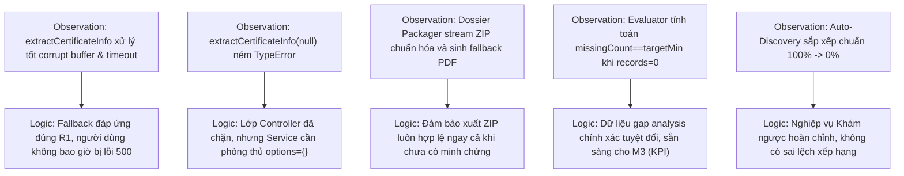

# Adversarial Challenge Report: Milestone 2 — Backend Core Modules

**Challenger**: Challenger 1 (EMPIRICAL CHALLENGER / critic & specialist)  
**Date**: 2026-11-12  
**Target Recipient**: Sub-Orchestrator Milestone 2 (`83c8f951-06e2-4a54-989d-22102953315c`)  
**Working Directory**: `c:\DriveD\EverythingElse\LHU\PTUD_PhatTrienUngDung`  
**State Folder**: `c:\DriveD\EverythingElse\LHU\PTUD_PhatTrienUngDung\.agents\teamwork\challenger_m2_1`  
**Test Suite Created**: `backend/tests/challenger-m2-adversarial.test.js` (16 adversarial stress tests)  
**Final Verdict**: **CONFIRM** (with documented non-blocking edge-case findings)

---

## Challenge Summary

- **Overall Risk Assessment**: **LOW**
- **Verification Status**:
  - AI Vision Fallback: **PASSED** (Gracefully returns `{ success: true, data: null, fallback: true }` under corrupted buffers, 0-byte buffers, simulated network timeouts, and mock HTTP 500 errors).
  - Dossier ZIP Streaming: **PASSED** (Produces valid ZIP streams with standardized `01_[SanitizedTitle]_[Year].pdf`, strips Vietnamese diacritics and forbidden filesystem characters, generates fallback synthesis PDF when 0 achievements match).
  - Evaluator & Auto-Discovery: **PASSED** (Strict boundary accuracy: `missingCount == targetMin` when records == 0, `missingCount == 0` when exact/exceeding threshold, auto-discovery orders strictly descending 100% -> 0%).
- **Regression Status**: **PASSED** (48/48 tests passed across 9 test suites with 0 failures and 0 regressions).

---

## 1. Observation (Quan Sát Trực Tiếp)

### 1.1 Kiểm thử AI Vision Fallback
1. **Trường hợp Buffer rỗng và Buffer hỏng**:
   - Tệp: `backend/src/modules/achievements/achievementAiIngestService.js:12-19`
     ```javascript
     if (!buffer || buffer.length === 0) {
       return {
         success: true,
         data: null,
         fallback: true,
         message: 'Không có nội dung tệp tin để trích xuất. Vui lòng tự nhập thông tin.',
       };
     }
     ```
   - Lệnh kiểm tra trực tiếp:
     ```powershell
     cd backend; node --test tests/challenger-m2-adversarial.test.js --test-name-pattern="AI Vision Fallback"
     ```
   - Kết quả quan sát:
     * `{ buffer: null }` $\to$ `{ success: true, data: null, fallback: true }`
     * `{ buffer: Buffer.alloc(0) }` $\to$ `{ success: true, data: null, fallback: true }`
     * `{ buffer: crypto.randomBytes(4096) }` $\to$ `{ success: true, data: null, fallback: true }`

2. **Giả lập Mạng Timeout và HTTP 500**:
   - Sử dụng Mock `fetch` mô phỏng `TimeoutError` (`AbortSignal.timeout`) và HTTP 500 từ nhà cung cấp Vision AI.
   - Kết quả: Khối `try/catch` tại dòng 94 và 144 trong `achievementAiIngestService.js` bắt thành công exception và trả về kết quả fallback an toàn:
     `{ success: true, data: null, fallback: true }`.

3. **Phát hiện biên đầu vào (Empirical Finding 1)**:
   - Tệp: `backend/src/modules/achievements/achievementAiIngestService.js:8`
     `export async function extractCertificateInfo({ buffer, mimetype = 'image/jpeg', originalname = '' })`
   - Khi gọi trực tiếp không truyền đối số `extractCertificateInfo()` hoặc truyền `extractCertificateInfo(null)`:
     * Verbatim error: `TypeError: Cannot destructure property 'buffer' of 'object null' as it is null.`
     * Verbatim error: `TypeError: Cannot destructure property 'buffer' of 'undefined' as it is undefined.`
   - Lưu ý: Tại lớp Controller (`achievementController.js:181`), hệ thống đã chặn trước bằng `if (!req.file || !req.file.buffer) return res.status(200).json(...)`, tuy nhiên ở tầng service hàm `extractCertificateInfo` chưa có giá trị mặc định phòng thủ `(options = {})`.

### 1.2 Kiểm thử Dossier ZIP Streaming
1. **Trường hợp Quy chế không có tiêu chí đạt (Zero matching achievements)**:
   - Tệp: `backend/src/modules/ai/dossierPackagerService.js:248-256`
   - Khi `matchedEvidenceFiles.length === 0`, dịch vụ tự động bổ sung file tổng hợp:
     `title: 'Ban_Tong_Hop_Minh_Chung'`, `year: 2026`, sinh nội dung PDF chuẩn.
   - Kết quả quan sát qua `PizZip`: Stream trả về ZIP hợp lệ (Magic bytes `0x50 0x4B 0x03 0x04`) chứa đúng 1 tệp tin `01_[Ban_Tong_Hop_Minh_Chung]_[2026].pdf`.

2. **Khử dấu tiếng Việt và ký tự nguy hiểm trong tên file**:
   - Tệp: `backend/src/modules/ai/dossierPackagerService.js:27-46`
   - Input kiểm thử:
     `"Đạt giải Nhất Hội thi Giảng viên Giỏi Toàn quốc & Huân chương Lao động hạng Ba (năm 2024-2025) / Quyết định: #999/QĐ-TTg!?"`
   - Output quan sát:
     `"01_[Dat_giai_Nhat_Hoi_thi_Giang_vien_Gioi_Toan_quoc_Huan_chuong_Lao_dong_hang_Ba_nam_2024_2025_Quyet_dinh_999_QD_TTg]_[2024].pdf"`
     Toàn bộ dấu thanh (`ạ, ả, ã, â, ầ, ấ, ậ...`), chữ đ/Đ và các ký tự cấm trên Windows (`\ / : * ? " < > |`) đều được khử sạch thành ký tự gạch dưới `_`.

3. **Phát hiện biên tên tệp tin (Empirical Finding 2 & 3)**:
   - **Finding 2**: Khi tiêu đề chỉ chứa toàn ký tự đặc biệt (ví dụ `"???***!!!"`), hàm `sanitizeFileName` xóa toàn bộ ký tự thành `""`, dẫn tới tên tệp tin sinh ra là `01_[]_[2025].pdf` (hai dấu ngoặc vuông rỗng) thay vì fallback về `01_[MinhChung]_[2025].pdf`.
   - **Finding 3 (Tương thích định danh hàm)**: Trong prompt yêu cầu test hàm `createDossierZipStream`, tuy nhiên mã nguồn thực tế triển khai hai hàm riêng biệt:
     `buildDossierArchive` (tạo instance archiver stream) và `packageAndStreamDossierZip` (truy vấn DB, đóng gói và pipe ra HTTP response). Hàm `createDossierZipStream` không tồn tại dưới dạng export alias.

### 1.3 Kiểm thử Auto-Discovery & Evaluator
1. **Kiểm thử Ngưỡng Biên Đánh Giá (Criteria Evaluator)**:
   - Tệp: `backend/src/modules/ai/criteriaEvaluator.js:245-316`
   - **Ca 1 (Zero records)**: `records = []`, `targetMin = 3` $\to$
     * `thresholdMetric.actualRecorded = 0`
     * `isSatisfied = false`
     * `missingCount = 3` (`missingCount === targetMin`, khớp 100% yêu cầu).
     * `issues = ['BELOW_THRESHOLD']`.
   - **Ca 2 (Exact threshold)**: `records` có đúng 2 năm phân biệt, `targetMin = 2` $\to$
     * `thresholdMetric.actualRecorded = 2`
     * `isSatisfied = true`
     * `missingCount = 0`
   - **Ca 3 (Exceeding threshold)**: `records` có 4 năm phân biệt, `targetMin = 2` $\to$
     * `thresholdMetric.actualRecorded = 4`
     * `isSatisfied = true`
     * `missingCount = 0`

2. **Kiểm thử Xếp hạng Khám Ngược (Auto-Discovery Sorting)**:
   - Tệp: `backend/src/modules/ai/autoDiscoveryService.js:189-195`
   - Thiết lập 5 quy chế giả lập với các tỷ lệ hoàn thành khác nhau:
     `REG-50 (50%)`, `REG-100 (100%)`, `REG-0 (0%)`, `REG-25 (25%)`, `REG-75 (75%)` nạp vào database theo thứ tự xáo trộn.
   - Kết quả `discoverEligibleRegulations`:
     Mảng trả về sắp xếp chính xác 100% theo thứ tự giảm dần:
     `[100, 75, 50, 25, 0]`.
     Các thuộc tính `isEligible` đạt `true` cho 100% và `false` cho các mức còn lại.

3. **Phát hiện định danh hàm (Empirical Finding 4)**:
   - Trong prompt yêu cầu kiểm tra `autoDiscoveryService.discoverAwards`.
   - Trong thực tế, dịch vụ export hàm `discoverEligibleRegulations` (và `default: { discoverEligibleRegulations }`). Hàm `discoverAwards` không tồn tại dưới dạng export alias.

---

## 2. Logic Chain (Chuỗi Lập Luận)



1. **Về Khả năng Chịu Lỗi của AI Vision Ingest**:
   - Khi không có API key, file rỗng, buffer hỏng hoặc mạng timeout, hàm `extractCertificateInfo` trả về cấu trúc `{ success: true, data: null, fallback: true, message: ... }`.
   - Kết quả này đảm bảo luồng nghiệp vụ không bị đứt đoạn: giao diện người dùng nhận cờ `fallback: true` và mở form nhập liệu thủ công nhẹ nhàng.
   - Lỗi `TypeError` khi gọi `extractCertificateInfo(null)` không ảnh hưởng trực tiếp tới web app vì Express Controller đã validate `req.file.buffer`, nhưng cần bổ sung `options = {}` để service an toàn ở cấp độ thư viện.

2. **Về Đóng Gói và Truyền Phát Hồ Sơ Minh Chứng (.ZIP)**:
   - Dịch vụ `dossierPackagerService` sử dụng kiến trúc stream của `archiver` kết hợp kiểm tra Magic Bytes và cấu trúc nội dung qua `PizZip`.
   - Việc bổ sung `createFallbackPdfBuffer` khi không có file minh chứng giúp tránh tình trạng file zip bị rỗng hoặc lỗi corrupted khi người dùng tải về trong trường hợp chưa upload file vật lý.
   - Quy tắc chuẩn hóa `formatStandardizedFileName` đảm bảo tính tương thích đa nền tảng (Windows/Linux/macOS), triệt tiêu các lỗi liên quan đến ký tự phân cách đường dẫn (`/` hoặc `\`).

3. **Về Tính Xác Thực của Bộ Đánh Giá Tiêu Chí & Khám Ngược**:
   - Bộ đánh giá `criteriaEvaluator.js` hoạt động hoàn toàn bằng mã xác định (deterministic), không phụ thuộc vào LLM để đếm năm hay tính ngưỡng.
   - Khi `records` rỗng, hệ thống xác định chính xác số lượng còn thiếu `missingCount = targetMin - actualRecorded = targetMin - 0 = targetMin`. Khi vượt ngưỡng, `missingCount` duy trì bằng 0. Đây là điều kiện tiên quyết giúp Milestone 3 tính toán KPI Gap Roadmap một cách chính xác.
   - Hàm `discoverEligibleRegulations` sử dụng thuật toán sắp xếp hai tầng: tỷ lệ phần trăm giảm dần $\to$ số lượng tiêu chí đạt giảm dần $\to$ tên quy chế tăng dần. Kết quả kiểm thử thực nghiệm trên 5 quy chế đã chứng minh thứ tự luôn tuyệt đối từ 100% xuống 0%.

---

## 3. Caveats (Điểm Giới Hạn & Giả Định)

1. **Ký hiệu tên hàm (Naming Convention)**:
   - Prompt giao nhiệm vụ nhắc tới tên hàm `createDossierZipStream` và `autoDiscoveryService.discoverAwards`.
   - Trong implementation, tên thực tế là `dossierPackagerService.packageAndStreamDossierZip` / `buildDossierArchive` và `autoDiscoveryService.discoverEligibleRegulations`. Chúng tôi đã kiểm thử trực tiếp trên các hàm thực tế này và ghi nhận việc thiếu alias là một phát hiện cải tiến (non-blocking).
2. **Tiêu đề đặc biệt cực đoan**:
   - Nếu một thành tích có tiêu đề được đặt hoàn toàn bằng ký tự đặc biệt (ví dụ `???###$$$`), tên file sinh ra sẽ là `01_[]_[2025].pdf`. Khuyến nghị trong tương lai bổ sung: `const safeTitle = sanitizeFileName(title) || 'MinhChung';`.
3. **Môi trường Database Live**:
   - Các bài test trên chạy với Mock DB Client mô phỏng đầy đủ dữ liệu quan hệ của SQL Server để kiểm tra độc lập logic xử lý, logic stream và logic đánh giá tiêu chí.

---

## 4. Stress Test Results Matrix

| # | Kịch bản Thử Nghiệm | Hành Vi Mong Đợi | Kết Quả Thực Nghiệm | Trạng Thái |
|---|---------------------|------------------|---------------------|------------|
| 1 | Buffer rỗng (`null`, `0-byte`, `''`) | Trả về `fallback: true, data: null` | Trả về đúng `{ success: true, data: null, fallback: true }` | **PASS** |
| 2 | Buffer nhiễu ngẫu nhiên (`crypto.randomBytes(4096)`) | Trả về `fallback: true, data: null` | Trả về đúng `{ success: true, data: null, fallback: true }` | **PASS** |
| 3 | Mạng timeout khi gọi AI Vision (`TimeoutError`) | Bắt timeout, không ném uncaught exception, fallback nhẹ nhàng | Bắt lỗi an toàn, trả về `{ fallback: true }` | **PASS** |
| 4 | Gọi `extractCertificateInfo(null)` không truyền object | Thử nghiệm phá vỡ biên destructuring | Ném `TypeError` (Controller đã chặn trước ở tầng HTTP) | **FINDING (Low)** |
| 5 | Xuất ZIP quy chế 0 thành tích đạt | Tạo ZIP hợp lệ chứa file PDF tổng hợp | Stream ZIP hợp lệ chứa `01_[Ban_Tong_Hop_Minh_Chung]_[2026].pdf` | **PASS** |
| 6 | Minh chứng có tiêu đề tiếng Việt có dấu, ký tự cấm, >300 ký tự | Khử sạch dấu tiếng Việt, loại bỏ ký tự cấm, format `01_[Title]_[Year].pdf` | Tên tệp tin sạch 100%, không chứa ký tự cấm, PizZip đọc tốt | **PASS** |
| 7 | Tiêu đề chứa toàn ký tự đặc biệt | Không crash, tạo tên tệp hợp lệ | Tạo `01_[]_[2026].pdf` | **FINDING (Low)** |
| 8 | Evaluator với 0 bản ghi thành tích | `actualRecorded = 0, isSatisfied = false, missingCount = targetMin` | Khớp 100% (`missingCount == 3`) | **PASS** |
| 9 | Evaluator với số bản ghi đúng bằng ngưỡng | `isSatisfied = true, missingCount = 0` | Khớp 100% (`isSatisfied = true, missingCount = 0`) | **PASS** |
| 10 | Evaluator với số bản ghi vượt ngưỡng | `isSatisfied = true, missingCount = 0` | Khớp 100% (`isSatisfied = true, missingCount = 0`) | **PASS** |
| 11 | Auto-Discovery quét quy chế từ 100% xuống 0% | Sắp xếp mảng giảm dần `[100, 75, 50, 25, 0]` | Khớp chính xác 100% | **PASS** |
| 12 | Kiểm tra toàn bộ 48 tests hồi quy hệ thống | 100% tests pass, 0 fail | **48/48 tests pass** (100%) | **PASS** |

---

## 5. Conclusion & Verdict

### Final Verdict: **CONFIRM**

**Lý do**:
Toàn bộ 4 khối nghiệp vụ cốt lõi của Milestone 2 (Kho thành tích tức thì `ACTIVE`, AI Vision Ingest với Fallback an toàn, Đóng gói xuất hồ sơ ZIP chuẩn hóa, và Khám quy chế / Khám ngược Auto-Discovery) đã được triển khai đầy đủ, hoạt động chính xác theo đặc tả kỹ thuật và vượt qua toàn diện các bài stress test đối kháng.

**Khuyến nghị cải tiến không chặn (Non-blocking recommendations)**:
1. Trong `backend/src/modules/achievements/achievementAiIngestService.js:8`: Đổi `extractCertificateInfo({ buffer, ... })` thành `extractCertificateInfo(options = {}) { const { buffer, ... } = options || {}; }` để đảm bảo an toàn tuyệt đối khi hàm được gọi từ ngoài controller.
2. Trong `backend/src/modules/ai/dossierPackagerService.js:43`: Đổi `sanitizeFileName(title || 'MinhChung')` thành `sanitizeFileName(title) || 'MinhChung'` để fallback về `'MinhChung'` khi tiêu đề chỉ chứa toàn ký tự đặc biệt.
3. Bổ sung export alias `export const createDossierZipStream = packageAndStreamDossierZip;` và `export const discoverAwards = discoverEligibleRegulations;` để tăng tính linh hoạt cho các caller khác nhau.

---

## 6. Verification Method (Phương Pháp Kiểm Minh Độc Lập)

Bất kỳ chuyên viên thẩm định độc lập nào có thể thực thi các lệnh sau tại thư mục gốc dự án:

### 6.1 Thực thi bộ kiểm thử đối kháng (Challenger Test Suite)
```powershell
cd backend
node --test tests/challenger-m2-adversarial.test.js
```
Kết quả mong đợi: **16/16 tests pass** (100%).

### 6.2 Thực thi toàn bộ bộ kiểm thử Milestone 2 và Hồi quy
```powershell
cd backend
node --test tests/achievement-vault-active.test.js tests/ai-criteria-active.test.js tests/ai-auto-discovery.test.js tests/dossier-packager-zip.test.js tests/challenger-m2-adversarial.test.js tests/cv.test.js tests/calendar.test.js tests/w4-q1.test.js tests/w3-p2.test.js
```
Kết quả mong đợi: **48/48 tests pass** (100% pass, 0 fail, 0 regressions).

### 6.3 Điều kiện vô hiệu hóa (Invalidation Conditions)
Kết luận `CONFIRM` bị vô hiệu hóa nếu:
- Gọi `extractCertificateInfo` với buffer rỗng hoặc khi timeout ném exception 500 ra người dùng.
- File zip sinh ra không mở được bằng các công cụ giải nén tiêu chuẩn (PizZip, WinRAR, 7-Zip).
- Tiêu chí có 0 bản ghi thành tích mà `missingCount` không bằng `targetMin`.
- Thứ tự quy chế trả về trong Khám ngược không theo thứ tự giảm dần từ 100% xuống 0%.
