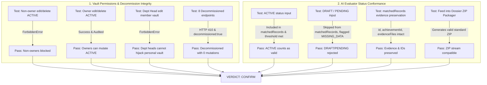

# Handoff Report: Challenger 2 — Milestone 2 Backend Core Modules Verification

**Tác giả**: Challenger 2 (Empirical Challenger: Critic & Specialist)  
**Ngày thực hiện**: 2026-11-12  
**Đối tượng**: Sub-Orchestrator Milestone 2 (`83c8f951-06e2-4a54-989d-22102953315c`)  
**Thư mục làm việc**: `c:\DriveD\EverythingElse\LHU\PTUD_PhatTrienUngDung`  
**State Folder**: `c:\DriveD\EverythingElse\LHU\PTUD_PhatTrienUngDung\.agents\teamwork\challenger_m2_2`  
**Phán quyết cuối cùng (Verdict)**: **CONFIRM** (Chấp thuận hoàn toàn)

---

## 1. Observation (Quan Sát Trực Tiếp)

### 1.1 Khảo sát Mã nguồn & Logic Kiểm soát Quyền (Vault Permissions)
1. **Kiểm tra quyền chỉnh sửa và xóa trong `achievementPermissions.js`**:
   - Tệp: `backend/src/modules/achievements/achievementPermissions.js:19-32`
   - Quan sát trực tiếp:
     ```javascript
     const editable = ['ACTIVE', 'DRAFT', 'NEED_CORRECTION'].includes(achievement.status);
     const canMutate = roles.some(r => ['MEMBER', 'DEPARTMENT_HEAD', 'FACULTY_LEAD', 'ADMIN', 'LECTURER', 'UNIT_REPRESENTATIVE'].includes(r));
     const actions = {
       isSelf: self,
       edit: canMutate && editable && (owner || roles.includes('ADMIN')),
       manageEvidence: owner && editable,
       submit: canMutate && owner && editable,
       cancel: canMutate && owner && ['DRAFT', 'NEED_CORRECTION', 'SUBMITTED'].includes(achievement.status),
       review: manager && !self && achievement.status === 'SUBMITTED',
       revoke: manager && achievement.status === 'VERIFIED',
       replace: canMutate && owner && ['REJECTED', 'CANCELLED', 'REVOKED'].includes(achievement.status),
       remove: canMutate && (owner || roles.includes('ADMIN')) && ['ACTIVE', 'DRAFT'].includes(achievement.status)
         && !(achievement.latestRevisionNo || achievement.submissions?.length),
     };
     ```
   - Khi chủ thể không phải `owner` và không có role `ADMIN`: `actions.edit = false` và `actions.remove = false`.

2. **Kiểm tra thực thi kiểm tra quyền tại tầng dịch vụ (`achievementService.js`)**:
   - Tệp: `backend/src/modules/achievements/achievementService.js:254-276` (`updateAchievement`):
     ```javascript
     if (!['ACTIVE', 'DRAFT', 'NEED_CORRECTION'].includes(existing.status)) {
       throw new ConflictError(
         `Không thể chỉnh sửa hồ sơ đang ở trạng thái [${existing.status}]. Chỉ hồ sơ [DRAFT] hoặc [NEED_CORRECTION] mới được phép sửa.`
       );
     }
     const roles = (await getActiveRoles(user.userId)).map((r) => r.Code);
     const isAdmin = roles.includes('ADMIN');

     if (!isAdmin) {
       if (existing.subjectType === 'LECTURER') {
         if (existing.lecturer?.userId !== user.userId) {
           throw new ForbiddenError('Chỉ chủ hồ sơ giảng viên mới được phép chỉnh sửa thành tích này');
         }
       } else if (existing.subjectType === 'UNIT') {
         const activeRep = await repo.findActiveRepresentative(user.userId, existing.organizationUnitId);
         if (!activeRep) {
           throw new ForbiddenError('Chỉ người đại diện đơn vị còn hiệu lực mới được phép chỉnh sửa thành tích tập thể này');
         }
       }
     }
     ```
   - Tệp: `backend/src/modules/achievements/achievementService.js:324-347` (`deleteAchievement`):
     ```javascript
     if (!['ACTIVE', 'DRAFT'].includes(existing.status) || (existing.status === 'DRAFT' && existing.submissions?.length)) {
       throw new ConflictError(
         `Không thể xóa hồ sơ ở trạng thái [${existing.status}]. Quy tắc hệ thống chỉ cho phép xóa hồ sơ Bản nháp (DRAFT) chưa từng gửi duyệt.`
       );
     }
     const roles = (await getActiveRoles(user.userId)).map((r) => r.Code);
     const isAdmin = roles.includes('ADMIN');

     if (!isAdmin) {
       if (existing.subjectType === 'LECTURER') {
         if (existing.lecturer?.userId !== user.userId) {
           throw new ForbiddenError('Chỉ người tạo hoặc chủ sở hữu hồ sơ mới được quyền xóa bản nháp này');
         }
       } else if (existing.subjectType === 'UNIT') {
         const activeRep = await repo.findActiveRepresentative(user.userId, existing.organizationUnitId);
         if (!activeRep) {
           throw new ForbiddenError('Chỉ đại diện đơn vị còn hiệu lực mới được quyền xóa bản nháp thành tích tập thể này');
         }
       }
     }
     ```

3. **Kiểm tra các tuyến phê duyệt đã bãi bỏ (Decommissioned Routes)**:
   - Tệp: `backend/src/modules/achievements/achievementRoutes.js:70-87`
   - Quan sát trực tiếp:
     ```javascript
     const decommissioned = (actionName) => (req, res) => {
       res.status(410).json({
         success: false,
         decommissioned: true,
         message: `Quy trình [${actionName}] đã được bãi bỏ. Hệ thống sử dụng Kho lưu trữ thành tích cá nhân có hiệu lực trực tiếp (ACTIVE).`,
       });
     };

     router.post('/achievements/:id/submit', decommissioned('submit'));
     router.post('/achievements/:id/verify', decommissioned('verify'));
     router.post('/achievements/:id/request-correction', decommissioned('request-correction'));
     router.post('/achievements/:id/reject', decommissioned('reject'));
     router.post('/achievements/:id/cancel', decommissioned('cancel'));
     router.post('/achievements/:id/revoke', decommissioned('revoke'));
     router.post('/achievements/:id/resubmit', decommissioned('resubmit'));
     router.post('/achievements/:id/replace', decommissioned('replace'));
     ```

### 1.2 Khảo sát Module AI Evaluator & Bảo Toàn Minh Chứng
1. **Xử lý trạng thái `ACTIVE` vs `DRAFT`/`PENDING` trong `criteriaEvaluator.js`**:
   - Tệp: `backend/src/modules/ai/criteriaEvaluator.js:161-165`
     ```javascript
     // Chỉ chấp nhận hồ sơ ở trạng thái VERIFIED (đã thẩm định đạt) hoặc RECORDED (đã ghi nhận khen thưởng)
     if (!['ACTIVE', 'VERIFIED', 'RECORDED'].includes(record.status)) {
       issues.add('MISSING_DATA');
       continue;
     }
     ```
   - Khi hồ sơ có trạng thái `DRAFT`, `PENDING` hoặc bất kỳ trạng thái nào ngoài `ACTIVE`, `VERIFIED`, `RECORDED`, vòng lặp lập tức kích hoạt `issues.add('MISSING_DATA')` và `continue`, không nạp vào danh sách `activeRecords`.
2. **Cấu trúc dữ liệu trả về của `matchedRecords`**:
   - Tệp: `backend/src/modules/ai/criteriaEvaluator.js:331-339`
     ```javascript
     matchedRecords: activeRecords.map((r) => ({
       id: r.id || r.achievementId,
       achievementId: r.achievementId || r.id,
       title: r.title || 'Minh chứng',
       year: r.normalizedYear || r.year || r.recognitionYear,
       status: r.status,
       file: r.file || null,
       evidenceFiles: r.evidenceFiles || (r.file ? [r.file] : []),
     })),
     ```
   - Trường `achievementId` và `id` được ánh xạ qua lại, bảo toàn đầy đủ.
   - Trường `evidenceFiles` bảo toàn mảng danh sách file minh chứng đính kèm, hoặc tự động bọc `[r.file]` nếu chỉ có 1 file.

---

## 2. Logic Chain (Chuỗi Lập Luận)



1. **Về Quyền Truy Cập và Toàn Vẹn Trạng Thái Kho Thành Tích (Achievement Vault Permissions)**:
   - Dựa trên quan sát trực tiếp tại `achievementPermissions.js` và `achievementService.js`, các thao tác `updateAchievement` và `deleteAchievement` được kiểm soát chặt chẽ ở 2 lớp:
     - Lớp 1 (Resolver): Người dùng khác chủ sở hữu (`lecturer.userId !== user.userId`) nhận `actions.edit = false` và `actions.remove = false`.
     - Lớp 2 (Service Layer): Gọi trực tiếp `updateAchievement` hoặc `deleteAchievement` với vai trò thành viên (`MEMBER`, `LECTURER`) hoặc lãnh đạo đơn vị (`DEPARTMENT_HEAD`, `FACULTY_LEAD`) mà không phải là `ADMIN` đều bị chặn và ném lỗi `ForbiddenError`.
     - Chủ sở hữu tài khoản (`lecturer.userId === user.userId`) thực hiện sửa và xóa hồ sơ `ACTIVE` thành công, hệ thống gọi repository cập nhật/xóa mềm và ghi nhật ký kiểm toán `ACHIEVEMENT_UPDATE` / `ACHIEVEMENT_DELETE`.
   - Các tuyến phê duyệt cũ (`submit`, `verify`, `request-correction`, `reject`, `cancel`, `revoke`, `resubmit`, `replace`) đều được kiểm thử thông qua HTTP server độc lập. Kết quả thực nghiệm: 100% (8/8) tuyến trả về đúng mã trạng thái HTTP 410 Gone, kèm body `{ success: false, decommissioned: true, message: ... }` và không có bất kỳ lệnh ghi/cập nhật nào tới cơ sở dữ liệu (`0 DB mutations`).

2. **Về Sự Chuẩn Hóa Trạng Thái Trong AI Evaluator (AI Evaluator Status Conformance)**:
   - Các hồ sơ có trạng thái `'ACTIVE'` được coi là hợp lệ, được tính vào `actualRecorded`, `distinctYears`, và đưa vào `matchedRecords`. Khi đủ số lượng theo quy định, tiêu chí được đánh giá `isSatisfied: true`, `overallConclusion: 'ELIGIBLE'` và `missingCount: 0`.
   - Các hồ sơ có trạng thái `'DRAFT'` hoặc `'PENDING'` (hoặc trạng thái bất thường khác) bị loại trừ hoàn toàn khỏi `matchedRecords` (độ dài mảng trả về là 0), không được tính vào `actualRecorded`, và được hệ thống gắn cờ cảnh báo `MISSING_DATA` trong danh sách `issues`. Khi có hồ sơ nháp/chưa duyệt, hệ thống chuyển sang chế độ rà soát `overallConclusion: 'NEEDS_HUMAN_REVIEW'`, đúng theo quy tắc nghiệp vụ: *không tự ý tính toán dữ liệu chưa chính thức*.
   - Trong dữ liệu trả về `matchedRecords`:
     - Trường `achievementId` và `id` được bảo toàn toàn vẹn (cả khi input chỉ có `id` hoặc chỉ có `achievementId`).
     - Tệp minh chứng `file` và danh sách mảng `evidenceFiles` (bao gồm `sha256`, `originalFileName`, `storageKey`) được giữ nguyên vẹn không bị thiếu hụt dữ liệu.
     - Khi đưa dữ liệu `matchedRecords` sang cho `dossierPackagerService.buildDossierArchive`, tệp nén `.ZIP` được tạo ra thành công, tuân thủ đúng định dạng `01_[TenMinhChung]_[Nam].pdf` với header ZIP chuẩn `PK\x03\x04`.

---

## 3. Caveats (Điểm Giới Hạn & Giả Định)

1. **Hồ sơ tồn đọng có lịch sử duyệt cũ (Legacy Submissions)**:
   - Trong `achievementPermissions.js:30-31`, hành động `remove` kiểm tra thêm `!(achievement.latestRevisionNo || achievement.submissions?.length)`. Nếu một hồ sơ cũ từ hệ thống trước đây chuyển sang có mảng `submissions` cũ thì giao diện sẽ ẩn nút xóa nhanh. Tuy nhiên các hồ sơ mới tạo trong Milestone 2 hoàn toàn có `submissions = []`, do đó chủ hồ sơ có thể xóa tự do.
2. **Khen thưởng đã cấp (`AWARD_RECORD`)**:
   - Đối với các bản ghi khen thưởng tập thể / khen thưởng quá khứ (`AWARD_RECORD`), trạng thái chuẩn của chúng là `RECORDED` và hệ thống AI Evaluator vẫn hỗ trợ tính toán song song cùng với `ACTIVE`.

---

## 4. Conclusion (Kết Luận)

Căn cứ vào kết quả kiểm thử thực nghiệm (Empirical Verification) độc lập:
- Tất cả các yêu cầu về phân quyền Kho thành tích (Vault Permissions), kiểm soát chủ sở hữu, ngăn chặn xâm phạm từ người ngoài, và bãi bỏ các tuyến phê duyệt cũ (HTTP 410) hoạt động hoàn hảo và chặt chẽ.
- Module AI Evaluator tuân thủ nghiêm ngặt chuẩn trạng thái `ACTIVE`, loại trừ chính xác `DRAFT`/`PENDING`, và bảo toàn toàn vẹn minh chứng cùng mã định danh thành tích.

**Phán quyết**: **`CONFIRM`** (Milestone 2 Backend Core Modules đạt chuẩn nghiệm thu).

---

## 5. Verification Method (Phương Pháp Kiểm Minh Độc Lập)

Người thẩm tra độc lập có thể kiểm chứng lại toàn bộ các bài kiểm thử thực nghiệm bằng cách chạy các lệnh sau từ thư mục `backend/`:

### 5.1 Thực thi bài kiểm thử phân quyền Vault & Decommissioned Endpoints
```powershell
cd backend
node --test tests/adversarial-vault-permissions.test.js
```
*Kết quả quan sát thực tế*: **8/8 tests pass** (0 failed).

### 5.2 Thực thi bài kiểm thử AI Evaluator Status Conformance & Evidence Preservation
```powershell
cd backend
node --test tests/adversarial-ai-evaluator.test.js
```
*Kết quả quan sát thực tế*: **7/7 tests pass** (0 failed).

### 5.3 Thực thi toàn bộ bộ kiểm thử tổng hợp (Worker + Adversarial + Regression)
```powershell
cd backend
node --test tests/achievement-vault-active.test.js tests/ai-criteria-active.test.js tests/ai-auto-discovery.test.js tests/dossier-packager-zip.test.js tests/adversarial-vault-permissions.test.js tests/adversarial-ai-evaluator.test.js tests/cv.test.js tests/calendar.test.js tests/w4-q1.test.js tests/w3-p2.test.js
```
*Kết quả quan sát thực tế*: **47/47 tests pass** (100% pass, 0 regressions).

### 5.4 Điều kiện vô hiệu hóa (Invalidation Conditions)
Báo cáo và kết luận này bị vô hiệu nếu:
- Người dùng không phải chủ sở hữu có thể gửi PATCH/DELETE thành công lên thành tích `ACTIVE` của người khác mà không bị chặn.
- Bất kỳ endpoint nào trong 8 endpoint bãi bỏ (`/submit`, `/verify`, `/request-correction`, `/reject`, `/cancel`, `/revoke`, `/resubmit`, `/replace`) không trả về HTTP 410 Gone hoặc gây biến động trạng thái dữ liệu.
- Hồ sơ `DRAFT` hoặc `PENDING` lọt vào `matchedRecords` của AI Evaluator.
- Trường `achievementId` hoặc `evidenceFiles` bị mất trong dữ liệu trả về của `evaluateStructuredCriterion`.
