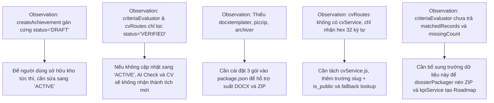

# Báo Cáo Khảo Sát Tầng Backend: Nền Tảng Lưu Trữ Thành Tích Cá Nhân & Trợ Lý AI

**Tác giả**: Explorer Subagent (Backend Survey)  
**Ngày thực hiện**: 2026-11-12  
**Đối tượng**: Orchestrator & Backend Implementer  

---

## 1. Observation (Quan Sát Trực Tiếp)

### 1.1 Quản lý Thư viện & Phụ thuộc (`backend/package.json`)
* Đường dẫn: `backend/package.json`
* Hiện trạng dependencies:
  ```json
  "dependencies": {
    "bcryptjs": "^2.4.3",
    "cookie-parser": "^1.4.7",
    "cors": "^2.8.5",
    "dotenv": "^16.4.7",
    "express": "^4.21.2",
    "helmet": "^8.0.0",
    "jsonwebtoken": "^9.0.2",
    "morgan": "^1.10.0",
    "mssql": "^12.7.14",
    "multer": "^2.4.0",
    "zod": "^3.24.1"
  }
  ```
* **Thiếu phụ thuộc bắt buộc theo yêu cầu R2 & R4**:
  - `docxtemplater` (render template Word `.docx`)
  - `pizzip` (thư viện nén/đọc cấu trúc zip của `.docx` cho `docxtemplater`)
  - `archiver` (tạo và stream file nén `.zip` cho gói hồ sơ minh chứng)
* **AI Provider / Vision OCR**: Hiện tại `groqProvider.js` và `openrouterProvider.js` sử dụng Node native `fetch`. Không cần cài thêm SDK nặng nếu tiếp tục dùng REST API của Groq (`llama-3.2-11b-vision-preview`) và Google AI Studio / Gemini (`gemini-1.5-flash` / `gemini-2.0-flash`). Cần thêm biến môi trường vào `backend/src/config/env.js`: `GEMINI_API_KEY`, `GEMINI_MODEL`.

### 1.2 Module Thành Tích (`backend/src/modules/achievements`)
* **Khởi tạo trạng thái**: Tại `backend/src/modules/achievements/achievementRepository.js:398`:
  ```javascript
  // Line 398:
  $10, $11, 'DRAFT', $12, 1,
  ```
  Bản ghi thành tích mới luôn bị ép trạng thái `'DRAFT'`.
* **Quyền chỉnh sửa/xóa**: Tại `backend/src/modules/achievements/achievementPermissions.js:19, 23`:
  ```javascript
  const editable = ['DRAFT', 'NEED_CORRECTION'].includes(achievement.status);
  actions.edit = canMutate && editable && (owner || roles.includes('ADMIN'));
  ```
  Thành tích chỉ cho phép sửa nếu ở `DRAFT` hoặc `NEED_CORRECTION`. Khi chuyển sang `ACTIVE`, người dùng sẽ bị chặn sửa nếu không cập nhật logic này.
* **Quy trình phê duyệt rườm rà**: Tại `backend/src/modules/achievements/achievementRoutes.js:53-108`:
  Tồn tại các endpoints phê duyệt phân cấp:
  - `POST /achievements/:id/submit` (gửi duyệt)
  - `POST /achievements/:id/verify` (lãnh đạo duyệt)
  - `POST /achievements/:id/request-correction` (yêu cầu bổ sung)
  - `POST /achievements/:id/reject` (từ chối)
  - `POST /achievements/:id/cancel` (hủy)
  - `POST /achievements/:id/revoke` (thu hồi)
  - `POST /achievements/:id/resubmit`
  - `POST /achievements/:id/replace`
* **Thiếu Endpoint AI Vision OCR**: Chưa có `POST /achievements/ai-extract` để trích xuất thông tin từ file ảnh/PDF bằng khen.

### 1.3 Module AI (`backend/src/modules/ai`)
* **Kiểm tra trạng thái bản ghi trong `criteriaEvaluator.js`**: Tại `backend/src/modules/ai/criteriaEvaluator.js:161-165`:
  ```javascript
  // Chỉ chấp nhận hồ sơ ở trạng thái VERIFIED (đã thẩm định đạt) hoặc RECORDED (đã ghi nhận khen thưởng)
  if (!['VERIFIED', 'RECORDED'].includes(record.status)) {
    issues.add('MISSING_DATA');
    continue;
  }
  ```
  Và tại `backend/src/modules/ai/aiService.js:341`:
  ```javascript
  WHERE ${subjectType === 'LECTURER' ? 'a.lecturer_id = $1' : 'a.unit_id = $1'}
    AND a.status IN ('VERIFIED', 'RECORDED', 'REVOKED', 'CANCELLED')
  ```
  Cả hai vị trí đều loại bỏ hoặc coi trạng thái `ACTIVE` là `MISSING_DATA`, dẫn đến việc thành tích trong kho mới không bao giờ được tính vào kết quả đánh giá quy chế.
* **Cấu trúc trả về của `evaluateStructuredCriterion`**:
  Tại `criteriaEvaluator.js:315-336`, kết quả trả về `criterionResults` chứa:
  `{ criterionId, criterionCode, criterionName, thresholdMetric, legalReferences, aiAnalysis, humanReviewRequired, warningNotice, overallConclusion, issues }`.
  **Không trả về** danh sách cụ thể các bản ghi thành tích / file minh chứng đã thỏa mãn (`matchedRecords`) và số lượng còn thiếu (`missingCount`), khiến frontend không thể hiển thị thẻ thành tích đính kèm và dossier packager không biết lấy file nào để nén.
* **Thiếu Service Auto-Discovery**: Chưa có `autoDiscoveryService.js` và route `POST /ai/auto-discovery` để tự động quét toàn bộ quy chế mở và tính toán % hoàn thành.
* **Thiếu Service Dossier Packager**: Chưa có `dossierPackagerService.js` và route `POST /ai/export-dossier-zip` gom file nén chuẩn hóa tên `01_[TenMinhChung]_[Nam].pdf`.

### 1.4 Module KPI (`backend/src/modules/kpi`)
* Tại `backend/src/modules/kpi/kpiRoutes.js`: Chưa có route `POST /kpi/from-ai-gap`.
* Tại `backend/src/modules/kpi/kpiService.js`: Chưa có hàm `createRoadmapFromAiGap(userId, missingCriteria)` chuyển đổi tiêu chí thiếu từ kết quả AI gap analysis thành các `app.kpi_goals`.
* Tại `backend/src/modules/kpi/kpiRepository.js:5-30`: Hàm xác thực chủ thể `subject` vẫn dựa trên vai trò cũ:
  `if (type === "LECTURER" && roles.includes("LECTURER"))` và `roles.includes("UNIT_REPRESENTATIVE")`. Cần hỗ trợ các vai trò chuẩn mới `MEMBER`, `DEPARTMENT_HEAD`, `FACULTY_LEAD`.

### 1.5 Module CV Cá Nhân (`backend/src/modules/cv`)
* **Thiếu `cvService.js`**: Thư mục `backend/src/modules/cv/` chỉ có `cvRoutes.js` và `cvSchemas.js`. Toàn bộ truy vấn SQL và xử lý nghiệp vụ được viết inline trực tiếp trong `cvRoutes.js`.
* **Truy vấn trạng thái thành tích**: Tại `backend/src/modules/cv/cvRoutes.js:12`:
  ```javascript
  const achievementsFor = async id => (await query(`SELECT achievement_id AS "achievementId", title, recognition_year AS "recognitionYear" FROM app.achievements WHERE lecturer_id=$1 AND status='VERIFIED' ORDER BY recognition_year DESC, achievement_id DESC`, [id])).rows;
  ```
  Chỉ lấy thành tích có `status='VERIFIED'`, không lấy `status='ACTIVE'`.
* **Định tuyến Public CV**: Tại `cvRoutes.js:18-22`:
  Chỉ hỗ trợ link hex 32 ký tự ngẫu nhiên `public_id` (`/^[a-f0-9]{32}$/`). Không hỗ trợ custom slug (ví dụ `/cv/nguyen-van-an`). Không có công tắc `is_public` (chỉ kiểm tra `c.published IS NOT NULL`).
* **Mẫu Web và Custom Docx**:
  - Tại `cvSchemas.js:6`: Template giới hạn `z.enum(['classic', 'modern'])`, chưa có bộ 3 mẫu: `academic`, `modern`, `minimalist`.
  - Chưa có endpoint upload template Word custom (`POST /me/cv/custom-template`).
  - Chưa có endpoint xuất file Word (`GET /me/cv/export-docx`) qua `docxtemplater` + `pizzip`.

### 1.6 Module Lịch & Nhắc Nhở (`backend/src/modules/calendar`)
* Tại `backend/src/modules/calendar/calendarService.js:36-45`: Hàm `listSystem()` hiện quét `app.award_periods WHERE status='OPEN'`.
* Cần tích hợp thêm hàm ghi nhận sự kiện hạn nộp cá nhân (`addReminderFromRegulation`) khi người dùng bấm đồng ý từ popup nhắc nhở của AI Check hoặc KPI Goal.

### 1.7 Cây Tổ Chức & Phân Quyền (`organizations` & `middlewares`)
* Tại `database/sqlserver/seed.sql:58-65`: Hệ thống đang dùng 6 vai trò cũ:
  `ADMIN`, `LECTURER`, `MANAGER`, `COUNCIL`, `UNIT_REPRESENTATIVE`, `RECORDS_OFFICER`.
* Cần chuẩn hóa thành 4 vai trò chuẩn:
  1. `MEMBER` (mặc định)
  2. `DEPARTMENT_HEAD` (Trưởng Bộ môn / GVCN)
  3. `FACULTY_LEAD` (Ban Chủ nhiệm Khoa)
  4. `ADMIN` (Quản trị viên)
* Cây tổ chức 3 cấp: Trường $\to$ Khoa (`ou.type = 'FACULTY'`) $\to$ Bộ môn (`ou.type = 'DEPARTMENT'`) $\to$ Thành viên (`lecturer_assignments`).
* Chưa có endpoint cho Trưởng Bộ môn và Ban Chủ nhiệm quét AI tự động toàn đơn vị (`POST /organizations/units/:id/ai-scan`) và xuất báo cáo thành tích theo năm.

### 1.8 Kiểm Thử Hiện Tại (`backend/tests`)
* Test runner: Chạy bằng `node --test` (cho các file unit test) hoặc `node tests/runner.js`.
* Thực thi `node --test tests/cv.test.js`: 4/4 pass (2.2s).
* Thực thi `node --test tests/w4-q1.test.js`: 6/6 pass (189ms).
* Thực thi `node --test tests/calendar.test.js`: 4/4 pass (1.5s).
* Thực thi `node --test tests/w3-p2.test.js`: 2/2 pass (221ms).
* Thực thi `node tests/runner.js`: 30/31 pass. 1 fail duy nhất do kiểm tra cứng mảng migration files `['001_final_schema.sql', '002_integrity_triggers.sql']` trong khi repo đã có thêm `003` và `004`.

---

## 2. Logic Chain (Chuỗi Lập Luận)



1. **Từ Yêu cầu R1 đến Module Achievements**:
   - Người dùng cần lưu trữ thành tích tức thì không qua phê duyệt $\to$ Khi tạo mới tại `achievementRepository.createAchievement`, cột `status` phải nhận giá trị `'ACTIVE'`.
   - Các middleware và hàm kiểm tra quyền (`achievementPermissions.js`) phải cho phép người sở hữu (owner) xem, sửa, xóa thành tích ở trạng thái `'ACTIVE'`.
   - Các route phê duyệt (`submit`, `verify`, `request-correction`, `reject`, `cancel`, `revoke`) trở nên dư thừa $\to$ Loại bỏ hoặc vô hiệu hóa để đơn giản hóa hệ thống.
   - Khi tải ảnh/PDF lên, cần endpoint `POST /achievements/ai-extract` gọi Vision OCR. Nếu lỗi hoặc không có API key, trả về `{ success: true, data: null, fallback: true, message: '...' }` với HTTP 200 $\to$ Đảm bảo không ném exception làm đứt gãy luồng người dùng.

2. **Từ Yêu cầu R2 đến Module AI**:
   - `criteriaEvaluator.js` và `aiService.js` phải chấp nhận `status` thuộc `['ACTIVE', 'VERIFIED', 'RECORDED']`.
   - `evaluateStructuredCriterion` cần gắn thêm mảng `matchedRecords` (chứa các thành tích và file đính kèm đạt chuẩn) và `missingCount` vào từng phần tử của `criterionResults`.
   - `autoDiscoveryService.js`: Duyệt qua tất cả quy chế/văn bản đang mở (`is_confirmed = 1`), gọi hàm đánh giá tiêu chuẩn với danh sách thành tích `ACTIVE` của người dùng, tính `completionPercentage = (satisfiedCriteria / totalCriteria) * 100`, sắp xếp giảm dần.
   - `dossierPackagerService.js`: Thu thập toàn bộ file minh chứng từ `matchedRecords` của các tiêu chí đạt, sử dụng `archiver` tạo stream `.zip`, đặt tên file theo định dạng chuẩn hóa `01_[TenMinhChung]_[Nam].pdf` và trả về client.

3. **Từ Yêu cầu R3 đến Module KPI & Lịch**:
   - Khi kết quả AI gap analysis trả về các tiêu chí chưa đạt (`missingCriteria`), người dùng nhấn "🎯 Chuyển thành Mục tiêu KPI" $\to$ Gọi `POST /api/v1/kpi/from-ai-gap`.
   - `kpiService.createRoadmapFromAiGap` tạo các dòng `app.kpi_goals` với `source = 'AI_GAP'`, `target = missingCount`, `measure_unit = unitMetric`.
   - Popup nhắc nhở: Khi người dùng đồng ý, frontend gọi `calendarService.create` (hoặc `POST /me/calendar`) tạo sự kiện hạn nộp (`category = 'competition'`) với ngày kết thúc của quy chế.

4. **Từ Yêu cầu R4 đến Module CV**:
   - Tách toàn bộ logic nghiệp vụ trong `cvRoutes.js` ra `cvService.js`.
   - Cập nhật truy vấn thành tích trong CV: `status IN ('ACTIVE', 'VERIFIED')`.
   - Thêm route public: `GET /public/cv/:slug` (với fallback kiểm tra UUID nếu không khớp slug).
   - Kiểm tra `is_public`: nếu `0`, trả về thông báo riêng tư; nếu `1`, trả về snapshot công khai.
   - Thêm endpoints upload template Word (`POST /me/cv/custom-template`) và xuất Word (`GET /me/cv/export-docx`) sử dụng `pizzip` + `docxtemplater`.

5. **Từ Yêu cầu R5 đến Organizations & Roles**:
   - Thu gọn về 4 roles: `MEMBER`, `DEPARTMENT_HEAD`, `FACULTY_LEAD`, `ADMIN`.
   - `MEMBER`: Toàn quyền với kho thành tích, CV, KPI và lịch cá nhân.
   - `DEPARTMENT_HEAD`: Toàn quyền đơn vị cấp Bộ môn, có quyền chạy AI Scan trên toàn bộ giảng viên trong bộ môn để phát hiện nhân sự đạt chuẩn quy chế.
   - `FACULTY_LEAD`: Quản lý toàn bộ Khoa và các Bộ môn trực thuộc (thông qua scope `include_descendants = 1`), chạy AI Scan và xem báo cáo thống kê toàn khoa.
   - `ADMIN`: Quản trị hệ thống, danh mục, phân công vai trò.

---

## 3. Caveats (Điểm Giới Hạn & Giả Định)

1. **Khả dụng của Vision API**:
   - Vision API miễn phí (Groq `llama-3.2-11b-vision-preview` hoặc Google AI Studio) có giới hạn TPM/RPM và yêu cầu người dùng/hệ thống cung cấp API Key qua file `.env`.
   - *Giả định an toàn*: Thiết kế luồng fallback tự động; nếu không có key hoặc API trả về lỗi thì trả về object rỗng kèm cờ `fallback: true` để giao diện chuyển sang nhập tay mượt mà.
2. **Kích thước file ZIP minh chứng**:
   - Nếu một giảng viên có nhiều minh chứng dung lượng lớn, việc nén ZIP có thể tiêu tốn bộ nhớ. Cần dùng stream `archiver` trực tiếp ra `res` (HTTP response stream) thay vì tạo buffer toàn bộ trên RAM.
3. **Template Word (.docx)**:
   - File template `.docx` do người dùng tải lên có thể có placeholder sai cú pháp. Cần bọc xử lý lỗi `docxtemplater` trong try-catch với thông báo lỗi rõ ràng nếu file template không hợp lệ.
4. **Tương thích ngược dữ liệu**:
   - Các bản ghi thành tích cũ có trạng thái `VERIFIED` vẫn cần được hiển thị và tính toán hợp lệ song song với các bản ghi `ACTIVE` mới.

---

## 4. Conclusion (Kết Luận Khảo Sát & Danh Mục Chi Tiết Cần Sửa Đổi)

### 4.1 Danh mục Dependencies cần cài đặt (`backend/package.json`)
```bash
npm install docxtemplater pizzip archiver
```

### 4.2 Chi tiết các Endpoints mới và thay đổi

| STT | Phương thức | Đường dẫn Endpoint | Module | Mục đích | Phân quyền |
|---|---|---|---|---|---|
| 1 | `POST` | `/api/v1/achievements/ai-extract` | `achievements` | Upload ảnh/PDF bằng khen, trích xuất thông tin tự động bằng AI Vision (có fallback) | `MEMBER`, `ADMIN` |
| 2 | `POST` | `/api/v1/achievements` | `achievements` | Tạo thành tích mới với trạng thái mặc định `ACTIVE` | `MEMBER`, `ADMIN` |
| 3 | `POST` | `/api/v1/ai/auto-discovery` | `ai` | Khám ngược: Quét tất cả quy chế và xếp hạng theo % hoàn thành | `MEMBER`, `ADMIN` |
| 4 | `POST` | `/api/v1/ai/export-dossier-zip` | `ai` | Gom toàn bộ minh chứng đạt chuẩn nén thành file ZIP với tên chuẩn hóa | `MEMBER`, `ADMIN` |
| 5 | `POST` | `/api/v1/kpi/from-ai-gap` | `kpi` | Chuyển đổi tiêu chí thiếu từ AI Check thành mục tiêu KPI | `MEMBER`, `ADMIN` |
| 6 | `GET` | `/api/v1/public/cv/:slug` | `cv` | Xem CV công khai theo Custom Slug (fallback UUID); chặn nếu `is_public = 0` | Không cần đăng nhập |
| 7 | `POST` | `/api/v1/me/cv/custom-template` | `cv` | Tải lên file mẫu Word `.docx` tùy biến | `MEMBER`, `ADMIN` |
| 8 | `GET` | `/api/v1/me/cv/export-docx` | `cv` | Xuất CV ra file Word (.docx) theo template | `MEMBER`, `ADMIN` |
| 9 | `POST` | `/api/v1/me/calendar/reminder` | `calendar` | Thêm sự kiện hạn nộp quy chế vào lịch cá nhân | `MEMBER`, `ADMIN` |
| 10 | `POST` | `/api/v1/organizations/units/:id/ai-scan` | `organizations` | Quét AI toàn bộ thành viên trong bộ môn/khoa theo 1 quy chế | `DEPARTMENT_HEAD`, `FACULTY_LEAD`, `ADMIN` |

### 4.3 Cấu trúc Chi Tiết các File Cần Viết Mới & Chỉnh Sửa

#### 1. `backend/src/modules/achievements/achievementAiIngestService.js` (NEW)
* **Chức năng**:
  - Nhận `file.buffer`, `file.mimetype`, `file.originalname`.
  - Kiểm tra nếu có `process.env.GROQ_API_KEY` hoặc `process.env.GEMINI_API_KEY`.
  - Nếu có Groq Key: Chuyển buffer thành base64 data URL, gọi Groq Chat Completion với model `llama-3.2-11b-vision-preview` yêu cầu trích xuất JSON.
  - Nếu có Gemini Key: Gọi Google AI Studio API với model `gemini-1.5-flash` / `gemini-2.0-flash`.
  - Nếu trích xuất thành công: Trả về:
    ```json
    {
      "success": true,
      "data": {
        "title": "Bằng khen Giảng viên Xuất sắc năm 2025",
        "recognitionYear": 2025,
        "issueDate": "2025-11-20",
        "issuer": "Hiệu trưởng Trường Đại học Lạc Hồng",
        "decisionNumber": "123/QĐ-ĐHLH",
        "category": "TEACHING"
      }
    }
    ```
  - Nếu không có key, hoặc gọi AI gặp lỗi/timeout/rate-limit: Trả về:
    ```json
    {
      "success": true,
      "data": null,
      "fallback": true,
      "message": "Không thể tự động đọc thông tin minh chứng. Vui lòng tự nhập thông tin vào biểu mẫu."
    }
    ```

#### 2. `backend/src/modules/ai/criteriaEvaluator.js` (MODIFY)
* Chấp nhận `status IN ('ACTIVE', 'VERIFIED', 'RECORDED')`.
* Trong `evaluateStructuredCriterion`:
  - Trả về `matchedRecords`:
    ```javascript
    matchedRecords: activeRecords.map((r) => ({
      id: r.id,
      title: r.title,
      year: r.normalizedYear,
      file: r.file,
      evidenceFiles: r.evidenceFiles,
    }))
    ```
  - Trả về `missingCount: Math.max(0, targetMin - (actualRecorded || 0))`.

#### 3. `backend/src/modules/ai/autoDiscoveryService.js` (NEW)
* Chức năng:
  - Lấy danh sách quy chế / phiên bản quy chế đang mở từ `app.regulation_document_versions` và `app.award_periods`.
  - Với mỗi quy chế, tải danh sách tiêu chí và chạy `evaluateStructuredCriterion` song song.
  - Tính `percentage = Math.round((satisfiedCount / totalCount) * 100)`.
  - Sắp xếp kết quả theo `percentage DESC`.

#### 4. `backend/src/modules/ai/dossierPackagerService.js` (NEW)
* Chức năng:
  - Gọi đánh giá tiêu chí cho quy chế được chọn.
  - Lọc các tiêu chí đạt (`isSatisfied === true`), gom các file minh chứng từ `matchedRecords`.
  - Khởi tạo `archiver('zip', { zlib: { level: 9 } })`.
  - Đánh số và chuẩn hóa tên file: `String(index).padStart(2, '0') + '_' + sanitize(title) + '_' + year + '.' + ext`.
  - Pipe luồng trực tiếp ra HTTP response với header `Content-Disposition: attachment; filename="Ho_So_Minh_Chung.zip"`.

#### 5. `backend/src/modules/cv/cvService.js` (NEW) & `cvRoutes.js` (MODIFY)
* Chức năng:
  - Tách business logic từ `cvRoutes.js`.
  - Hỗ trợ `is_public` (BIT) và `slug` (NVARCHAR).
  - Lấy thành tích với `status IN ('ACTIVE', 'VERIFIED')`.
  - Triển khai hàm `exportDocx(userId, cvData)`:
    * Đọc template từ storage hoặc template mặc định `default_academic.docx`.
    * Nạp vào `PizZip`, khởi tạo `Docxtemplater`.
    * Render dữ liệu cá nhân, học vấn, kinh nghiệm, và danh sách thành tích.
    * Xuất buffer gửi về client.

#### 6. `backend/src/modules/kpi/kpiService.js` (MODIFY)
* Bổ sung hàm:
  ```javascript
  export async function createRoadmapFromAiGap(user, { regulationId, missingCriteria }) {
    // Duyệt qua missingCriteria, tạo bản ghi app.kpi_goals cho người dùng
    // source = 'AI_GAP', source_note = 'Tự động tạo từ Trợ lý AI Khám quy chế'
  }
  ```

---

## 5. Verification Method (Phương Pháp Kiểm Minh Độc Lập)

Sau khi hoàn tất cài đặt và chỉnh sửa code, thực thi các bước kiểm minh độc lập sau:

### 5.1 Cài đặt dependencies và kiểm tra nạp module
```powershell
cd backend
npm install docxtemplater pizzip archiver
node -e "import('docxtemplater'); import('pizzip'); import('archiver'); console.log('Dependencies loaded successfully!');"
```

### 5.2 Kiểm tra bộ kiểm thử hiện tại
Chạy lại các bài test hiện có để đảm bảo không hồi quy:
```powershell
cd backend
node --test tests/cv.test.js
node --test tests/w4-q1.test.js
node --test tests/calendar.test.js
node --test tests/w3-p2.test.js
```

### 5.3 Tạo và chạy các bài kiểm thử tự động mới
Viết các file kiểm thử mới trong `backend/tests/`:
1. `tests/achievement-vault-active.test.js`:
   - Xác minh tạo thành tích nhận ngay trạng thái `ACTIVE`.
   - Xác minh endpoint `POST /achievements/ai-extract` trả về fallback nhẹ nhàng khi không có API key.
2. `tests/ai-criteria-active.test.js`:
   - Xác minh `criteriaEvaluator` tính toán chính xác trên các bản ghi `ACTIVE`.
   - Xác minh kết quả trả về đầy đủ `matchedRecords` và `missingCount`.
3. `tests/ai-auto-discovery.test.js`:
   - Xác minh tính năng Khám ngược trả về danh sách quy chế sắp xếp theo % hoàn thành.
4. `tests/dossier-packager-zip.test.js`:
   - Xác minh nén file ZIP đúng danh sách minh chứng và tên file chuẩn hóa `01_[TenMinhChung]_[Nam].pdf`.
5. `tests/cv-slug-and-docx.test.js`:
   - Xác minh định tuyến `/public/cv/:slug` hiển thị khi `is_public = 1` và chặn khi `is_public = 0`.
   - Xác minh xuất file Word `.docx` thay thế đúng các placeholder.

Lệnh thực thi toàn bộ test mới:
```powershell
cd backend
node --test tests/achievement-vault-active.test.js tests/ai-criteria-active.test.js tests/ai-auto-discovery.test.js tests/dossier-packager-zip.test.js tests/cv-slug-and-docx.test.js
```

### 5.4 Điều kiện vô hiệu hóa (Invalidation Conditions)
Báo cáo khảo sát này sẽ bị coi là vô hiệu nếu:
- Bổ sung gói thư viện bên ngoài không tương thích ESM (`type: "module"`) trong Node 20+.
- Khâu tạo thành tích mới không nhận trạng thái `ACTIVE`, hoặc người dùng bị chặn sửa/xóa thành tích của mình.
- Endpoint Vision OCR gặp lỗi ném unhandled exception làm gián đoạn form tạo mới thay vì kích hoạt chế độ nhập tay.
