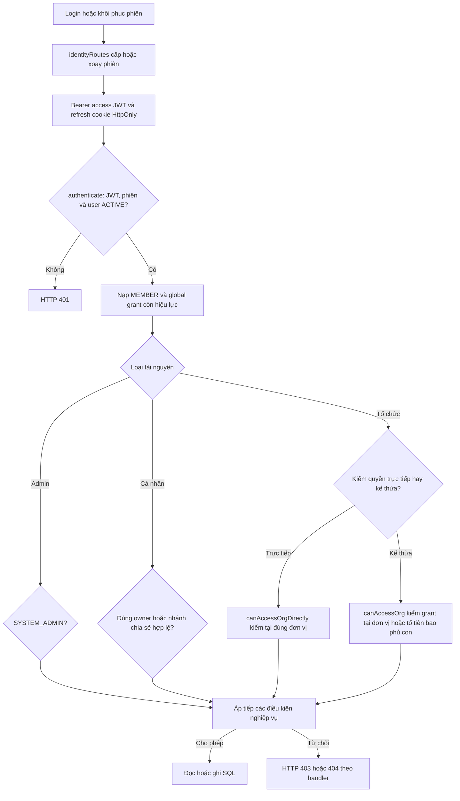
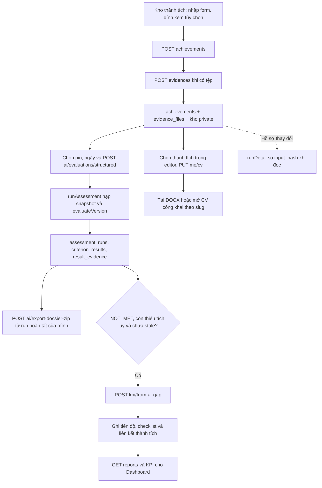
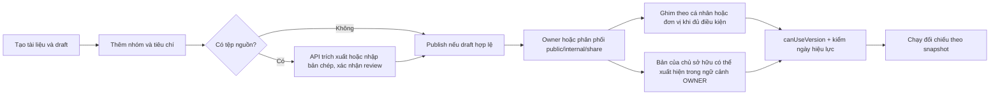

# Kiến trúc hệ thống và phân quyền

Đặc tả theo mã nguồn trên nhánh `cleanup/promote-v2`, mốc `687b4e2`. Các đường dẫn API trong tài liệu bỏ tiền tố mặc định `/api/v1`, trừ khi ghi rõ. Tên bảng SQL thuộc schema `app`. “API riêng” nghĩa là handler có đăng ký và kiểm quyền. “UI nối API” nghĩa là component có action gọi handler đó. Đây là đặc tả từ mã nguồn, không phải một lần nghiệm thu mới.

## Phần 1 — Kiến trúc và công nghệ hiện hành

| Tầng | Thành phần và trách nhiệm |
| --- | --- |
| Trình duyệt | React 18, React Router, Vite, Tailwind CSS, Axios. `main.jsx` khởi tạo app. `AppRoutes.jsx` định tuyến, `MainLayout` cung cấp sidebar/topbar và outlet, `AuthProvider` giữ hồ sơ phiên. Các trang, modal và drawer giữ state cục bộ. |
| HTTP client | `apiClient.js` gắn Bearer từ bộ nhớ, gửi cookie với credentials, gộp lần refresh đồng thời và thử lại một lần trên 401 phù hợp. `request.js` bóc envelope và cache các GET đủ điều kiện. `vaultApi.js` truyền `fresh:true` và tùy chọn multipart/blob. `useLoad` chặn phản hồi của generation cũ. `useCollection` đọc từng trang 100 dòng. Ghi dữ liệu và đổi token làm mất hiệu lực read cache. |
| Express | `server.js` kết nối DB rồi khởi động HTTP. Nếu DB chưa sẵn sàng, server vẫn mở để phục vụ liveness. `app.js` dùng Helmet, CORS, cookie parser, correlation ID và handler lỗi. Sáu router nghiệp vụ mount tại API prefix, health ở `/health`. Route gốc HTTP `GET /` trả thông tin REST. |
| SQL Server | Driver `mssql`, truy vấn T-SQL có bind tham số, transaction qua `dbHelper.js`. DDL gồm **8 migration** và **38 bảng nghiệp vụ** theo khai báo. `app._schema_migrations` theo dõi checksum. Runner khóa application lock, từ chối baseline trên DB chưa được quản lý nhưng đã có bảng. |
| Kho tệp | `files.js` chọn kho minh chứng theo `STORAGE_DIR` hoặc thư mục private mặc định. Kho nguồn quy chế là thư mục sibling `regulations`. SQL giữ storage key, SHA-256, MIME, dung lượng và quan hệ. Hai kho được tải qua handler có kiểm quyền. ZIP và DOCX tạo ở backend rồi trả binary. |
| AI và email | `intelligenceEvaluator.js` đối chiếu theo rule. `regulationSources.js` trích xuất PDF/DOCX và gọi AI đề xuất qua Worker Pool nếu có `AI_POOL_URL`, hoặc Groq/OpenRouter theo cấu hình. `vision.js` trích xuất minh chứng qua luồng Groq/Gemini riêng. `identityRoutes.js` gửi link đặt lại mật khẩu qua Resend khi cấu hình. |
| Vận hành | `cloudflare/ai-pool/` gồm Worker, dashboard và test riêng. SQL và kho private được backup cùng nhau theo archive v3. Demo seed và fixture kiểm thử chạy qua script riêng. |

```text
frontend/
  src/
    routes/AppRoutes.jsx       URL và RequireAuth
    pages/                    Trang độc lập, gồm Profile/Cv/PublicCv,
                              Achievements, Discovery, Goals, Organizations,
                              Reports, Admin, Dashboard và RegulationLibrary
    layouts/                  Shell, topbar và Outlet
    context/                  Phiên đăng nhập
    components/{common,calendar,auth}/
    hooks/                    useLoad, useCollection, useTheme
    services/                 apiClient, authApi, request, vaultApi, read cache
backend/
  src/
    app.js, server.js
    modules/                  identity, vault, intelligence, support,
                              regulation source/distribution và bộ kiểm quyền
    health/                   Liveness/readiness
    integrations/ai/          Interface, lỗi và adapter AI
    config/, middlewares/, utils/
  tests/                      Unit và tích hợp
database/
  scripts/migrate.js
  sqlserver/{migrations,sources}/
  sqlserver/verify.mjs
cloudflare/ai-pool/            Worker/dash vận hành
docs/api/API_REFERENCE.md
```

| Migration | Phạm vi |
| --- | --- |
| `001_v2_schema.sql` | Tạo baseline 33 bảng nghiệp vụ, FK, CHECK, unique và index. |
| `002_v2_integrity.sql` | Trigger toàn vẹn cây, membership, phiên bản, kết quả và lịch sử/audit. |
| `003_regulation_distribution.sql` | Sở hữu/phân phối quy chế, share, adoption, nguồn và quyền quy chế. |
| `004_distribution_integrity.sql` | Tăng ràng buộc thời điểm và bảo toàn phản hồi chia sẻ. |
| `005_source_transcription.sql` | Phương thức trích xuất tự động hoặc bản chép thủ công. |
| `006_allow_20mb_sources.sql` | Nâng file nguồn PDF/DOCX lên 20 MiB. |
| `007_regulation_sharing_and_join_requests.sql` | Chia sẻ cho cá nhân, join request và cập nhật consent membership. |
| `008_personal_regulation_exclusions.sql` | Loại trừ cá nhân khỏi ngữ cảnh chủ sở hữu của phiên bản. |

FK ghép bảo toàn chủ sở hữu giữa thành tích, minh chứng, KPI và CV, cùng phiên bản giữa quy chế và kết quả. CHECK bảo vệ enum, thời gian và cú pháp JSON. Trigger giữ bất biến các bản đã công bố/kết quả hoàn thành và ngăn chu trình tổ chức hoặc kỳ membership chồng lấn. Zod và các kiểm tra nghiệp vụ bổ sung quy tắc mà DDL không biểu diễn. Xem [toàn bộ migration](database/sqlserver/migrations) và [bản đồ schema, JSON và rule](TECHNICAL_DEEP_DIVE.md).

## Phần 2 — Route, thao tác và luồng dữ liệu

JSON thành công dùng dạng `{success:true,data:...}` trên các handler nghiệp vụ. Thiếu phiên hợp lệ thường trả 401, thiếu quyền trả 403, ID ngoài tập tài nguyên có thể truy vấn trả 404, validation nghiệp vụ trả 400 và xung đột trạng thái có thể trả 409. UI hiển thị thông báo hoặc trạng thái tải theo từng trang. Nguồn định tuyến [AppRoutes.jsx](frontend/src/routes/AppRoutes.jsx).

### Danh sách route

| URL | Trang và component | Chức năng trên trang | Điều kiện truy cập |
| --- | --- | --- | --- |
| `/login` | [AuthPage](frontend/src/pages/AuthPage.jsx) | Đăng nhập, chuyển sang đăng ký hoặc quên mật khẩu | Public. Phiên hợp lệ chuyển về dashboard |
| `/reset-password` | [ResetPassword](frontend/src/pages/ResetPassword.jsx) | Nhập và xác nhận mật khẩu mới | Public. API yêu cầu token khôi phục hợp lệ |
| `/cv/:slug` | [PublicCv.jsx](frontend/src/pages/PublicCv.jsx) | Xem CV được công bố | Public. Slug phải thuộc CV công khai |
| `/` | `Navigate` trong AppRoutes | Chuyển sang `/me/dashboard` | Đăng nhập |
| `/me/dashboard` | [Dashboard](frontend/src/pages/Dashboard.jsx) | Tổng quan, KPI gần đây, lối tắt nghiệp vụ, lịch cá nhân | Đăng nhập |
| `/me/profile` | [Profile.jsx](frontend/src/pages/Profile.jsx), [Cv.jsx](frontend/src/pages/Cv.jsx) | Xem/sửa hồ sơ, đổi mật khẩu, thiết kế và xuất CV ở tab `?tab=cv` | Đăng nhập, dữ liệu cá nhân |
| `/me/cv` | `Navigate` trong AppRoutes | Chuyển sang `/me/profile?tab=cv` | Đăng nhập |
| `/achievements` | [Achievements.jsx](frontend/src/pages/Achievements.jsx) | Danh sách, tìm/lọc, tạo/sửa, thùng rác, khôi phục, đính kèm và trích xuất AI | Đăng nhập, thành tích của chính mình |
| `/kpi` | [Goals.jsx](frontend/src/pages/Goals.jsx) | Mục tiêu, tiến độ, checklist, liên kết thành tích, xóa mục tiêu | Đăng nhập, KPI của chính mình |
| `/me/ai-forecast` | [Discovery.jsx](frontend/src/pages/Discovery.jsx) | Đối chiếu quy chế cá nhân, xem lịch sử, tạo KPI từ tiêu chí thiếu, xuất ZIP, đối chiếu theo tổ chức khi có quyền | Đăng nhập. Khám tổ chức cần quyền theo phạm vi |
| `/regulations` | [RegulationLibrary](frontend/src/pages/RegulationLibrary.jsx) | Duyệt kho, áp dụng, chia sẻ, quản lý tài liệu và phiên bản | Đăng nhập. Phạm vi đọc và thao tác tùy chủ sở hữu, chia sẻ và quyền tổ chức |
| `/regulations/:regulationId` | [RegulationLibrary](frontend/src/pages/RegulationLibrary.jsx) | Mở trực tiếp tài liệu, đọc phiên bản, tiêu chí và tệp nguồn | Như kho quy chế |
| `/organizations` | [Organizations.jsx](frontend/src/pages/Organizations.jsx) | Cây tổ chức, thành viên, lời mời, đơn gia nhập, liên kết cấp trên/cấp dưới, cấp quyền | Đăng nhập. Các thao tác quản lý kiểm tra quyền trên tổ chức |
| `/reports` | [Reports.jsx](frontend/src/pages/Reports.jsx) | Tổng hợp số lượng và tỷ trọng thành tích theo năm và loại | Đăng nhập, dữ liệu cá nhân |
| `/admin` | [Admin.jsx](frontend/src/pages/Admin.jsx) | Tài khoản, quyền toàn hệ thống, danh mục loại thành tích | Route frontend yêu cầu đăng nhập. Menu và API quản trị yêu cầu `SYSTEM_ADMIN` |
| `/me/calendar`, `/calendar`, `/notifications` | `Navigate` trong AppRoutes | Chuyển về dashboard. Lịch nằm trong dashboard, thông báo nằm ở thanh ứng dụng | Đăng nhập |
| `*` | [NotFound](frontend/src/pages/NotFound.jsx) | Màn 404 cho URL không khớp route | Public |

`RequireAuth` chờ khôi phục phiên rồi hiển thị layout hoặc chuyển sang `/login`. Backend kiểm tra phiên và trạng thái tài khoản trong [access.js](backend/src/modules/access.js). Quyền tổ chức lấy từ `org_access_grants` đang hiệu lực và có thể bao gồm đơn vị cấp dưới. `SYSTEM_ADMIN` được đi qua kiểm tra quyền tổ chức trong các helper tương ứng. Quy chế “công khai” vẫn nằm sau đăng nhập của kho quy chế. CV công khai có route và API public riêng.

### Luồng hoạt động theo trang và module

### 1. Đăng nhập, đăng ký và khôi phục mật khẩu

- `/login` có hai chế độ trong cùng trang. Form đăng nhập có email, mật khẩu, hiện/ẩn mật khẩu và ghi nhớ. Form đăng ký có họ tên, email, mật khẩu và loại người dùng. Nút quên mật khẩu dùng email đang nhập. Điều khiển đổi theme chạy phía trình duyệt. Sau đăng ký, UI hiển thị xác nhận và có đường về form đăng nhập. `/login` chờ khôi phục phiên rồi chuyển về dashboard nếu đã đăng nhập.
- `/reset-password` đọc token từ `#token=...`, xóa fragment khỏi thanh địa chỉ, nhập lại để xác nhận, cho hiện mật khẩu mới, báo mismatch hoặc link không hợp lệ và có link quay lại đăng nhập. Access JWT lưu trong bộ nhớ. Refresh cookie mang token ngẫu nhiên, DB chỉ giữ hash. `authenticate` kiểm chữ ký, `userId`, `sessionId`, tài khoản ACTIVE và phiên chưa thu hồi/chưa hết hạn. Các POST login/register/forgot/reset chia chung bộ đếm IP, giới hạn 30 trong 15 phút.

**User Flow.** Người dùng nhập email/mật khẩu, có thể chọn ghi nhớ, chuyển sang form đăng ký hoặc yêu cầu email khôi phục. Link khôi phục mở trang đặt lại mật khẩu với token và form xác nhận mật khẩu. Phiên hợp lệ được phục hồi khi mở lại ứng dụng.

| Thao tác | Frontend → API | Xử lý backend → DB |
| --- | --- | --- |
| Đăng ký | `POST /auth/register` với `{fullName,email,password,personType}` | Hash mật khẩu, tạo `users`, `person_profiles`, ghi `audit_events` và tạo `auth_sessions` trong transaction. Handler trả access token và cookie phiên |
| Đăng nhập | `POST /auth/login` với `{username,password,rememberMe}`, username là email | Đối chiếu email chuẩn hóa và tài khoản ACTIVE, xác minh hash, tạo `auth_sessions`. Phiên 7 ngày hoặc 30 ngày tùy lựa chọn |
| Khôi phục phiên, đọc hồ sơ, đăng xuất | `POST /auth/refresh`, `GET /auth/me`, `POST /auth/logout` | Refresh token đi qua cookie HttpOnly, DB giữ hash. Refresh xoay phiên, logout thu hồi phiên và xóa cookie. Hồ sơ đọc `users`, `person_profiles`, `global_role_grants`, `memberships`, `organizations`, `org_access_grants` |
| Quên mật khẩu | `POST /auth/forgot-password` với `{email}` | Với tài khoản ACTIVE, tạo hash token hết hạn sau 30 phút trong `auth_tokens` và gọi Resend gửi link có token trong URL fragment. Phản hồi dùng thông điệp chung |
| Đặt lại mật khẩu | `POST /auth/reset-password` với `{token,password}` | Kiểm tra token chưa dùng và còn hạn, cập nhật `users`, tiêu thụ token, thu hồi `auth_sessions` và ghi `audit_events` |

**Tình trạng.** Nối API. Gửi email phụ thuộc cấu hình URL ứng dụng, key và địa chỉ gửi. Thiếu cấu hình trả 503. Lỗi gửi từ provider được ghi log và UI vẫn nhận thông điệp chung, nên phản hồi thành công chưa xác nhận thư đã đến. Nguồn mã [authApi.js](frontend/src/services/authApi.js), [AuthContext.jsx](frontend/src/context/AuthContext.jsx), [identityRoutes.js](backend/src/modules/identityRoutes.js).

### 2. Dashboard, lịch và thanh ứng dụng

- Giao diện lịch ngay Dashboard cho chuyển tháng/năm, về hôm nay, chọn ngày, xem ngày có nhiều sự kiện, mở form, lưu/hủy/xóa. `endsAt` phải sau `startsAt`, `remindAt` không muộn hơn bắt đầu. Trình duyệt hiển thị giờ local, backend chuẩn hóa ISO UTC. Trạng thái gồm `SCHEDULED`, `COMPLETED`, `CANCELLED`. Trường `goalId` có trong API, Dashboard không có form gắn KPI.
- Topbar tìm kiếm theo các nguồn trong bảng dưới, đổi theme, mở hồ sơ và chuông. Lối tắt tìm kiếm đến trang quản trị chỉ xuất hiện với admin. Sidebar có điều hướng desktop và menu thêm trên mobile. Nút đăng xuất thu hồi phiên qua API.
- Header dashboard, thẻ hero, bốn lối tắt và lịch thuộc `Dashboard.jsx` / `DashboardCalendar.jsx`. Phân biệt KPI tóm tắt và bảng report đầy đủ. `/notifications`, `/calendar`, `/me/calendar` là alias chuyển hướng.

**User Flow.** Dashboard hiện lời chào, số lượng hoạt động cá nhân, lối tắt sang kho thành tích, quy chế, CV, KPI và danh sách KPI gần đây. Người dùng chọn ngày/sự kiện trên lịch để xem hoặc mở form thêm/sửa/xóa. Chuông thông báo cho phép xem thêm, đọc từng mục hoặc đánh dấu tất cả đã đọc. Ô tìm kiếm gợi ý trang và dữ liệu nghiệp vụ.

| Thao tác | Frontend → API | Xử lý backend → DB |
| --- | --- | --- |
| Xem tổng quan | `GET /reports`, `GET /kpi/goals?pageSize=4` | Tổng hợp `achievements`, `kpi_goals`, `cvs`, `notifications`, `assessment_runs` theo người dùng. Dashboard dùng số thành tích, KPI và lượt đánh giá. API KPI trả danh sách của chủ sở hữu |
| Xem và sửa lịch | `GET/POST /me/calendar/events`, `PATCH/DELETE /me/calendar/events/:id` | Form gửi `{title,description,startsAt,endsAt,remindAt,status}`. Handler kiểm tra thứ tự thời gian, chuẩn hóa UTC và đọc/ghi/xóa `calendar_events` theo chủ sở hữu. API hỗ trợ thêm `goalId` và kiểm tra trong `kpi_goals` |
| Thông báo | `GET /notifications?page=1&pageSize=10` và trang tiếp theo, `PATCH /notifications/:id/read`, `POST /notifications/read-all` | Trả item, tổng và số chưa đọc. Cập nhật `read_at` trong `notifications` theo người nhận |
| Tìm kiếm chung | `GET /achievements?search=…`, `GET /kpi/goals`, `GET /regulations/documents`, `GET /organizations` | Dùng các API nghiệp vụ và phạm vi tương ứng. Thành tích tìm trên server. KPI/quy chế lọc cục bộ trên tối đa trang đầu 100 kết quả. Link trang được tra từ danh mục điều hướng tĩnh |

**Tình trạng.** Các số đếm, sự kiện và thông báo lấy từ API. Hình minh họa, lối tắt và tên trang tìm kiếm là nội dung tĩnh. Lịch lưu `remindAt` thực tế. Router hiện hành chỉ lưu/đọc mốc thời gian, chưa có luồng phát nhắc lịch được nối từ lịch dashboard. Nguồn mã [DashboardCalendar.jsx](frontend/src/components/calendar/DashboardCalendar.jsx), [GlobalSearch.jsx](frontend/src/components/common/GlobalSearch.jsx), [NotificationDropdown.jsx](frontend/src/components/common/NotificationDropdown.jsx), [supportRoutes.js](backend/src/modules/supportRoutes.js).

### 3. Hồ sơ cá nhân và CV

- `/me/profile` có tab thông tin, `?tab=cv` và bảo mật. Form thông tin giữ state cục bộ và có luồng lưu/hủy chỉnh sửa. Thẻ thông tin đơn vị hiển thị dữ liệu phiên và hồ sơ. Form mật khẩu xác nhận mật khẩu mới. Sau đổi mật khẩu, backend xóa refresh cookie và trả `reauthenticate:true`. Frontend xóa phiên và yêu cầu đăng nhập lại.
- `Cv.jsx` có chuyển Chỉnh sửa/Xem trước trên màn hình nhỏ, chọn mẫu, slug, tiêu đề, giới thiệu, chọn thành tích, cài email/điện thoại và xác nhận khi đổi công khai. Có tải DOCX, sao chép link, mở link và hộp QR tạo phía client khi có CV công khai đã lưu. `PublicCv.jsx` render danh tính/giới thiệu và thành tích từ payload công khai, có trạng thái tải/lỗi. Không gọi API chỉnh sửa hoặc export từ trang CV public.

**User Flow.** Trang hồ sơ mở phần thông tin cá nhân, cho xem tổ chức/quyền và chỉnh sửa thông tin. Người dùng có thể đổi mật khẩu. Trong tab CV, chọn mẫu Modern, Academic hoặc Minimalist, chỉnh tiêu đề/giới thiệu, chọn thành tích, xem trước, lưu, đặt chế độ công khai và chọn hiển thị email/điện thoại. CV công khai có link để sao chép. DOCX được tải từ cấu hình đã lưu.

| Thao tác | Frontend → API | Xử lý backend → DB |
| --- | --- | --- |
| Đọc/lưu hồ sơ | `GET/PATCH /me/profile`. Form dùng các trường hồ sơ như `fullName,personType,birthDate,phone,headline,biography` | Đọc thông tin tài khoản, vai trò và membership như `/auth/me`. Chỉ cập nhật các trường cho phép trong `person_profiles` của người gọi. Schema cũng nhận `attributes` |
| Đổi mật khẩu | `POST /auth/change-password` với `{oldPassword,newPassword}` | Xác minh mật khẩu cũ, ghi hash vào `users`, thu hồi phiên/token cũ, xóa cookie và yêu cầu đăng nhập lại |
| Thiết kế/lưu CV | `GET /me/cv`, `GET /achievements` qua các trang, `PUT /me/cv` với `{slug,templateId,isPublic,headline,bio,selectedAchievementIds,showEmail,showPhone}` | Kiểm tra slug và quyền sở hữu thành tích. Slug tối đa 100 ký tự, chỉ chữ thường ASCII, số và nhóm phân cách bằng dấu gạch ngang, tối thiểu 3 ký tự nếu được gửi và tránh tên dành riêng. Khi tạo mà không nhập slug, backend sinh UUID. Backend lưu `cvs`, tìm hoặc thêm mẫu trong `cv_templates`, thay danh sách có thứ tự trong `cv_achievements`, ghi audit |
| Xem link công khai | `GET /public/cv/:slug` | Chỉ lấy CV có trạng thái PUBLIC và chủ tài khoản ACTIVE. Kết hợp hồ sơ và thành tích được chọn còn hoạt động. Chỉ trả email/điện thoại khi cài đặt cho phép |
| Xuất Word | `GET /me/cv/export-docx` | Đọc `cvs`, `person_profiles`, `cv_achievements`, `achievements`, dựng DOCX từ tên, headline, giới thiệu và danh sách thành tích |

**Tình trạng.** Lưu và xuất nối API. Mẫu chọn và preview được render ngay trên frontend. API xuất Word có bộ dựng văn bản riêng, gồm các đoạn nội dung nói trên. `GET /cv/templates` có handler trả danh sách mẫu cố định, còn tab CV khai báo lựa chọn mẫu trong component. Nguồn mã [vaultRoutes.js](backend/src/modules/vaultRoutes.js), [supportRoutes.js](backend/src/modules/supportRoutes.js).

### 4. Kho thành tích và minh chứng

- Thanh công cụ có Thống kê & Báo cáo và Thêm thành tích. Kho/Thùng rác có tìm tên, bộ lọc loại, năm, đơn vị cấp, xóa bộ lọc, phân trang và nút mở nhóm lọc nâng cao trên mobile. Click tên mở detail, click badge minh chứng mở drawer tại phần tệp. Nút sửa, đưa vào thùng rác, hoàn tác hoặc khôi phục xuất hiện theo trạng thái hàng.
- Form drawer có tên/ngày đạt, loại, đơn vị cấp, mô tả, trường động của loại và thuộc tính tùy chỉnh. Hỗ trợ chọn/kéo tệp, xem/xóa tệp chọn, quét lại, chọn đề xuất thay thế hoặc giữ dữ liệu, bỏ thuộc tính, lưu/hủy. `?search=…` và `?add=1&criterion=…&type=…` nối từ tìm kiếm/đối chiếu. Upload thành tích dùng giới hạn cấu hình `MAX_FILE_SIZE_BYTES` mặc định 10 MiB và kiểm nội dung PDF/DOCX/PNG/JPEG. Xóa minh chứng làm mềm hàng, tải chỉ đọc tệp và thành tích còn hoạt động.

**User Flow.** Người dùng xem kho hoạt động hoặc thùng rác, tìm/lọc, mở chi tiết, thêm/sửa thành tích và khôi phục mục đã đưa vào thùng rác. Form cho nhập trường theo loại thành tích, chọn tệp và yêu cầu AI gợi ý dữ liệu. Người dùng xem/chọn đề xuất trước khi lưu. Minh chứng có hành động mở, tải, xóa và thử tải lại khi upload lỗi.

| Thao tác | Frontend → API | Xử lý backend → DB |
| --- | --- | --- |
| Tải kho, thùng rác và loại | `GET /achievements` và `GET /achievements?trash=true` qua các trang, `GET /achievements/catalogs` | Lọc theo chủ sở hữu và `deleted_at`, nối `achievement_types`, đọc metadata minh chứng. Catalog trả cả schema thuộc tính theo loại |
| Tạo/sửa | `POST /achievements`, `PATCH /achievements/:id` với dữ liệu form như `{title,description,achievedAt,achievementTypeId,issuer,attributes}` | Validate, kiểm tra loại, lưu `achievements` và audit. Schema hỗ trợ `levelCode`. Khi tạo kèm tệp, frontend lưu record trước rồi mới upload |
| Đưa vào thùng rác/khôi phục | `DELETE /achievements/:id`, `POST /achievements/:id/restore` | Cập nhật trạng thái xóa mềm/khôi phục trong `achievements`, kiểm tra chủ sở hữu và ghi audit |
| Tệp | `GET/POST /achievements/:id/evidences` với multipart `file` khi tạo, `DELETE /evidences/:id`, `GET /evidence-files/:id/download` | Kiểm tra thành tích và tệp theo phạm vi đọc, lưu bytes trong filesystem, ghi `evidence_files` với tên, MIME, kích thước, hash và storage key. Tải file trả nội dung nhị phân |
| Trích xuất AI | `POST /achievements/ai-extract` với multipart `file` | Handler kiểm tra tệp, gọi luồng trích xuất theo định dạng trong `vision.js` và trả gợi ý. Thành tích chỉ được ghi qua thao tác lưu riêng |

**Tình trạng.** Danh sách và CRUD nối API. Lọc danh sách kho và thao tác chọn gợi ý xử lý ở frontend. Preview tệp dùng blob từ API hoặc tệp người dùng vừa chọn. Trích xuất AI phụ thuộc provider/cấu hình và có đường lỗi. Upload thất bại sau khi lưu có thể để lại thành tích đã lưu và cho thử upload lại. Backend có API cấp/thu hồi chia sẻ minh chứng `POST /evidence-files/:id/shares` và `DELETE /evidence-shares/:id` trên `evidence_shares`. UI kho hiện nối luồng quản lý và tải tệp. Nguồn mã [vaultRoutes.js](backend/src/modules/vaultRoutes.js), [vision.js](backend/src/modules/vision.js).

### 5. Đối chiếu quy chế cá nhân và tổ chức

- Tab cá nhân có chọn ngày, chọn tất cả hoặc từng ngữ cảnh, chạy nhiều lần lần lượt, thử lại mục lỗi, chọn xem chi tiết, mở lịch sử phân trang, chuyển về kết quả mới nhất, tải minh chứng từng tệp/ZIP, bổ sung thành tích và tạo/mở KPI khi phù hợp. Hỗ trợ deep link `?version=…&adoption=…`. Danh sách có thể có nhiều ngữ cảnh cùng phiên bản. Thao tác tổ chức có chọn đơn vị, chọn cấp dưới khi đủ grant, lọc/chọn thành viên và quy chế, xem kết quả theo nhóm đạt/thiếu, chọn người nhận, đặt ghi chú/hạn, xem trước, gửi từng người hoặc hàng loạt, gửi lại hoặc hủy.
- **Rule và stale.** `inputSnapshot` lấy `person_profiles` và toàn bộ `achievements` chưa xóa của người được khám theo ID. `evaluateRule` lọc `achieved_at` theo khoảng ngày và ngày xét, sau đó áp `filters` theo `title`, `issuer`, `level_code`, `achievement_type_id`, `achieved_at` hoặc một khóa `attributes.*`. Loại thành tích chỉ lọc khi rule yêu cầu. Leaf `count`, `sum`, `boolean`, `distinct_years` đếm/cộng/kiểm sự tồn tại/đếm năm (có thể dùng chuỗi liên tiếp dài nhất). Rule lồng dùng AND/OR. `evaluateVersion` áp loại người dùng, kết hợp nhóm và tiêu chí bắt buộc rồi xử lý điều kiện loại trừ. Trạng thái là `MET`, `NOT_MET`, `INSUFFICIENT_DATA`, `NOT_APPLICABLE`. `MANUAL` và `UNSUPPORTED` cho thiếu dữ liệu khi áp dụng. % hoàn thành là tỷ lệ tiêu chí MET trên tất cả kết quả, khác kết luận tổng hợp. `runAssessment` lưu snapshot, kết quả và liên kết chứng cứ. `runDetail` so SHA-256 của snapshot đầu vào hiện tại với hash đã lưu. Thay đổi thuộc tính hồ sơ hoặc thành tích đã nạp có thể làm stale kể cả ngoài cửa sổ của một tiêu chí. Stale tính khi đọc chi tiết và không ghi đè lượt cũ.

**User Flow.** Người dùng xem quy chế đã áp dụng, chọn ngữ cảnh và ngày đánh giá, xem kết quả phân theo tiêu chí, mở lịch sử hoặc tải minh chứng. Tiêu chí thiếu đủ điều kiện có thể tạo KPI. Với quyền tổ chức, người dùng chọn đơn vị, phạm vi cấp dưới, thành viên, quy chế và ngày, chạy đối chiếu rồi xem hoặc gửi kết quả cho thành viên.

| Thao tác | Frontend → API | Xử lý backend → DB |
| --- | --- | --- |
| Chuẩn bị và xem lịch sử | `GET /regulations/library`, `GET /regulations/versions/:id`, `GET /ai/evaluations/structured/latest`, `GET /ai/evaluations/structured/history`, `GET /ai/evaluations/structured/:id` | Dùng các phiên bản đã áp dụng và quyền hiện tại. Đọc lịch sử, snapshot, chi tiết tiêu chí và minh chứng từ `assessment_runs`, `criterion_results`, `result_evidence` và bảng quy chế |
| Chạy đối chiếu cá nhân | `POST /ai/evaluations/structured` với `{regulation_version_id,evaluation_date,adoption_id}` trong ngữ cảnh đã chọn | Kiểm tra quyền dùng phiên bản đã công bố và hiệu lực theo ngày. Đọc hồ sơ, nhóm/tiêu chí và thành tích thuộc phạm vi. Bộ máy rule đánh giá điều kiện, ghi run, kết quả từng tiêu chí và liên kết chứng cứ. Chi tiết kiểm tra dữ liệu đã đổi để đánh dấu kết quả cũ |
| Tải minh chứng | `POST /ai/export-dossier-zip` với `{runId}`, hoặc `GET /evidence-files/:id/download` | ZIP chỉ lấy run hoàn tất của người dùng và tệp còn hoạt động thuộc phạm vi, từ `assessment_runs`, `criterion_results`, `result_evidence`, `achievements`, `evidence_files` và filesystem. ZIP gồm JSON kết quả và tệp |
| Tạo KPI từ phần thiếu | `POST /kpi/from-ai-gap` với `{source_result_id}` | Kiểm tra kết quả thuộc người dùng, run hoàn tất còn hiện hành và tiêu chí thiếu một lượng tích lũy dương. Tạo `kpi_goals` với mục tiêu bằng lượng còn thiếu và liên kết về kết quả nguồn |
| Khám tổ chức | `GET /organizations/:id/members?includeDescendants=…`, `GET /organizations/units/:id/assessment-options`, `POST /organizations/units/:id/ai-scan` với `{regulation_version_id,evaluation_date,include_descendants,user_ids}` | Kiểm tra quyền `ASSESSMENTS_RUN` và `ASSESSMENTS_VIEW`, phiên bản đủ điều kiện và thành viên đang hiệu lực/ACTIVE trong phạm vi. Ghi batch vào `assessment_batches` và chạy đánh giá cho thành viên được chọn |
| Gửi tóm tắt kết quả | `POST /organizations/units/:id/assessment-notifications` với `{runIds,note,deadline?,resendKey?}` | Kiểm tra quyền và phạm vi run/người nhận, ghi thông báo trong `notifications`. UI gửi theo từng người nhận và theo dõi lỗi từng lượt |

**Tình trạng.** Luồng đối chiếu chính nối API và dùng bộ đánh giá quy tắc có kết quả lưu SQL. Phần đối chiếu không cần LLM. Tiêu chí thủ công hoặc chưa hỗ trợ có trạng thái riêng trong bộ đánh giá. `POST /ai/auto-discovery` và `POST /ai/evaluations/structured/:id/notify` có handler, còn UI trên gọi các endpoint đối chiếu có cấu trúc và thông báo tóm tắt như bảng. Nguồn mã [intelligenceRoutes.js](backend/src/modules/intelligenceRoutes.js), [intelligenceEvaluator.js](backend/src/modules/intelligenceEvaluator.js).

### 6. Mục tiêu / KPI

- Danh sách trình bày dạng bảng/thẻ, phân trang, mở modal tạo hoặc chi tiết. Form tạo có gợi ý mẫu điền cục bộ, tên, chỉ tiêu số, đơn vị và hạn. Detail mở theo URL `?goal=…`, có ghi tiến độ số, thêm/tick checklist, đổi trạng thái, liên kết thành tích, xác nhận xóa và hủy.
- `goalDetail` lấy giá trị thủ công từ bản ghi mới nhất theo `recorded_at DESC,id DESC`. Nguồn `ACHIEVEMENTS` cộng `contribution_value` của các liên kết có thành tích chưa xóa. Tỷ lệ được làm tròn hai chữ số và chặn trên ở 100. Tạo KPI từ khoảng thiếu dùng nguồn `MANUAL`, nên gắn thành tích hỗ trợ không tự đổi số tiến độ.

**User Flow.** Người dùng xem danh sách theo trang, tạo mục tiêu, mở chi tiết, cập nhật trạng thái, nhập tiến độ thủ công, thêm/đánh dấu việc cần làm, liên kết thành tích hoặc xóa mục tiêu. Có thể mở trực tiếp mục tiêu qua `/kpi?goal=…` từ luồng đánh giá.

| Thao tác | Frontend → API | Xử lý backend → DB |
| --- | --- | --- |
| Danh sách và chi tiết | `GET /kpi/goals?page=…`, `GET /kpi/goals/:id` | Đọc mục tiêu cá nhân chưa xóa và dữ liệu liên quan trong `kpi_goals`, `kpi_tasks`, `kpi_progress`, `kpi_achievements`, `achievements` |
| Tạo, đổi trạng thái, xóa | `POST /kpi/goals` với `{title,target_value,measure_unit,due_date}`, `PATCH /kpi/goals/:id` với `{status}`, `DELETE /kpi/goals/:id` | Kiểm tra mục tiêu và ngày, ghi hoặc xóa mềm `kpi_goals`. API PATCH nhận thêm các trường hợp lệ của mục tiêu |
| Tiến độ | `POST /kpi/goals/:id/progress` với `{current_value}` | Chỉ ghi tiến độ trực tiếp cho nguồn MANUAL, thêm bản ghi `kpi_progress`. Với nguồn ACHIEVEMENTS, backend tính từ thành tích liên kết còn hoạt động |
| Checklist | `POST /kpi/goals/:id/tasks` với `{title}`, `PATCH /kpi/goals/:id/tasks/:taskId` với `{status}` | Kiểm tra sở hữu mục tiêu, ghi `kpi_tasks` và thời điểm hoàn thành khi DONE |
| Liên kết thành tích | `GET /achievements` để chọn, `POST /kpi/goals/:id/achievements` với `{achievement_id,contribution_value}` | Xác minh thành tích hoạt động cùng chủ sở hữu, ghi `kpi_achievements` |

**Tình trạng.** Nối API. API V2 có thêm xóa checklist và gỡ liên kết thành tích. Màn hiện tại nối thêm mục checklist, đổi trạng thái và thêm liên kết. Import CSV và đồng bộ KPI ngoài thuộc lịch sử triển khai. Nguồn mã [intelligenceRoutes.js](backend/src/modules/intelligenceRoutes.js).

### 7. Kho quy chế

- Danh mục có Đang áp dụng / Trường / Khoa / Cá nhân, tìm tên hoặc mã, nhóm danh mục gợi ý, chọn đơn vị và trang danh sách. Luồng chia sẻ có danh sách nhận/gửi, chấp nhận/từ chối hoặc thu hồi tùy quyền. Chi tiết mở bằng `/regulations/:regulationId?version=…`, có chọn phiên bản, căn cứ, xem/tải nguồn, nhóm và tiêu chí, tiếp nhận/bỏ áp dụng, mở đối chiếu, cập nhật pin sau xác nhận hoặc so sánh bản mới.
- Form tạo quy chế lập `first_version` trong bước đầu rồi mở inspector cấu hình tiêu chí. Form phiên bản có thời hạn, nguồn, đối tượng, toán tử tổng hợp và thông tin bao phủ. Tùy quyền có thêm phiên bản, thêm/sửa nhóm hoặc tiêu chí, công bố, xóa draft/tài liệu theo ràng buộc, bật/tắt công khai hoặc nội bộ, chia sẻ theo email/tổ chức và ghim cho đơn vị. Bật công khai không tự ghim. Tệp nguồn PDF xem qua blob, DOCX có bản xem text.
- `POST /regulations/versions/:id/source` dùng multipart `file` (PDF/DOCX 20 MiB) và metadata tùy chọn. `POST …/source/extract`, `PATCH …/source/text` với `{text,confirmed:true}`, `POST …/source/ai-propose`, `POST …/source/review` với `{confirmed:true}` có handler. Tệp và bản chép ở `regulation_source_files`; các bước ghi áp cho draft và quyền quản lý phù hợp. Đề xuất AI là phản hồi để xem xét, không tự ghi tiêu chí. Màn thư viện hiện dùng các API đọc, preview và download tệp nguồn.

**User Flow.** Người dùng duyệt kho theo ngữ cảnh, mở tài liệu và chọn phiên bản để xem hiệu lực, phạm vi áp dụng, quy tắc, nhóm/tiêu chí, căn cứ và tệp nguồn nếu có. Có thể tiếp nhận cho cá nhân hoặc tổ chức có quyền, bỏ áp dụng cá nhân, so sánh phiên bản hiện tại với bản mới trước khi cập nhật, chia sẻ và xử lý chia sẻ đến. Người có quyền quản lý có thể tạo tài liệu và bản nháp, chỉnh cấu hình, công bố, điều chỉnh phân phối và xóa bản nháp/tài liệu khi điều kiện cho phép.

| Thao tác | Frontend → API | Xử lý backend → DB |
| --- | --- | --- |
| Tải kho và chi tiết | `GET /regulations/documents` qua các trang hoặc `GET /regulations/documents/:id`, `GET /regulations/library`, `GET /regulations/shares`, `GET /regulations/versions/:id`. Dữ liệu phụ từ tổ chức, hồ sơ và catalog | Tính phạm vi đọc và ngữ cảnh cá nhân/tổ chức từ `regulations`, `regulation_versions`, `criterion_groups`, `criteria`, `regulation_shares`, `regulation_adoptions`, `regulation_personal_exclusions` và dữ liệu quyền/membership |
| Tạo tài liệu/bản nháp | `POST /regulations/documents` với `{code,name,first_version,…}`, `POST /regulations/documents/:id/versions` với nhãn, kỳ hiệu lực, metadata nguồn, phạm vi và quy tắc tổng hợp | Xác định chủ sở hữu cá nhân hoặc `owner_organization_id`, kiểm tra quyền và kỳ hiệu lực. Ghi `regulations` và `regulation_versions` |
| Chỉnh nhóm/tiêu chí | `POST /regulations/versions/:id/{groups,criteria}`, `PATCH /regulations/{groups,criteria}/:id` | Nhóm gửi mã, tên và toán tử. Tiêu chí gửi thêm `rule`, căn cứ, nhóm, cờ bắt buộc/loại trừ và dữ liệu mô tả khi có. Kiểm tra bản nháp, ghi `criterion_groups` hoặc `criteria` |
| Công bố/xóa | `POST /regulations/versions/:id/publish`, `DELETE /regulations/versions/:id`, `DELETE /regulations/documents/:id` | Kiểm tra quyền, trạng thái và ràng buộc dữ liệu. Công bố yêu cầu bộ tiêu chí hợp lệ và review trước nếu có tệp nguồn. Cập nhật `regulation_versions`, hoặc xử lý các hàng tài liệu/nháp liên quan khi xóa được |
| Phân phối và áp dụng | `PATCH /regulations/documents/:id/distribution` với `{is_public}` hoặc `{is_internal}`. `POST /regulations/versions/:id/adopt` với `{}` hoặc `{organization_id}`. `DELETE /regulations/versions/:id/adopt` để bỏ áp dụng cá nhân | Cập nhật phạm vi trong `regulations`, ghi phiên bản áp dụng trong `regulation_adoptions`. Bỏ áp dụng cá nhân xóa pin của phiên bản và ghi loại trừ đối với bản tự sở hữu. So sánh bản cũ/mới dùng hai phản hồi chi tiết ở frontend |
| Chia sẻ | `POST /regulations/versions/:id/shares` với đích chia sẻ người dùng hoặc tổ chức, `POST /regulations/shares/:id/respond` với `{accept}`, `POST /regulations/shares/:id/revoke` | Kiểm tra quyền chia sẻ hoặc quyền nhận, lưu/chuyển trạng thái `regulation_shares` và cập nhật ngữ cảnh truy cập |
| Xem/tải tệp nguồn | `GET /regulations/versions/:id/source`, `GET …/source/download`, `GET …/source/preview` | Đọc `regulation_source_files` và filesystem theo phạm vi đọc phiên bản. PDF được mở từ blob, DOCX xem dưới dạng text |

**Tình trạng.** Nguồn dữ liệu thư viện và thao tác trên nối API. Quyền viết theo sở hữu cá nhân hoặc quyền tổ chức tương ứng, gồm `REGULATIONS_CREATE`, `REGULATIONS_MANAGE`, `REGULATIONS_PUBLISH`, `REGULATIONS_SHARE`, `REGULATIONS_ADOPT` và `REGULATIONS_UPDATE` theo hành động. Bộ mã nguồn có API upload/trích xuất/sửa văn bản/đề xuất AI/review tệp nguồn. Màn thư viện hiện nối đọc metadata, preview và tải tệp, còn các API ghi tệp nguồn chưa có lời gọi từ màn này. Đề xuất nguồn ở backend dùng AI Pool, Groq hoặc OpenRouter theo cấu hình. Nhãn “Tiêu chí mẫu” có thể đến từ dữ liệu demo đã lưu. Nguồn mã [intelligenceRoutes.js](backend/src/modules/intelligenceRoutes.js), [regulationDistributionRoutes.js](backend/src/modules/regulationDistributionRoutes.js), [regulationSourceRoutes.js](backend/src/modules/regulationSourceRoutes.js), [regulationAccess.js](backend/src/modules/regulationAccess.js).

### 8. Tổ chức

- Form ở màn danh bạ có Xin gia nhập, Lời mời đến và Tạo tổ chức/Tạo nhóm độc lập. Đơn có chọn tổ chức và lý do tùy chọn, xem trạng thái. Lời mời có chấp nhận/từ chối. Chi tiết đơn vị có breadcrumb, cây mở/đóng, tab Thành viên và Cơ cấu tổ chức khi có quyền. Thành viên có tìm tên/email, lọc đơn vị, phân trang, mời nhiều email theo từng request, xóa có xác nhận và dialog quyền gồm checkbox theo nhóm và phạm vi hậu duệ.
- Cơ cấu cho kiểm và xử lý đơn gia nhập, lời yêu cầu liên kết, chọn đơn vị cấp trên hoặc đơn vị để mời liên kết và xác nhận chuyển/tách khi UI cung cấp. Ghi quan hệ qua transaction cùng tree lock. Backend kiểm vai trò của bên đồng ý tại thời điểm áp dụng, đối chiếu cha cũ và bảo toàn lịch sử.
- `POST /organizations` có thể tạo root không cần grant cha. UI non-admin dùng nhãn Tạo nhóm độc lập, còn tạo con phải chọn cha có quyền và thỏa quy tắc grant khởi tạo. Tạo root cấp grant ban đầu, không tự tạo membership. API còn hỗ trợ `managerUserId` và `managerPermissions` với hạn chế theo scope.

**User Flow.** Người dùng duyệt cây tổ chức, chọn đơn vị, xem lời mời/đơn của mình và xin gia nhập. Người có quyền có thể xem thành viên, mời qua email tài khoản, xử lý đơn, kết thúc tư cách thành viên, đổi tên đơn vị, quản lý quan hệ cấp trên/cấp dưới hoặc cấp quyền cho thành viên. UI có form tạo tổ chức cho admin.

| Thao tác | Frontend → API | Xử lý backend → DB |
| --- | --- | --- |
| Cây tổ chức và trạng thái của tôi | `GET /organizations`, `GET /me/profile`, `GET /me/invitations`, `GET /me/join-requests` | Đọc `organizations`, `memberships`, `membership_invitations`, `membership_join_requests`, hồ sơ và grants |
| Thành viên | `GET /organizations/:id/members?includeDescendants=auto`, `DELETE /organizations/:id/members/:membershipId` | Đọc theo `MEMBERS_VIEW` và phạm vi cấp dưới. Khi kết thúc membership của người khác, backend yêu cầu `MEMBERS_MANAGE` và kiểm tra bảo vệ người quản lý. Đóng `memberships`, thu hồi grant liên quan trong `org_access_grants` và ghi `audit_events` |
| Mời và phản hồi | `POST /organizations/:id/invitations` với `{email}`, `POST /invitations/:id/respond` với `{accept}` | Tra tài khoản, ghi `membership_invitations`, ghi thông báo. Người nhận hợp lệ phản hồi, khi đồng ý tạo `memberships` theo kiểm tra của handler |
| Xin gia nhập và duyệt | `POST /organizations/:id/join-requests` với `{reason?}`, `GET /organizations/:id/join-requests`, `POST /organizations/:id/join-requests/:requestId/respond` với `{accept}` | Ghi và xử lý `membership_join_requests`, thêm membership khi duyệt, cập nhật thông báo. Danh sách duyệt và phản hồi yêu cầu quyền quản lý thành viên |
| Tạo và đổi tên | `POST /organizations` với `{name,code,organizationType,parentId,managerEmail?}`, `PATCH /organizations/:id` với `{name}` | Kiểm tra quyền và cấu trúc, ghi `organizations`. Luồng tạo cấp quyền ban đầu trong `org_access_grants` cho tài khoản quản lý đã xác định, ghi audit và ghi `organization_link_history` nếu tạo tổ chức con |
| Liên kết đơn vị | `GET /organizations/:id/link-requests`, `POST /organizations/:id/link-requests` với `{targetParentId}`, `POST /organization-link-requests/:id/respond` với `{accept}` | Kiểm tra quyền cấu trúc và quan hệ hợp lệ. Ghi `organization_link_requests`, cập nhật quan hệ trong `organizations` và ghi `organization_link_history` khi áp dụng |
| Quản lý quyền | `GET /organizations/:id/access`, `PUT /organizations/:id/access/users/:userId` với `{grantIds,permissions:[{permissionCode,includeDescendants}]}` | Kiểm tra `ACCESS_MANAGE`, membership và phạm vi được cấp. Đối chiếu snapshot grant, thêm/kết thúc quyền trong `org_access_grants` và ghi `audit_events` |

**Tình trạng.** Các luồng trên nối API và dùng SQL. Cây và bộ lọc trình bày xử lý từ dữ liệu trả về. Mời người dùng là lời mời trong hệ thống đến tài khoản được tra theo email. Backend còn khai báo endpoint chi tiết/xóa tổ chức, danh sách/thu hồi lời mời đơn vị, lịch sử liên kết, cấp/thu hồi grant đơn và gửi thông báo trực tiếp cho tổ chức. Danh mục API bên dưới ghi chúng theo handler. Nguồn mã [identityRoutes.js](backend/src/modules/identityRoutes.js), [access.js](backend/src/modules/access.js).

### 9. Thống kê & Báo cáo

- UI có link Về kho thành tích ở header hoặc trạng thái rỗng, bảng năm, thanh phân bố theo loại và tỷ trọng. Không có modal hoặc form lọc/xuất. `useCollection` đọc từng trang của kho trước khi tổng hợp.

**User Flow.** Người dùng xem tổng số thành tích, bảng theo năm, phân bố theo loại và tỷ trọng, hoặc quay về kho. Nếu kho trống có trạng thái hướng dẫn về kho.

**Data Flow.** `Reports` gọi `GET /achievements` qua các trang và lấy thành tích hoạt động của chính người dùng từ `achievements` và `achievement_types`. Frontend nhóm theo năm của `achievedAt` và `typeName`, rồi tính số lượng và phần trăm. Handler `GET /reports` thuộc luồng tổng quan dashboard.

**Tình trạng.** Dữ liệu thật qua API, công thức và thanh tỷ trọng chạy ở frontend. Trang chưa có nút xuất báo cáo. Nguồn mã [Reports](frontend/src/pages/Reports.jsx), [vaultRoutes.js](backend/src/modules/vaultRoutes.js), [supportRoutes.js](backend/src/modules/supportRoutes.js).

### 10. Quản trị hệ thống

- Tab Tài khoản có tìm tên/email và lọc trạng thái ở client trên danh sách API trả về (tối đa 200 tài khoản, bỏ DELETED). Tab Phân quyền có select tài khoản và xác nhận cấp/thu hồi. Tab Danh mục có danh sách và form code/tên. Hộp thoại xác nhận có hủy và khóa trong lúc request. Backend chặn tự vô hiệu hóa tài khoản hoặc tự thu hồi grant `SYSTEM_ADMIN`.

**User Flow.** Quản trị viên xem danh sách tài khoản, lọc theo trạng thái/tên/email, xác nhận bật hoặc vô hiệu hóa tài khoản. Tab phân quyền hiển thị grant đang hiệu lực và cho cấp/thu hồi `SYSTEM_ADMIN`. Tab danh mục hiển thị loại thành tích và có form thêm mã/tên.

| Thao tác | Frontend → API | Xử lý backend → DB |
| --- | --- | --- |
| Danh sách và trạng thái tài khoản | `GET /admin/users`, `PATCH /admin/users/:id` với `{accountStatus:'ACTIVE'|'DISABLED'}` | Đọc `users` và `person_profiles`, kiểm tra điều kiện bảo vệ quản trị, cập nhật trạng thái, thu hồi phiên khi vô hiệu hóa và ghi audit |
| Vai trò toàn hệ thống | `GET /admin/global-roles`, `POST /admin/global-roles` với `{userId,roleCode:'SYSTEM_ADMIN'}`, `DELETE /admin/global-roles/:id` | Đọc grant hiệu lực, tạo hoặc kết thúc quyền trong `global_role_grants`, ghi audit và kiểm tra ràng buộc quản trị |
| Danh mục loại thành tích | `GET /achievements/catalogs`, `POST /achievements/catalogs` với `{code,name}` | Đọc loại đang hoạt động. Thêm loại vào `achievement_types` yêu cầu `SYSTEM_ADMIN` |

**Tình trạng.** Nối API. Ô lọc tài khoản xử lý cục bộ. Menu ẩn với người thiếu role, còn URL trực tiếp vẫn qua guard đăng nhập và các API quản trị trả lỗi phân quyền. Danh mục này có UI thêm loại, hiện chưa có action sửa/xóa loại. Nguồn mã [identityRoutes.js](backend/src/modules/identityRoutes.js), [vaultRoutes.js](backend/src/modules/vaultRoutes.js).

### 11. Alias, wildcard và API vận hành

Các alias trong bảng dùng Navigate với replace trong guard xác thực. `NotFound.jsx` hiển thị “Không tìm thấy trang”, dẫn về Dashboard nếu có phiên hoặc đăng nhập nếu chưa có, không gọi API nghiệp vụ. `GET /health` và `GET /health/readiness` là probe HTTP backend, readiness kiểm SQL Server. `GET /` ở origin backend trả JSON thông tin API, còn `/` phía React chuyển Dashboard.

### 12. Hợp đồng dữ liệu bổ sung

| Tác vụ | Payload và trường hợp biên |
| --- | --- |
| GET phân trang | `pageParams` mặc định page 1, pageSize 30, tối đa 100 và nhận alias `limit`. Một số API tổ chức/catalog trả mảng. |
| Rule lá và nhánh | Lá dùng `{type,target,comparator?,filters?,field?,from?,to?,last_years?,consecutive?,measure_unit?}`. Filter `{field,operator,value}` dùng `eq/ne/in/gte/lte/contains` và kết hợp AND trong một lá. Comparator mặc định gte. Nhánh dùng `{operator:"AND" hoặc "OR",rules:[...]}`. |
| Chứng cứ đánh giá | `result_evidence` lưu snapshot của thành tích khớp. ZIP đọc tệp hoạt động tại thời điểm xuất. Run phải COMPLETED và chủ thể là chính người gọi. Chi tiết run cá nhân bổ sung tên tệp, còn kết quả tổ chức trả theo scope và membership. |
| Phiên bản quy chế | `version_label,effective_from,effective_to,source_title,source_url,source_kind,issuing_authority,collected_at,applicability,aggregation,coverage`. Nguồn MANUAL/OFFICIAL/DEMO. `aggregation` có `operator` và `require_ungrouped`. |
| Nhóm và tiêu chí | Nhóm nhận `code,title,operator,is_required,sort_order`. Tiêu chí nhận `code,title,description,criterion_group_id,rule,source_reference,is_required,is_exclusion,sort_order,coverage_status,provenance`. FK kiểm nhóm và tiêu chí cùng phiên bản. |
| Upload nguồn | Multipart có `file`, tùy chọn `sourceUrl,collectedAt,issuingAuthority,isDemo`. Review yêu cầu EXTRACTED rồi cập nhật dấu xác nhận trên phiên bản. |
| Chia sẻ | Quy chế nhận đúng một đích `recipient_organization_id` hoặc `recipient_email`, phản hồi `{accept}`. Share tệp nhận `recipientUserId` hoặc `recipientOrganizationId`, tùy chọn `validTo`, `includeDescendants` áp với tổ chức. |
| KPI và checklist | Mục tiêu có PLANNED, IN_PROGRESS, COMPLETED, CANCELLED. Checklist có TODO, IN_PROGRESS, DONE, CANCELLED. Tick UI dùng DONE/TODO. DELETE KPI xóa mềm. Trạng thái và tiến độ là hai trường nghiệp vụ riêng. |

Nguồn [shared.js](backend/src/modules/shared.js), [intelligenceEvaluator.js](backend/src/modules/intelligenceEvaluator.js), [intelligenceRoutes.js](backend/src/modules/intelligenceRoutes.js), [regulationSourceRoutes.js](backend/src/modules/regulationSourceRoutes.js).

### Danh mục endpoint đang được đăng ký

Các phương thức liệt kê trên cùng dòng dùng chung đường dẫn hoặc nhóm đường dẫn được ghi rõ. Handler có thể yêu cầu quyền, trạng thái hoặc phạm vi dữ liệu ngoài xác thực phiên.

| Router | Method và đường dẫn |
| --- | --- |
| [app.js](backend/src/app.js), [health](backend/src/health/healthRoutes.js) | `GET /` ở gốc server. Theo tiền tố API có `GET /health`, `GET /health/readiness` |
| [Identity](backend/src/modules/identityRoutes.js) · tài khoản | `POST /auth/{register,login,refresh,logout,forgot-password,reset-password,change-password}`; `GET /auth/me`; `GET/PATCH /me/profile` |
| Identity · tổ chức | `GET/POST /organizations`; `GET/PATCH/DELETE /organizations/:id`; `GET /organizations/:id/members`; `DELETE /organizations/:id/members/:membershipId` |
| Identity · gia nhập và lời mời | `GET /me/invitations`, `GET /me/join-requests`; `GET/POST /organizations/:id/{join-requests,invitations}`; `POST /organizations/:id/join-requests/:requestId/respond`; `POST /invitations/:id/respond`; `DELETE /invitations/:id` |
| Identity · quyền, cấu trúc, thông báo | `GET/POST /organizations/:id/access`; `PUT /organizations/:id/access/users/:userId`; `DELETE /organizations/:id/access/:grantId`; `GET/POST /organizations/:id/link-requests`; `GET /organizations/:id/link-history`; `POST /organization-link-requests/:id/respond`; `POST /organizations/:id/notifications` |
| Identity · admin | `GET /admin/users`; `PATCH /admin/users/:id`; `GET/POST /admin/global-roles`; `DELETE /admin/global-roles/:id` |
| [Vault](backend/src/modules/vaultRoutes.js) · kho | `GET/POST /achievements`; `GET/PATCH/DELETE /achievements/:id`; `GET/POST /achievements/catalogs`; `POST /achievements/ai-extract`; `POST /achievements/:id/restore` |
| Vault · minh chứng và CV | `GET/POST /achievements/:id/evidences`; `DELETE /evidences/:id`; `GET /evidence-files/:id/download`; `POST /evidence-files/:id/shares`; `DELETE /evidence-shares/:id`; `GET /cv/templates`; `GET/PUT /me/cv`; `GET /public/cv/:slug` |
| [Intelligence](backend/src/modules/intelligenceRoutes.js) · quy chế | `GET/POST /regulations/documents`; `GET/PATCH/DELETE /regulations/documents/:id`; `POST /regulations/documents/:id/versions`; `GET/PATCH/DELETE /regulations/versions/:id`; `POST /regulations/versions/:id/{publish,groups,criteria}`; `PATCH/DELETE /regulations/{groups,criteria}/:id` |
| [Distribution](backend/src/modules/regulationDistributionRoutes.js) | `GET /regulations/library`; `PATCH /regulations/documents/:id/distribution`; `POST/DELETE /regulations/versions/:id/adopt`; `POST /regulations/versions/:id/shares`; `GET /regulations/shares`; `POST /regulations/shares/:id/{respond,revoke}` |
| [Source](backend/src/modules/regulationSourceRoutes.js) | `GET/POST /regulations/versions/:id/source`; `GET …/source/{download,preview}`; `POST …/source/{extract,ai-propose,review}`; `PATCH …/source/text` |
| Intelligence · đánh giá | `GET/POST /ai/evaluations/structured`; `GET /ai/evaluations/structured/{latest,history,:id}`; `POST /ai/evaluations/structured/:id/notify`; `POST /ai/auto-discovery`; `GET /organizations/units/:id/assessment-options`; `POST /organizations/units/:id/{ai-scan,assessment-notifications}` |
| Intelligence · KPI | `GET/POST /kpi/goals`; `GET/PATCH/DELETE /kpi/goals/:id`; `POST /kpi/from-ai-gap`; `POST /kpi/goals/:id/{progress,tasks,achievements}`; `PATCH/DELETE /kpi/goals/:id/tasks/:taskId`; `DELETE /kpi/goals/:id/achievements/:achievementId` |
| [Support](backend/src/modules/supportRoutes.js) · lịch | `GET/POST /me/calendar/events` và alias `/me/calendar`; `PATCH/DELETE /me/calendar/events/:id`; alias `DELETE /me/calendar/:id` |
| Support · tổng quan, thông báo, xuất tệp | `GET /reports` cùng alias `/reports/dashboard`, `/dashboard`; `GET /selections`; `GET /notifications`; `PATCH /notifications/:id/read`; `POST /notifications/read-all`; `POST /ai/export-dossier-zip`; `GET /me/cv/export-docx` |

## Phần 3 — Ma trận vai trò, quyền và phạm vi

### 3.1. Phiên và tầng toàn hệ thống

| Đối tượng | Nguồn và hiệu lực |
| --- | --- |
| Khách | Không có phiên Bearer hợp lệ. Vào các route công khai và wildcard. CV chỉ trả nội dung cho slug của CV công khai. Thư viện quy chế công khai vẫn cần đăng nhập. |
| `MEMBER` | Vai trò nền do `authenticate` và `getUserProfile` thêm vào `roles` và `roleCodes` cho người dùng. CHECK của `global_role_grants` không nhận mã này. |
| `REGULATION_MANAGER` | Mã hợp lệ trong `global_role_grants` và có nhãn trên UI. Handler quy chế hiện dựa trên ownership, quyền đơn vị và ngoại lệ admin của helper. Chỉ có role này không cấp quyền sửa quy chế người khác hoặc quy chế đơn vị. Form cấp global role chỉ gửi `SYSTEM_ADMIN`. |
| `SYSTEM_ADMIN` | Mở menu quản trị và dữ liệu `/admin/*`. `hasGlobalRole` kiểm tài khoản ACTIVE và grant còn hiệu lực. Cả hai hàm kiểm grant tổ chức trả true với admin. Các kiểm tra owner, membership, trạng thái, pin và consent riêng của nghiệp vụ vẫn có thể chặn thao tác. |
| `person_type` | `STUDENT`, `LECTURER`, `STAFF`, `OTHER` là loại hồ sơ trong `person_profiles`, được chọn khi đăng ký hoặc sửa hồ sơ. Dùng cho `evaluateVersion` khi phiên bản khai báo `applicability.person_types`. Không phải role/grant và không tự mở menu quản trị. |

Grant có hiệu lực theo UTC trong khoảng `[valid_from, valid_to)`, với `valid_to=NULL` là chưa kết thúc. Middleware nạp role từ DB mỗi request. Grant hoặc phiên thu hồi có tác dụng ở API ngay cả khi frontend đang giữ snapshot hồ sơ cũ. Quyền sở hữu theo `req.user.userId`, không lấy owner từ payload tạo tài nguyên cá nhân. Nguồn [access.js](backend/src/modules/access.js), [identityRoutes.js](backend/src/modules/identityRoutes.js).

### 3.2. Tầng tổ chức và các mã quyền

- `memberships` thể hiện quan hệ thành viên đã đồng ý và có thời hạn. `org_access_grants` cấp từng hành động riêng. Có membership không tự có grant. Người tạo nhóm độc lập có thể có grant khởi tạo mà không có membership. Grant ở cha không đi lên và không lan sang nhánh anh em.
- `canAccessOrg(userId, orgId, permission, db, requireDescendants)` duyệt CTE từ đơn vị ACTIVE lên các tổ tiên ACTIVE. Grant trực tiếp được dùng cho chính đơn vị. Grant ở tổ tiên chỉ hiệu lực với `include_descendants=1`. Khi request mở cả phạm vi cấp dưới, `requireDescendants=true` buộc grant bao phủ hậu duệ kể cả khi grant ở ngay đơn vị gốc. `orgScopeIds` lấy hợp các đơn vị active có grant và hậu duệ tương ứng.
- `canAccessOrgDirectly` chỉ dùng grant tại đúng đơn vị, có ngoại lệ `SYSTEM_ADMIN`. `authorizeOrg` và `authorizeRegulation` ném 403 khi điều kiện sai. `regulationAccess.js` tách quyền quản lý và quyền đọc/dùng của từng phiên bản.

| Grant | Hành động thực thi và điều kiện kèm theo |
| --- | --- |
| `MEMBERS_VIEW` | `GET /organizations/:id/members`. `includeDescendants=auto` chỉ mở cấp dưới nếu có quyền tương ứng, `true` yêu cầu quyền mở hậu duệ. Trong UI, cần quyền này cùng RUN/VIEW để mở đối chiếu tổ chức. |
| `MEMBERS_MANAGE` | Xem đơn/lời mời của đơn vị, mời, duyệt đơn, kết thúc membership người khác. `authorizeManagerChange` bảo vệ người có `ACCESS_MANAGE` trực tiếp. API kết thúc membership của chính người gọi không yêu cầu `MEMBERS_MANAGE`, vẫn qua kiểm tra bảo vệ quản lý. Tự duyệt đơn/tự mời có kiểm tra grant trực tiếp. |
| `ACCESS_MANAGE` | Xem grant, thay snapshot grant một người, cấp/thu hồi từng grant. `authorizeGrant` kiểm người cấp có quyền được cấp và phạm vi tương ứng, kể cả khi đổi scope hậu duệ. Cấp grant `REGULATIONS_*`, `ACCESS_MANAGE`, `ASSESSMENTS_RUN`, `MEMBERS_MANAGE` còn cần ACCESS_MANAGE trực tiếp tại đích. Backend đòi quản lý cấp trên có quyền bao phủ hậu duệ hoặc system admin khi thay người quản lý trực tiếp. Snapshot ID grant lệch trả 409. |
| `STRUCTURE_MANAGE` | Sửa tên/thông tin, archive theo ràng buộc, xem yêu cầu/lịch sử liên kết và đề nghị hoặc phản hồi liên kết khi là bên đủ quyền. Tạo con cần quyền cấu trúc ở cha và khả năng cấp từng grant khởi tạo theo phạm vi hậu duệ, gồm ACCESS_MANAGE. Handler kiểm lại consent trong transaction và ghi lịch sử khi parent thay đổi. |
| `ASSESSMENTS_VIEW` | Đọc kết quả khám của người khác trong batch tổ chức khi còn quyền xem, đọc được phiên bản và người được khám còn trong phạm vi membership. Cũng dùng trong kiểm quyền tải minh chứng được chia sẻ cho tổ chức. |
| `ASSESSMENTS_RUN` | Cùng VIEW để lấy lựa chọn và chạy scan đơn vị. Cần pin phiên bản phù hợp với đơn vị hoặc tổ tiên và đúng hiệu lực. Chỉ scan thành viên ACTIVE trong phạm vi, giới hạn 500 người duy nhất. Mở cấp dưới đòi grant RUN và VIEW bao phủ cấp dưới. UI còn cần MEMBERS_VIEW để chọn thành viên. |
| `MEMBERS_NOTIFY` | Gửi thông báo cho thành viên trong scope hoặc gửi kết quả khám. Tóm tắt run kiểm cả quyền đọc run và scope của batch. Không cấp quyền xem/chạy. |
| `REGULATIONS_CREATE` | Tạo tài liệu sở hữu đơn vị, kiểm trực tiếp tại đơn vị. Nếu body có `first_version`, cần cả MANAGE. Tạo kèm cờ phân phối cần SHARE. |
| `REGULATIONS_MANAGE` | Sửa tài liệu, quản lý draft, phiên bản, nhóm/tiêu chí, tệp/bản chép nguồn. Kiểm trực tiếp tại đơn vị sở hữu. Có thể đọc bản nháp. Không tự cấp PUBLISH hoặc SHARE. |
| `REGULATIONS_PUBLISH` | Công bố phiên bản hợp lệ của đơn vị, kiểm trực tiếp tại đơn vị sở hữu. Có quyền đọc phiên bản phục vụ nhiệm vụ công bố kể cả khi thiếu MANAGE. |
| `REGULATIONS_SHARE` | Đổi cờ phân phối, tạo và quản lý lời chia sẻ của quy chế đơn vị, kiểm trực tiếp ở đơn vị sở hữu. Có quyền đọc phiên bản phục vụ nhiệm vụ chia sẻ. |
| `REGULATIONS_ADOPT` | Ghim bản đầu từ nguồn hợp lệ và phản hồi lời chia sẻ cho đơn vị. Kiểm trực tiếp ở đơn vị nhận/áp dụng. |
| `REGULATIONS_UPDATE` | Đổi phiên bản cho pin đơn vị đã tồn tại. Kiểm trực tiếp ở đơn vị. Khi đường chọn pin có nguồn OWNED, handler còn kiểm ADOPT ở đơn vị sở hữu. |

### 3.3. Quyền đọc, dùng và phân phối quy chế

1. `canManageRegulation` cho chủ sở hữu cá nhân quản lý quy chế của chính họ. Với quy chế tổ chức, hàm gọi kiểm grant trực tiếp theo hành động. SYSTEM_ADMIN không tự quản lý quy chế cá nhân của người khác.
2. `canReadVersion` kiểm tài khoản active, quyền quản lý hoặc nhiệm vụ PUBLISH/SHARE trực tiếp. Sau đó chỉ xét phiên bản PUBLISHED. Đường đọc có thể đến từ công khai, share cá nhân đã nhận hoặc đang chờ, share tổ chức đang chờ kèm ADOPT trực tiếp, quy chế nội bộ dựa trên membership, hoặc pin hợp lệ. Grant đọc pin và phạm vi chạy scan có các nhánh kiểm riêng. Grant quản lý kế thừa ở cha không mở draft quy chế riêng của con.
3. `listAccessiblePinnedContexts` trả `PERSONAL` cho pin cá nhân, `ORGANIZATION` cho pin đơn vị phù hợp membership và tổ tiên, `OWNER` cho bản Published của chủ sở hữu cá nhân chưa bị loại trừ hoặc trùng pin cá nhân. Pin OWNED tại tổ tiên có điều kiện public/internal. Code có thể lọc các mã demo đã nghỉ khỏi danh sách hiển thị.
4. `canUseVersion` kiểm ngữ cảnh được dùng khi đối chiếu, tách với quyền đọc. Scan tổ chức cần pin phù hợp với đơn vị hoặc tổ tiên. Pin cá nhân không thay thế pin tổ chức. Backend còn kiểm ngày hiệu lực và scope chủ thể khi chạy.
5. Chia sẻ và ghim là hai bản ghi khác nhau. Chấp nhận có thể ghim trong cùng transaction. Thu hồi offer hoặc đổi phạm vi phân phối không tự gỡ pin đã nhận. Bỏ áp dụng cá nhân xóa pin tương ứng và thêm loại trừ nếu là bản tự sở hữu. Cập nhật không đổi lượt đánh giá đã lưu.
6. Tải minh chứng dùng kiểm chủ tệp hoặc share hiệu lực. Với share tổ chức, handler kiểm `ASSESSMENTS_VIEW` tại đơn vị nhận hoặc nhánh cấp dưới được share cho phép. Quyền nhìn thấy kết quả một người không tự mở file đính kèm. Admin vẫn phải qua nhánh owner/share trong handler tải file. Nguồn [regulationAccess.js](backend/src/modules/regulationAccess.js), [regulationDistributionRoutes.js](backend/src/modules/regulationDistributionRoutes.js), [vaultRoutes.js](backend/src/modules/vaultRoutes.js).

### 3.4. Ma trận truy cập và menu

“Quản lý đơn vị” là người có một hoặc nhiều grant theo scope. Trong bảng, “Có theo grant” đòi đúng mã quyền, đúng phạm vi và kiểm tra tài nguyên. Thành viên thường được hiểu là tài khoản không có grant quản lý trước thao tác.

| Route hoặc mục điều hướng | Khách | Thành viên thường | Quản lý đơn vị | SYSTEM_ADMIN |
| --- | --- | --- | --- | --- |
| `/login` | Có form | Chuyển Dashboard | Chuyển Dashboard | Chuyển Dashboard |
| `/reset-password`, `/cv/:slug`, wildcard | Có theo token/slug nếu cần | Có | Có | Có |
| `/`, `/me/calendar`, `/calendar`, `/notifications`, `/me/cv` | Chuyển login | Có, chuyển trang đích | Có, chuyển trang đích | Có, chuyển trang đích |
| Dashboard, Hồ sơ & CV, Thành tích, KPI, Đối chiếu, Quy chế, Tổ chức | Không | Có route và mục điều hướng | Có | Có |
| `/reports` và `/regulations/:regulationId` | Không | Có route. Báo cáo qua link/tìm kiếm, tài liệu qua thư viện và quyền đọc | Có, cùng điều kiện | Có, cùng quyền đọc tài nguyên |
| `/admin` | Không | URL trực tiếp qua guard đăng nhập, menu ẩn, API quản trị 403 | Như thành viên nếu thiếu SYSTEM_ADMIN | Có URL, mục sidebar và gợi ý tìm kiếm |
| Topbar tìm kiếm, đổi theme, chuông, hồ sơ và đăng xuất ở shell | Không | Có | Có | Có |

Sidebar desktop và thanh mobile dựa trên `navItems`. Mobile đưa Dashboard, Thành tích, KPI và Đối chiếu vào nhóm truy cập nhanh, các mục khác qua menu thêm. Báo cáo không có mục sidebar riêng. Nguồn [Sidebar.jsx](frontend/src/components/common/Sidebar.jsx), [GlobalSearch.jsx](frontend/src/components/common/GlobalSearch.jsx), [AppRoutes.jsx](frontend/src/routes/AppRoutes.jsx).

### 3.5. Ma trận thao tác trên cùng trang

| Trang và tác vụ | Khách | Thành viên thường | Quản lý đơn vị | SYSTEM_ADMIN |
| --- | --- | --- | --- | --- |
| Kho thành tích, KPI, CV cá nhân đọc/ghi | Không | Có, của mình | Có, của mình | Có, của mình |
| Kho quy chế tạo cá nhân, quản lý draft/công bố của mình | Không | Có, theo ownership và trạng thái | Có | Có |
| Kho quy chế tạo cho đơn vị | Không | Không trước khi có grant | Có nếu CREATE + MANAGE trực tiếp cho form tạo kèm draft | Có, đơn vị hợp lệ |
| Kho quy chế sửa, công bố, phân phối quy chế đơn vị | Không | Không | Có từng hành động theo `can_manage`/`can_publish`/`can_share` của API và trạng thái bản chọn | Có cho quy chế đơn vị, điều kiện draft/publish vẫn áp dụng |
| Xem/áp dụng quy chế cá nhân hoặc công khai | Không | Có theo quyền đọc và nguồn pin | Có theo điều kiện tương tự | Có theo điều kiện tương tự |
| Tiếp nhận/cập nhật cho đơn vị | Không | Không | Có theo ADOPT/UPDATE trực tiếp và nguồn cho phép. UI lọc tổ chức đích và có luồng riêng cho share đến | Có theo nguồn cho phép |
| Đối chiếu cá nhân, lịch sử và KPI từ khoảng thiếu | Không | Có, với pin/phiên bản phù hợp | Có | Có |
| Tab đối chiếu tổ chức và chọn hậu duệ | Không | Ẩn | Có khi ít nhất một đơn vị đủ RUN + VIEW + MEMBERS_VIEW. Bật hậu duệ khi cả ba bao phủ hậu duệ | Có khi có đơn vị trong danh bạ |
| Gửi thông báo kết quả | Không | Không | Nút có điều kiện MEMBERS_NOTIFY và dữ liệu kết quả/người nhận. API kiểm lại quyền đọc, batch và scope | Có, khi có batch/người nhận hợp lệ |
| Tổ chức xem danh bạ, xin vào, xử lý lời mời cá nhân, tạo nhóm độc lập | Không | Có | Có | Có |
| Tổ chức xem thành viên, mời, duyệt đơn, xóa | Không | Không nếu thiếu grant | Có theo VIEW/MANAGE, hàng có bảo vệ quản lý và phạm vi | Có, theo điều kiện người nhận/quan hệ còn hiệu lực |
| Tổ chức đổi tên, tab cơ cấu, gắn/tách | Không | Ẩn khi thiếu STRUCTURE_MANAGE | Có theo STRUCTURE_MANAGE và consent | Có, vẫn kiểm trạng thái, tree và ràng buộc |
| Tổ chức sửa quyền | Không | Ẩn khi thiếu ACCESS_MANAGE | Có theo ACCESS_MANAGE và quy tắc ủy quyền/bảo vệ manager | Có theo validator và snapshot grant |
| Quản trị tài khoản, vai trò toàn hệ thống, thêm danh mục | Không | API riêng trả 403, kể cả khi mở URL trực tiếp | API riêng trả 403 nếu thiếu SYSTEM_ADMIN | Có. Chặn tự vô hiệu hóa hoặc tự thu hồi SYSTEM_ADMIN |

Nút quản trị danh mục dùng `POST /achievements/catalogs` với kiểm SYSTEM_ADMIN trong Vault, còn GET danh mục dùng được cho người đã đăng nhập. Các hành động UI ẩn/hiện dùng dữ liệu hồ sơ, quyền và cờ server trả. Bảo vệ dữ liệu nằm tại handler, kể cả khi gọi API trực tiếp. Một số API đọc tài nguyên theo owner sẽ trả 404 khi ID thuộc người khác. Nguồn [Discovery.jsx](frontend/src/pages/Discovery.jsx), [RegulationLibrary.jsx](frontend/src/pages/RegulationLibrary.jsx), [Organizations.jsx](frontend/src/pages/Organizations.jsx), [Admin.jsx](frontend/src/pages/Admin.jsx).

## Phần 4 — Sơ đồ nghiệp vụ

### 4.1. Xác thực và quyền tổ chức



### 4.2. Nhập thành tích, đối chiếu, KPI và xuất tệp



### 4.3. Quy chế từ nháp tới ngữ cảnh đối chiếu


