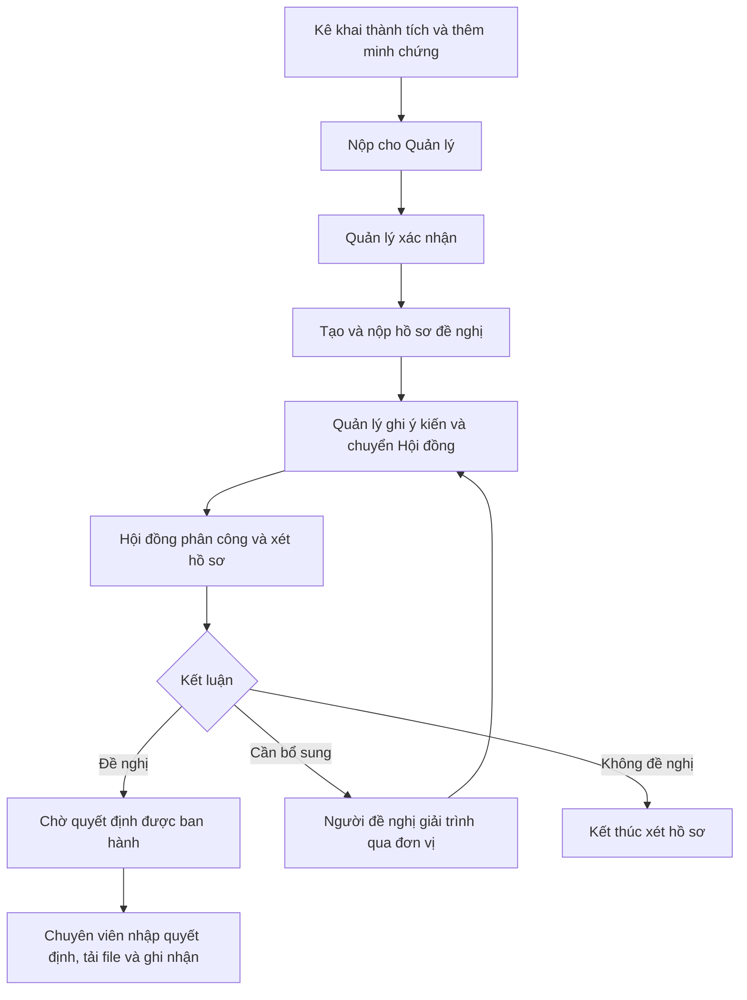
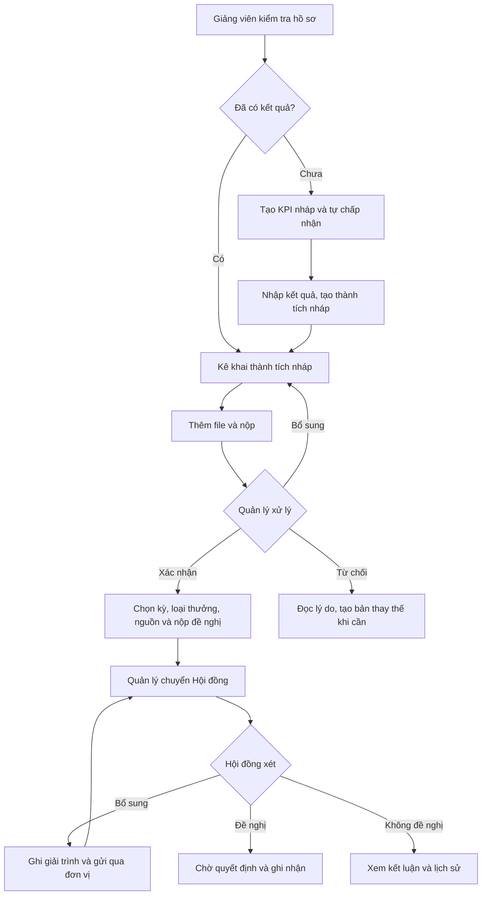
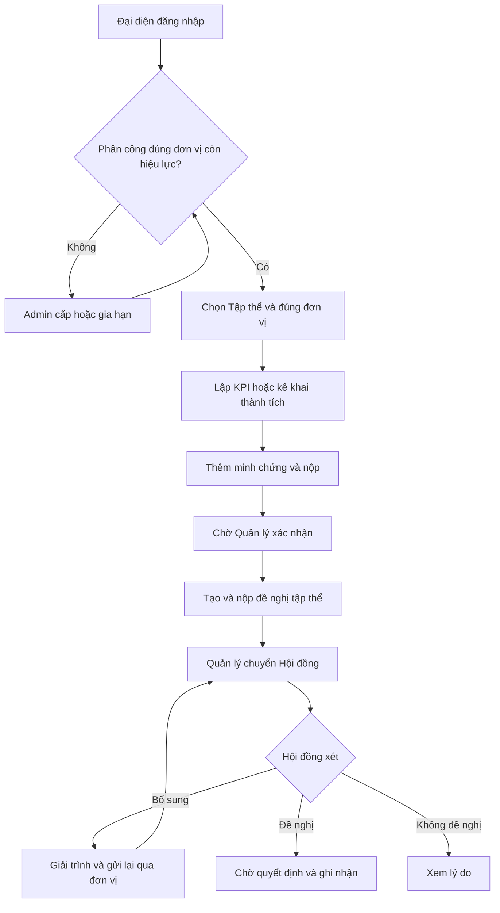
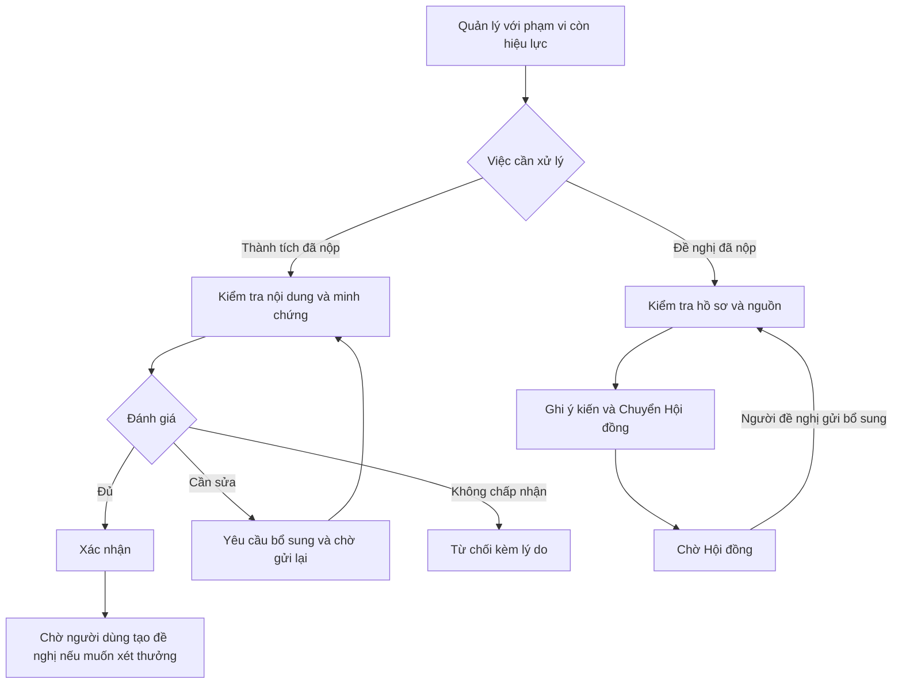
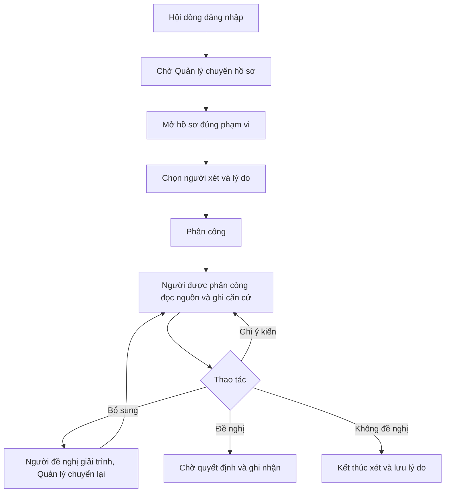
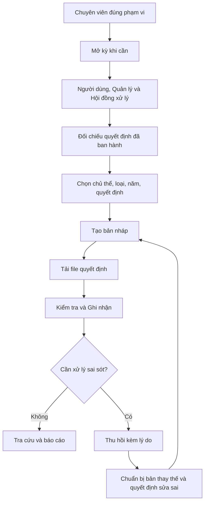
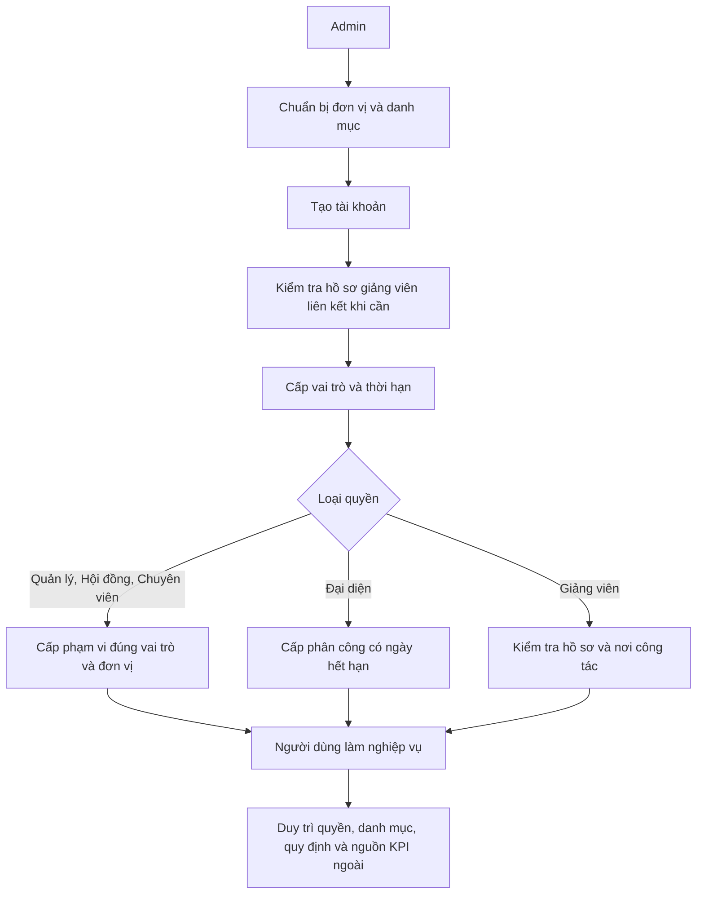

# Hướng dẫn sử dụng hệ thống theo vai trò

Đối chiếu giao diện và kiểm tra quyền trong code ngày 14/10/2026. Các tài khoản, file và dữ liệu SCN là MÔ PHỎNG.

## 1. Hiểu hệ thống trước khi dùng

Hệ thống quản lý hồ sơ năng lực của giảng viên/tập thể, thành tích và minh chứng, mục tiêu KPI, hồ sơ đề nghị khen thưởng, khen thưởng theo quyết định, quy định, đánh giá AI và báo cáo.

Có ba bước nghiệp vụ khác nhau:

| Đối tượng | Ý nghĩa | Người xử lý | Hoàn tất |
|---|---|---|---|
| Thành tích | Việc đã làm, kết quả đạt được và minh chứng | Người kê khai → Quản lý | VERIFIED: đã xác nhận |
| Hồ sơ đề nghị | Xin xét một loại thưởng trong một kỳ, dựa trên nguồn hợp lệ | Người đề nghị → Quản lý → Hội đồng | RECOMMENDED hoặc NOT_RECOMMENDED |
| Bản ghi khen thưởng | Lưu thưởng theo quyết định đã ban hành | Chuyên viên thi đua khen thưởng | RECORDED: đã ghi nhận |

Ví dụ: An có bài báo → bài báo được xác nhận → An xin xét Chiến sĩ thi đua cơ sở → Hội đồng đề nghị khen thưởng → khi có quyết định, chuyên viên ghi vào sổ. Xác nhận thành tích chưa đồng nghĩa được thưởng. Kết luận Hội đồng chưa đồng nghĩa đã có quyết định.

KPI là nhánh lập kế hoạch: mục tiêu → kết quả thực hiện → tạo thành tích nháp → thêm minh chứng → đi qua luồng xác nhận. KPI không thay thế hồ sơ thành tích.

## 2. Người mới bắt đầu thế nào?

1. Nhận tài khoản từ quản trị viên, đăng nhập bằng tên đăng nhập và mật khẩu.
2. Nhìn menu để biết chức năng được phép. Một tài khoản có thể có nhiều vai trò.
3. Nếu là giảng viên, mở Hồ sơ năng lực, kiểm tra thông tin, cập nhật điện thoại/chức danh/học vị khi cần.
4. Kê khai việc đã làm: vào Thành tích. Lập kế hoạch tương lai: vào Mục tiêu / KPI.
5. Xin xét thưởng: hoàn thành xác nhận nguồn rồi vào Hồ sơ đề nghị.
6. Xem trạng thái, lịch sử và chuông thông báo để biết đang chờ ai. Test vai trò khác thì đăng xuất rồi đăng nhập tài khoản tương ứng.

Đăng ký và Quên mật khẩu trên trang đăng nhập hiện chỉ mô phỏng, chưa tạo tài khoản/gửi email thật. Đổi mật khẩu thật nằm trong Hồ sơ năng lực: mật khẩu hiện tại, mật khẩu mới tối thiểu 8 ký tự, nhập lại mật khẩu mới. Đổi thành công thu hồi phiên cũ và yêu cầu đăng nhập lại. Tài khoản chỉ có Hội đồng/Chuyên viên/Admin chưa có trang đổi mật khẩu riêng trong menu hiện tại.

Giảng viên, đơn vị, loại thành tích/loại thưởng, người xét, quyết định, năm học và bản ghi liên quan chọn bằng tên; không phải nhớ ID. Mã kỳ, Mã KPI, Số quyết định, Mã đơn vị khi tạo mới là mã nghiệp vụ cần đặt/chép từ nguồn thực tế, nên vẫn nhập bằng chữ.

## 3. Các vai trò và phạm vi

| Vai trò | Nhiệm vụ chính | Tài khoản demo |
|---|---|---|
| Giảng viên — LECTURER | Hồ sơ, KPI, thành tích và đề nghị cá nhân | an.nv |
| Đại diện tập thể — UNIT_REPRESENTATIVE | KPI, thành tích và đề nghị của đơn vị được đại diện | cuong.lh, có thêm Giảng viên |
| Quản lý đơn vị — MANAGER | Xác nhận thành tích, chuyển đề nghị Hội đồng | bich.tt, có thêm Giảng viên |
| Hội đồng — COUNCIL | Phân công, nhận xét, yêu cầu bổ sung, kết luận đề nghị | council.demo |
| Chuyên viên thi đua khen thưởng — RECORDS_OFFICER | Mở kỳ, nhập quyết định, ghi nhận/thu hồi thưởng | records.demo |
| Quản trị viên — ADMIN | Tài khoản, vai trò, phạm vi, đại diện, tổ chức, danh mục | duc.pm |

Mật khẩu demo: demo1234 nếu chưa đổi. council.other dùng test Hội đồng chưa được phân công; linh.pharm ở Khoa Dược ngoài phạm vi của Bích; rep.expired hết hạn đại diện; locked.demo đã khóa.

Vai trò quyết định làm được việc gì; phạm vi quyết định làm cho đơn vị nào. Quản lý/Hội đồng/Chuyên viên cần phạm vi đúng vai trò và còn hiệu lực. Phạm vi khoa có thể gồm bộ môn con khi bật Bao gồm đơn vị con. Đại diện chỉ làm cho đúng đơn vị được phân công và còn thời hạn, không tự đại diện đơn vị con. Nơi công tác không tự tạo quyền quản lý.

Menu tài khoản nhiều vai trò là tổng các menu được phép. Từng thao tác vẫn kiểm tra chủ sở hữu, phạm vi, phân công và trạng thái. Không tự xét hồ sơ cá nhân/hồ sơ do mình nộp theo quy tắc chống tự duyệt. Admin không tự có quyền Quản lý/Hội đồng/Chuyên viên.

## 4. Giảng viên

### Quyền và công việc

Quản lý dữ liệu cá nhân: hồ sơ, KPI, thành tích/minh chứng, đề nghị, báo cáo và AI trong quyền. Không xác nhận thành tích của mình, không kết luận Hội đồng, không ghi thưởng vào sổ. Giảng viên đơn lẻ được xem báo cáo nhưng không xuất CSV.

### A. Kê khai thành tích

1. Thành tích → Kê khai Thành tích → Cá nhân → chọn loại thành tích phù hợp.
2. Điền tiêu đề rõ việc đạt được, tối thiểu 5 ký tự; mô tả; vai trò đóng góp nếu có; thời gian nếu có; năm ghi nhận; chọn năm học khi áp dụng. Ngày kết thúc không trước ngày bắt đầu.
3. Lưu nháp → mở chi tiết → Minh chứng → tên/ghi chú minh chứng → chọn file → tải lên. Hỗ trợ PDF, JPG/JPEG, PNG, DOCX, tối đa 10 MB/tệp, file phải đúng định dạng.
4. Có ít nhất một file → Nộp duyệt hồ sơ → SUBMITTED, chờ Quản lý.
5. NEED_CORRECTION: đọc lý do, sửa hồ sơ/file rồi gửi lại. VERIFIED: đã xác nhận, có thể dùng làm nguồn đề nghị.

Nháp sửa/xóa theo điều kiện hệ thống. Nháp/cần bổ sung/đã nộp có thể hủy theo quyền. Bản xác nhận không sửa trực tiếp. Bản từ chối/hủy/thu hồi có thể tạo bản thay thế và giữ lịch sử bản cũ.

### B. Tạo đề nghị cá nhân

Cần kỳ đang mở và trong thời gian nhận; ít nhất một nguồn hợp lệ của chính mình: thành tích VERIFIED và/hoặc thưởng RECORDED. File nguồn cần tồn tại để chụp dữ liệu lúc nộp.

| Trường | Cách điền/chọn |
|---|---|
| Chủ thể | Cá nhân của tôi |
| Giảng viên đề nghị | Tên mình, thường được điền sẵn khi chỉ có một lựa chọn |
| Kỳ đề nghị | Kỳ đang mở và còn thời gian; demo chọn kỳ SCN đang mở |
| Loại khen thưởng đề nghị | Loại đang xin xét; demo Chiến sĩ thi đua cơ sở |
| Mục đích đề nghị | Lý do cụ thể, tối thiểu 5 ký tự; demo SCN-MAIN — Đề nghị xét Chiến sĩ thi đua cơ sở cho Nguyễn Văn An |
| Thành tích đã xác nhận | Tìm tên rồi tích chọn; demo chọn SCN-A01 sau xác nhận |
| Khen thưởng đã ghi nhận nếu có | Chọn khi dùng làm căn cứ, không có thì để trống |

Tạo hồ sơ nháp → kiểm tra chi tiết → Nộp hồ sơ xét duyệt. Nháp chưa gửi cho đơn vị xử lý.

SUBMITTED chờ Quản lý → COUNCIL_PENDING chờ Hội đồng → UNDER_REVIEW đang xét → RECOMMENDED được đề nghị hoặc NOT_RECOMMENDED không đề nghị.

Hội đồng yêu cầu bổ sung: mở hồ sơ, đọc ý kiến, nhập giải trình ít nhất 5 ký tự → Gửi bổ sung qua đơn vị → chờ Quản lý chuyển lại. Giới hạn hiện tại: bước này gửi nội dung bằng chữ và đổi trạng thái; chưa có sửa bộ nguồn, đính kèm file bổ sung riêng hoặc tạo lại bản chụp nguồn trong giao diện. Không sửa một thành tích đã xác nhận để thay nguồn của đề nghị cũ.

### C. Lập KPI

Mục tiêu / KPI → Cá nhân → tạo mục tiêu: Mã KPI, Tên mục tiêu, Đơn vị đo, Bắt đầu kỳ, Kết thúc kỳ, Chỉ tiêu số lượng, Kế hoạch thực hiện, Căn cứ/Nguồn cung cấp.

Ví dụ SCN-KPI-AN-2026; Hoàn thành hai bài báo; đơn vị bài; chỉ tiêu 2; thời hạn đủ thực hiện; nguồn Kế hoạch công tác cá nhân năm 2026. Lưu nháp → kiểm tra → Chấp nhận. Người dùng tự chấp nhận kế hoạch, không chờ Quản lý duyệt KPI.

Có kết quả: nhập số lượng thực tế, nguồn kết quả, ghi chú minh chứng. Chọn loại thành tích khi tạo thành tích từ kết quả; chỉ tạo thành tích nháp, vẫn cần file và xác nhận. Nhập CSV/TSV/XLSX: chọn file → xem trước → sửa lỗi → nhập; dòng trùng được bỏ qua, dòng sai/xung đột phải xử lý.

Gợi ý AI: chọn lần đánh giá, xem gợi ý, kiểm tra mục tiêu/chỉ tiêu/thời hạn/kế hoạch, chấp nhận/từ chối. Gợi ý hợp lệ được chấp nhận tạo KPI ACCEPTED; nguồn mô phỏng/chưa đủ điều kiện có thể bị chặn ở bước này.

## 5. Đại diện tập thể

Làm KPI, thành tích và đề nghị cho đúng đơn vị được đại diện. Cần vai trò và phân công còn hiệu lực, có ngày kết thúc. Không chỉ dựa vào nơi công tác.

Demo cuong.lh công tác tại Bộ môn Khoa học Máy tính nhưng đại diện Bộ môn Kỹ thuật Phần mềm. Kê khai tập thể chọn Bộ môn Kỹ thuật Phần mềm; kê khai cá nhân cho Cường dùng nhánh Cá nhân nhờ vai trò Giảng viên đi kèm.

1. Kiểm tra đơn vị có thể chọn. Không thấy đơn vị cần làm: nhờ Admin kiểm tra phân công/thời hạn.
2. KPI: chọn Tập thể và đơn vị đại diện → lập/chấp nhận kế hoạch → nhập kết quả như cá nhân.
3. Thành tích: chọn Tập thể, đơn vị, loại áp dụng tập thể, tiêu đề/mô tả/thời gian/năm → lưu nháp → tải minh chứng → nộp.
4. Chờ Quản lý xác nhận; cần bổ sung thì sửa và nộp lại.
5. Hồ sơ đề nghị: Tập thể tôi đại diện → đơn vị → kỳ mở → loại thưởng tập thể, ví dụ Tập thể lao động xuất sắc → mục đích → nguồn hợp lệ của đúng đơn vị.
6. Tạo nháp → nộp → chờ Quản lý/Hội đồng. Nếu cần bổ sung, ghi giải trình và gửi lại qua đơn vị.
7. Tổ chức: xem hồ sơ đơn vị trong quyền; Báo cáo: xem/xuất CSV dữ liệu được phép.

Đại diện không tự xác nhận, không tự kết luận Hội đồng, không tự ghi thưởng. Hết hạn phân công sẽ mất quyền đại diện; hồ sơ/lịch sử cũ được giữ.

## 6. Quản lý đơn vị

Hai công việc riêng: xác nhận thành tích và chuyển đề nghị tới Hội đồng. Cần vai trò cùng phạm vi còn hiệu lực. Demo Bích quản lý Khoa Công nghệ Thông tin gồm hai bộ môn; không quản lý Khoa Dược.

### A. Xác nhận thành tích

Chờ người kê khai nộp → Thành tích → Hàng chờ thẩm định → lọc/tìm hồ sơ → đọc chủ thể, nội dung, năm, đóng góp, file và lịch sử.

- Đủ căn cứ: Xác nhận → VERIFIED.
- Cần sửa: Yêu cầu bổ sung, ghi rõ thiếu gì → NEED_CORRECTION, chờ gửi lại.
- Không chấp nhận: Từ chối, ghi lý do → REJECTED.
- Bản xác nhận có sai sót: Thu hồi xác nhận kèm lý do → REVOKED, giữ lịch sử.

### B. Chuyển đề nghị

Chờ người dùng nộp đề nghị; xác nhận thành tích không tự tạo đề nghị. Vào Hồ sơ đề nghị → Tất cả đơn vị trong phạm vi hoặc lọc Bộ môn Kỹ thuật Phần mềm → mở SUBMITTED → kiểm tra kỳ/loại/nguồn/bản chụp → nhập Ý kiến đơn vị → Chuyển Hội đồng → COUNCIL_PENDING.

Ví dụ ý kiến: Đơn vị đã đối chiếu hồ sơ và đề nghị Hội đồng xem xét. Vòng bổ sung: chờ người đề nghị gửi lại về SUBMITTED, kiểm tra giải trình rồi chuyển Hội đồng lại.

Quản lý không kết luận Hội đồng hoặc ghi sổ nếu không có vai trò tương ứng. Bích có thêm Giảng viên nên kê khai cá nhân được, nhưng không tự duyệt/chuyển hồ sơ của mình. Có thể xem/xuất báo cáo, hồ sơ đơn vị, AI trong phạm vi. Kho quy định cho thêm văn bản/phiên bản, nhưng Quản lý đơn lẻ không có quyền xác nhận áp dụng.

## 7. Hội đồng xét duyệt

Tài khoản chỉ có Hội đồng bắt đầu ở Hồ sơ đề nghị; hiện chỉ có trang đó trong menu. Không xác nhận thành tích thay Quản lý hoặc ghi thưởng thay Chuyên viên.

Cần vai trò, phạm vi đúng đơn vị, còn hiệu lực. Ghi ý kiến/yêu cầu bổ sung/kết luận cần được phân công trên chính hồ sơ. Cùng phạm vi không đồng nghĩa được xét mọi hồ sơ.

1. Chờ Quản lý chuyển COUNCIL_PENDING → mở Hồ sơ đề nghị → chọn phạm vi/đơn vị → mở hồ sơ.
2. Đọc nguồn, bản chụp lúc nộp, ý kiến đơn vị và lịch sử.
3. Chọn Thành viên Hội đồng được phân công bằng tên. Demo chọn council.demo để tự test, hợp lệ khi không là chủ thể/người nộp và đúng phạm vi.
4. Nhập lý do ít nhất 5 ký tự → Phân công → UNDER_REVIEW. Người đã phân công được đánh dấu, không chọn trùng.
5. Người được phân công nhập căn cứ ít nhất 5 ký tự rồi chọn Ghi ý kiến, Yêu cầu bổ sung, Đề nghị khen thưởng hoặc Không đề nghị.
6. Yêu cầu bổ sung → NEED_CORRECTION, chờ người đề nghị giải trình và Quản lý chuyển lại. Phân công cũ vẫn giữ, người xét cũ tiếp tục; hoặc phân công người khác chưa có phân công. Không phân công trùng người cũ.
7. Đề nghị → RECOMMENDED; Không đề nghị → NOT_RECOMMENDED, lưu lý do.

Hiện chưa có giao diện phiên họp/biểu quyết/quy tắc đa số. Kết luận không tự sinh quyết định hoặc bản ghi thưởng.

## 8. Chuyên viên thi đua khen thưởng

Cần vai trò và phạm vi còn hiệu lực. Mở kỳ nhận đề nghị và ghi sổ theo quyết định. Không xác nhận thành tích hoặc kết luận Hội đồng thay các vai trò đó.

### A. Mở kỳ

Hồ sơ đề nghị → Mở kỳ đề nghị → Mã kỳ mới, Tên kỳ, Bắt đầu, Kết thúc → Mở kỳ. Người dùng chọn kỳ mở/còn thời gian để tạo/nộp. Hiện chưa có nút sửa/đóng kỳ riêng.

### B. Ghi thưởng

Thực tế cần quyết định đã ban hành và file. Demo dùng quyết định/file MÔ PHỎNG.

1. Khen thưởng → chọn Cá nhân/Tập thể → chọn người/đơn vị nhận.
2. Chọn Loại khen thưởng, Năm ghi nhận đúng quyết định.
3. Quyết định khen thưởng: chọn quyết định có sẵn nếu đúng; hoặc Nhập quyết định mới → Số quyết định, Ngày, Cơ quan ban hành, Tiêu đề.
4. Thành tích liên quan nếu có: tìm và tích nguồn đúng chủ thể; có thể để trống. Trang này cho liên kết lịch sử nên không xem việc chọn được một thành tích là chứng minh nó đã xác nhận.
5. Bản đã thu hồi cần thay thế: không thay thế bản ghi nào khi ghi mới bình thường.
6. Tạo bản nháp → DRAFT → mở chi tiết → chọn file → Tải file quyết định.
7. Kiểm tra → Ghi nhận khen thưởng → RECORDED, lưu người/ngày ghi nhận và lịch sử.

Ví dụ An: Cá nhân → Nguyễn Văn An → Chiến sĩ thi đua cơ sở → 2026 → Nhập quyết định mới → SCN-MAIN-2026-DEMO → ngày test → Đơn vị mô phỏng PTUD → tiêu đề có MÔ PHỎNG → A01 → không thay thế → tạo nháp → tải decision-demo.pdf → ghi nhận.

Hệ thống hiện chưa tự chuyển RECOMMENDED thành bản ghi thưởng và chưa bắt buộc liên kết trực tiếp một đề nghị khi tạo bản ghi. Chuyên viên phải đối chiếu và chọn đúng chủ thể, loại, nguồn, quyết định.

### C. Thu hồi/sửa sai

Mở RECORDED → lý do → Thu hồi → REVOKED. Chuẩn bị bản thay thế → kiểm tra thông tin được điền → nhập quyết định sửa sai mới → tạo nháp → tải file → ghi nhận. Giữ bản cũ/lịch sử. Không sửa trực tiếp bản đã ghi nhận. Một quyết định có thể dùng cho nhiều người; đã có bản ghi được ghi nhận thì không thay file như quyết định nháp.

## 9. Quản trị viên

Admin chuẩn bị tài khoản/dữ liệu nền để các vai trò nghiệp vụ làm việc; không phải tham gia từng lần kê khai/xét/ghi thưởng khi cấu hình đã đúng.

1. Tổ chức: tạo đơn vị bằng mã nghiệp vụ, tên, loại, chọn đơn vị cha, mô tả. Chuyển công tác: chọn giảng viên, đơn vị mới, thời điểm hiệu lực; giữ lịch sử.
2. Quản trị → Tài khoản: tên đăng nhập, email, tên hiển thị, mật khẩu ban đầu ít nhất 10 ký tự → lưu. Sửa thông tin/trạng thái hoạt động/khóa khi cần.
3. Vai trò tài khoản: chọn tài khoản, vai trò, hiệu lực từ/đến.
4. Quản lý/Hội đồng/Chuyên viên: Phạm vi quản lý → tài khoản, đúng vai trò, đơn vị, Bao gồm đơn vị con nếu cần, thời hạn nằm trong thời hạn vai trò.
5. Đại diện: Đại diện có hạn → tài khoản có vai trò đại diện, đơn vị, ngày bắt đầu và ngày kết thúc bắt buộc. Đây khác phạm vi quản lý.
6. Năm học: mã/tên, ngày bắt đầu/kết thúc, năm hiện tại, hoạt động.
7. Loại thành tích: mã/tên/mô tả, áp dụng cá nhân/tập thể/cả hai, hoạt động.
8. Loại thưởng: mã/tên/mô tả, nhóm Danh hiệu/Hình thức, cấp, đối tượng, hoạt động.
9. Kho quy định: thêm văn bản và phiên bản, xem trích đoạn/tiêu chí, xác nhận/bỏ xác nhận theo quyền. Hiện chưa có form đầy đủ tạo/sửa trích đoạn, quy tắc tiêu chí hay mọi trạng thái nguồn; cần công cụ dữ liệu/API hiện có để chuẩn bị các phần đó.
10. Mục tiêu / KPI của Admin: nguồn KPI ngoài, ánh xạ mã nhân viên nguồn sang giảng viên bằng tên, đồng bộ, xem lỗi/xung đột. Mã nhân viên bên ngoài nhập đúng hệ thống nguồn. Đồng bộ không tự xác nhận thành tích.

Giới hạn tạo tài khoản: form Tài khoản chưa có tạo hồ sơ giảng viên và liên kết tài khoản ngay trong form. Nhánh cá nhân cần hồ sơ giảng viên liên kết và dữ liệu nơi công tác; cấp vai trò Giảng viên không tự tạo đủ hồ sơ. Demo đã có liên kết cần thiết.

Người dùng thiếu quyền: kiểm tra tài khoản hoạt động → vai trò hiệu lực → phạm vi/phân công đúng đơn vị → trạng thái hồ sơ → phân công người xét → quy tắc chống tự duyệt. Menu xuất hiện không đảm bảo thao tác mọi dữ liệu.

## 10. Chức năng đúng với từng trang hiện có

Các vai trò trong bảng là quyền mở trang; dữ liệu/hành động bên trong vẫn có giới hạn riêng.

| Trang | Vai trò mở được | Chức năng và cách bắt đầu |
|---|---|---|
| Trang chủ | Giảng viên, Đại diện, Quản lý, Chuyên viên, Admin | Tổng quan/lối vào nhanh; một số chỉ số, lịch, gợi ý đang minh họa. Dùng trang nghiệp vụ kiểm tra trạng thái thật. |
| Hồ sơ năng lực | Giảng viên, Đại diện, Quản lý | Hồ sơ giảng viên chính tài khoản; lịch sử công tác, thành tích/danh hiệu/minh chứng; sửa điện thoại/chức danh/học vị, đổi mật khẩu. Cần hồ sơ liên kết. |
| Thành tích | Giảng viên, Đại diện, Quản lý, Chuyên viên, Admin | Tìm/lọc, kê khai, minh chứng, lịch sử, nộp/duyệt/thu hồi/thay thế tùy quyền và trạng thái. Chuyên viên không xác nhận chỉ vì có menu. |
| Mục tiêu / KPI | Giảng viên, Đại diện, Admin | Cá nhân/tập thể: lập/nhập mục tiêu, chấp nhận, kết quả, tạo thành tích nháp, gợi ý AI, dữ liệu ngoài được phép. Admin đơn lẻ quản trị nguồn/ánh xạ/đồng bộ. Quản lý đơn lẻ không có trang này. |
| Hồ sơ đề nghị | Giảng viên, Đại diện, Quản lý, Hội đồng, Chuyên viên | Người đề nghị tạo/nộp; Quản lý chuyển; Hội đồng phân công/xét; Chuyên viên mở kỳ/tra cứu. Admin đơn lẻ không có menu. |
| Khen thưởng | Chuyên viên | Chọn chủ thể/loại/năm/quyết định; nháp, tải file, ghi nhận, thu hồi/thay thế, lịch sử. |
| Kho quy định | Giảng viên, Đại diện, Quản lý, Chuyên viên, Admin | Văn bản, phiên bản, trích đoạn, tiêu chí; Quản lý/Admin thêm văn bản/phiên bản; Admin xác nhận trên UI. Hội đồng đơn lẻ chưa có menu dù API có một số quyền quy định. |
| Phân tích & Thẩm định AI | Giảng viên, Đại diện, Quản lý, Chuyên viên, Admin | Chọn chủ thể có quyền, phân tích/đánh giá, tiêu chí/căn cứ/lịch sử khi được phép. Chuyên viên đơn lẻ có menu nhưng có thể không có chủ thể hợp lệ. |
| Báo cáo / CSV | Giảng viên, Đại diện, Quản lý, Chuyên viên, Admin | Lọc năm học/năm/đơn vị/loại/chủ thể/trạng thái, áp dụng, xem thống kê/bảng. Đại diện/Quản lý/Chuyên viên/Admin xuất CSV trong quyền; Giảng viên đơn lẻ chỉ xem. |
| Tổ chức | Giảng viên, Đại diện, Quản lý, Chuyên viên, Admin | Cây/danh sách đơn vị. Chi tiết hồ sơ đơn vị cần Admin hoặc phân công/phạm vi hợp lệ; Giảng viên đơn lẻ không tự có quyền chi tiết. Admin quản lý đơn vị, đại diện, chuyển công tác. |
| Quản trị | Admin | Tài khoản, vai trò, phạm vi, đại diện có hạn, năm học, loại thành tích, loại thưởng. |
| Thông báo qua chuông | Theo tài khoản đăng nhập | Đọc và tới hồ sơ liên quan khi có quyền; không phải bước duyệt riêng. |

### AI

Chọn Cá nhân/Tập thể → chọn chủ thể được phép → chọn tiêu chí khi thẩm định → đánh giá → đọc kết quả, nguồn, dữ liệu thiếu, mô phỏng/xác nhận và lịch sử. Không coi mọi kết quả là phản hồi của mô hình thật. AI không tự xác nhận thành tích, kết luận Hội đồng, ban hành quyết định hay ghi thưởng. Nguồn mô phỏng/chưa xác nhận không là quy định thật của trường; dữ liệu thay đổi có thể khiến kết quả cũ không còn phù hợp. Gợi ý KPI cần kiểm tra và chấp nhận theo điều kiện nguồn.

### Báo cáo

Chọn bộ lọc bằng tên → áp dụng → xem bản ghi/trạng thái/thống kê → xuất khi có quyền. Thành tích VERIFIED và thưởng RECORDED mới là bản hợp lệ tương ứng; nháp/từ chối/thu hồi không được cộng như bản hợp lệ. Báo cáo không tự quyết định ai được thưởng.

## 11. Trạng thái cho biết đang chờ ai

| Nhóm | Trạng thái | Tiếp theo |
|---|---|---|
| Thành tích | DRAFT | Người kê khai thêm file/kiểm tra/nộp |
| Thành tích | SUBMITTED | Quản lý xác nhận/bổ sung/từ chối |
| Thành tích | NEED_CORRECTION | Người kê khai sửa hồ sơ/file và nộp lại |
| Thành tích | VERIFIED | Đã xác nhận, có thể chọn làm nguồn |
| Thành tích | REJECTED/CANCELLED/REVOKED | Đọc lý do, tạo bản thay thế khi cần |
| Đề nghị | DRAFT | Người đề nghị kiểm tra/nộp |
| Đề nghị | SUBMITTED | Quản lý ghi ý kiến/chuyển Hội đồng |
| Đề nghị | COUNCIL_PENDING | Hội đồng phân công; đã có phân công từ vòng trước thì người xét tiếp tục |
| Đề nghị | UNDER_REVIEW | Người được phân công xét |
| Đề nghị | NEED_CORRECTION | Người đề nghị giải trình, gửi qua đơn vị, Quản lý chuyển lại |
| Đề nghị | RECOMMENDED | Đã đề nghị, chờ ban hành quyết định và ghi sổ |
| Đề nghị | NOT_RECOMMENDED | Đã kết luận không đề nghị |
| Khen thưởng | DRAFT | Chuyên viên tải file và ghi nhận |
| Khen thưởng | RECORDED | Đã vào sổ, tra cứu/báo cáo |
| Khen thưởng | REVOKED | Đã thu hồi, tạo bản thay thế nếu có quyết định sửa sai |
| KPI | DRAFT | Chủ mục tiêu kiểm tra/chấp nhận kế hoạch |
| KPI | ACCEPTED | Thực hiện, nhập kết quả, tạo thành tích nháp khi cần |

## 12. Lượt thực hành dễ hiểu

Không reset seed khi đang thực hành. Đã xong một bước thì kiểm tra trạng thái và tiếp tục từ đó.

| Bước | Tài khoản | Thao tác | Kết quả |
|---|---|---|---|
| 1 | an.nv | Thành tích A01: thêm minh chứng và nộp nếu còn nháp | SUBMITTED |
| 2 | bich.tt | Hàng chờ thẩm định: xác nhận A01 | VERIFIED |
| 3 | an.nv | Đề nghị: kỳ SCN mở, Chiến sĩ thi đua cơ sở, nguồn A01, mục đích SCN-MAIN; tạo nháp và nộp | SUBMITTED |
| 4 | bich.tt | Đề nghị Bộ môn Kỹ thuật Phần mềm: ý kiến, Chuyển Hội đồng | COUNCIL_PENDING |
| 5 | council.demo | Chọn người xét council.demo, lý do, Phân công | UNDER_REVIEW |
| 6 | council.demo | Căn cứ, Đề nghị khen thưởng | RECOMMENDED |
| 7 | records.demo | Khen thưởng: An, loại/năm đúng, quyết định SCN-MAIN mới, A01; tạo nháp | DRAFT |
| 8 | records.demo | Mở nháp, tải decision-demo.pdf, Ghi nhận | RECORDED |
| 9 | an.nv / records.demo | Hồ sơ năng lực/Báo cáo theo quyền | Dữ liệu và trạng thái tương ứng |

Sau luồng chính test: thành tích bổ sung/từ chối/thu hồi/thay thế; đề nghị bổ sung/không đề nghị; thưởng thu hồi/thay thế; KPI nhập file/kết quả/chuyển thành tích; tập thể; ngoài phạm vi/hết hạn/chưa phân công.

Xem [Kịch bản đầy đủ và fixture](testing/scenario/README.md). File mô phỏng trong docs/testing/scenario/fixtures/.

## 13. Khi không thấy hồ sơ/nút/lựa chọn

- Quản lý không thấy đề nghị: đã nộp hay chỉ lưu nháp? Chọn Tất cả đơn vị trong phạm vi/đúng đơn vị; Làm mới khi người khác vừa xử lý.
- Không chọn được nguồn đề nghị: đúng chủ thể, VERIFIED/RECORDED và đủ file chưa?
- Hội đồng không kết luận được: đã phân công tài khoản hiện tại? Đúng trạng thái? Ý kiến ít nhất 5 ký tự?
- Không thấy đơn vị tập thể: vai trò và phân công đúng đơn vị còn hiệu lực?
- Không ghi thưởng được: đã tải file quyết định thành công chưa?
- Admin không có nút nghiệp vụ: cần vai trò/phạm vi nghiệp vụ tương ứng.
- Sai phiên bản: người khác đã xử lý sau khi mở; làm mới, đọc trạng thái rồi chọn thao tác phù hợp.

## 14. Căn cứ trong code

Menu: frontend/src/routes/AppRoutes.jsx, frontend/src/components/common/Sidebar.jsx. Biểu mẫu: frontend/src/pages/ và các component KPI. Quyền/trạng thái: backend/src/modules/achievements/, awards/, kpi/, reports/, regulations/, organizations/, admin/; backend/src/middlewares/requireUnitRead.js.

Xem [Tài khoản, vai trò và phạm vi](requirements/ACCOUNT_ROLES_AND_SCOPES.md).
