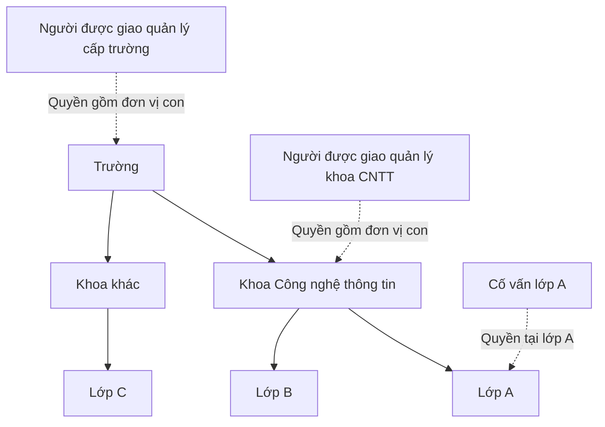
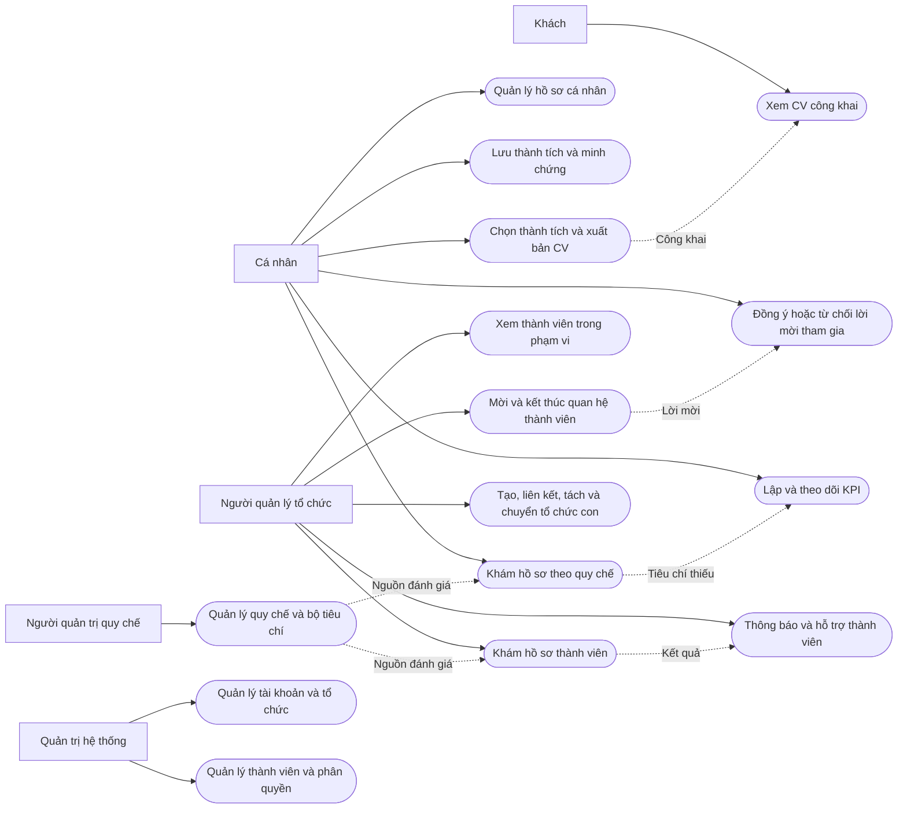
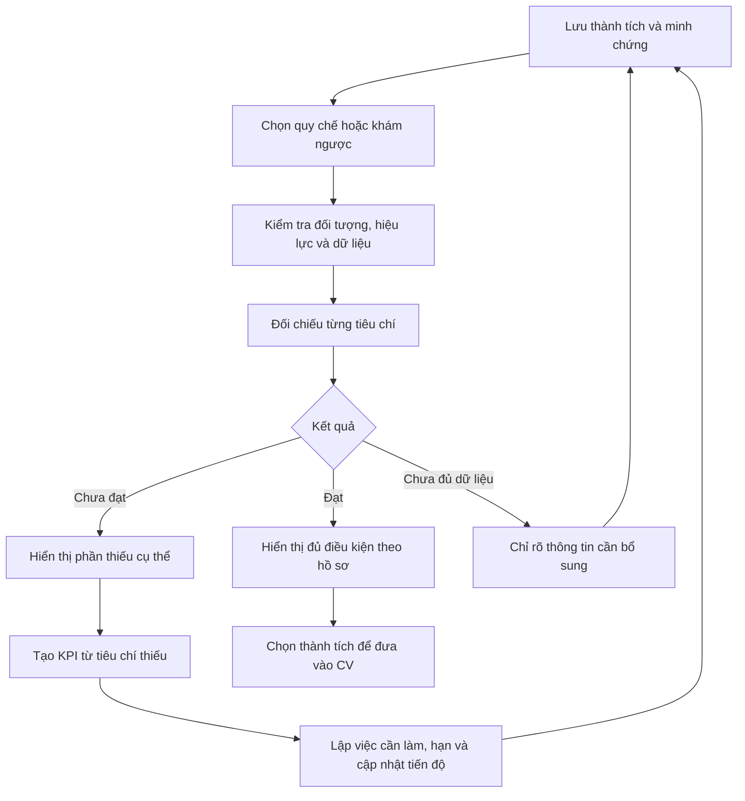
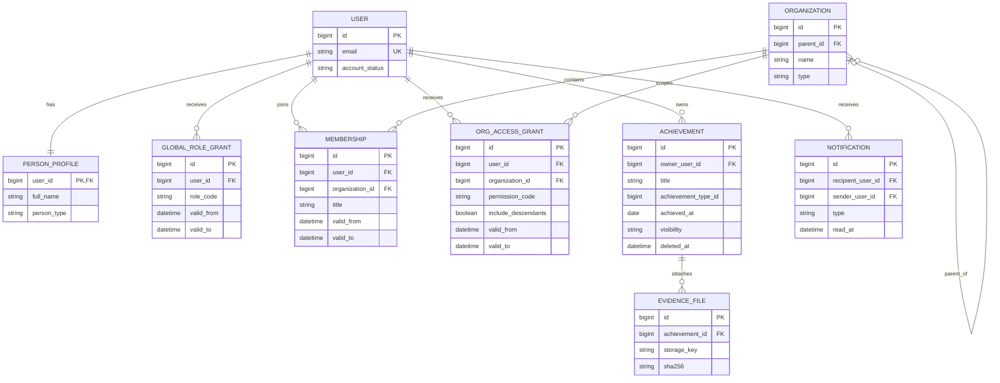
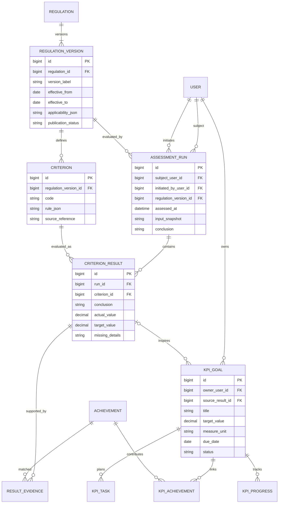
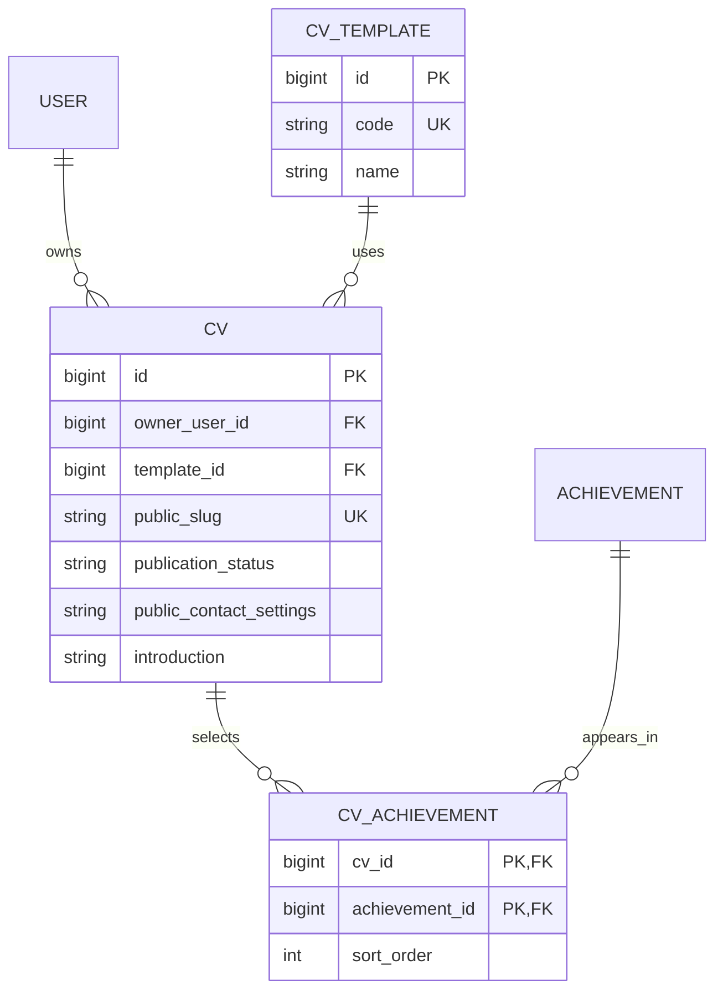

# Kho thành tích cá nhân — Use case và ERD tổng quát V2

Ngày: 15/11/2026. Trạng thái: schema, API runtime và giao diện đã chuyển sang nền V2. Các sơ đồ và use case mô tả cả mục tiêu nghiệp vụ; không mặc định mọi chi tiết đều đã hoàn thiện hoặc nghiệm thu.

Schema: [migration V2](../../database/sqlserver/migrations/001_v2_schema.sql), [ràng buộc liên dòng](../../database/sqlserver/migrations/002_v2_integrity.sql). Đã áp dụng 2 migration: 33 bảng nghiệp vụ, 71 FK, 80 CHECK, 11 trigger. Baseline được tạo rỗng, không có seed/import tự động. Đã kiểm tra 13 ràng buộc schema và các luồng identity/intelligence/API trên SQL Server với dữ liệu kiểm thử rollback; tình trạng dữ liệu hiện tại cần kiểm tra trực tiếp.

Tài liệu này mô tả hướng mới theo trao đổi với người dùng: tự lưu thành tích, khám hồ sơ theo quy chế, lập KPI từ phần còn thiếu, tạo CV và hỗ trợ thành viên trong cây tổ chức. Tài liệu Markdown xét duyệt cũ đã được dọn; các tài sản lịch sử còn giữ không thay thế phạm vi V2.

## 1. Phạm vi và nguyên tắc

- Cá nhân đăng thành tích và minh chứng vào kho riêng; không có bước nộp, duyệt, từ chối hay Hội đồng.
- Cá nhân không thuộc tổ chức vẫn dùng đầy đủ kho, khám hồ sơ, KPI và CV.
- Một cá nhân có thể thuộc nhiều tổ chức theo từng thời gian; đây là đề xuất để hỗ trợ chuyển lớp, kiêm nhiệm và nhiều đơn vị.
- Tổ chức có quan hệ cha–con: trường → khoa → lớp, hoặc trường → khoa → bộ môn. Mỗi tổ chức có tối đa một cha; không tạo chu trình.
- Người có quyền quản lý được xem kết quả và hỗ trợ thành viên trong phạm vi được phân công. Quyền xem kết quả không tự động cho phép đọc toàn bộ tệp minh chứng riêng tư.
- Kết quả khám là mức đáp ứng theo dữ liệu đã khai và phiên bản quy chế, không phải quyết định công nhận danh hiệu.
- Quy tắc cụ thể quyết định đạt/chưa đạt; AI hỗ trợ trích xuất, giải thích và đề xuất kế hoạch. Không để AI tự suy đoán điều kiện pháp quy.
- SQL Server tiếp tục là hệ quản trị đích.

## 2. Tác nhân và quyền

| Tác nhân | Khả năng |
| --- | --- |
| Khách | Xem CV đã được chủ sở hữu công khai qua đường dẫn. |
| Cá nhân | Quản lý hồ sơ, kho và minh chứng; khám hồ sơ; quản lý KPI; soạn và công khai CV. |
| Người quản lý tổ chức | Có mọi quyền cá nhân; xem và khám thành viên trong phạm vi; gửi thông báo hỗ trợ. |
| Người quản trị quy chế | Quản lý nguồn quy chế, phiên bản, đối tượng áp dụng và bộ tiêu chí có thể đánh giá. |
| Quản trị hệ thống | Quản lý tài khoản, cây tổ chức, thành viên và phân quyền. |

“Người dùng tự do” và “người thuộc tổ chức” là hai trạng thái quan hệ thành viên, không cần hai role tài khoản. “Sinh viên”, “giảng viên”, “cố vấn học tập”, “trưởng bộ môn” là loại hồ sơ/chức danh; quyền được cấp riêng theo tổ chức.

Quyền tổ chức: `MEMBERS_VIEW`, `ASSESSMENTS_VIEW`, `ASSESSMENTS_RUN`, `MEMBERS_NOTIFY`, `MEMBERS_MANAGE`, `STRUCTURE_MANAGE`, `ACCESS_MANAGE`. `MEMBERS_MANAGE` quản lý thành viên; `STRUCTURE_MANAGE` quản lý cơ cấu; `ACCESS_MANAGE` cấp/thu hồi quyền trong phạm vi được phép. Mỗi phân công có thời hạn và cờ áp dụng cho tổ chức con. Vai trò quy chế và quản trị hệ thống là quyền toàn hệ thống, tách khỏi phân công tổ chức.

### 2.1. Người quản lý ở tổ chức cấp trên

Tổ chức thuộc tổ chức được biểu diễn bằng cây `ORGANIZATION.parent_id`. Người ở cấp trên sử dụng cùng nhóm use case quản lý, nhưng phạm vi là tổ chức được giao và các tổ chức con nếu phân công có `include_descendants = true`. Không cần tạo một role mới cho mỗi tầng của cây.

| Phân công | Phạm vi khám hồ sơ thành viên |
| --- | --- |
| Cố vấn lớp A | Thành viên lớp A. |
| Người quản lý khoa CNTT, gồm đơn vị con | Thành viên trực tiếp của khoa và thành viên lớp A, lớp B; không gồm khoa khác/lớp C. |
| Người quản lý trường, gồm đơn vị con | Thành viên trực tiếp của trường và thành viên các khoa, lớp trực thuộc trường. |
| Người có quyền ở khoa nhưng không gồm đơn vị con | Chỉ thành viên trực tiếp của khoa, không tự bao gồm các lớp. |
| Người chỉ là thành viên trường/khoa | Không tự có quyền khám hồ sơ người khác. |

Ví dụ người quản lý khoa chọn “Sinh viên 5 tốt”, chọn toàn khoa hoặc riêng lớp A rồi quét. Kết quả có thể gom theo lớp để thấy ai đạt, ai thiếu gì; mở từng người để xem chi tiết được phép và gửi thông báo. Người quản lý trường thực hiện tương tự với toàn trường, từng khoa hoặc từng lớp trong phạm vi. Khi có nhiều loại người dùng, phải lọc đối tượng áp dụng trước khi đánh giá.

Quy tắc thực thi:

- Quyền khám, xem kết quả, gửi thông báo và quản lý thành viên là các quyền độc lập. Có quyền khám toàn khoa không đồng nghĩa có quyền sửa thành tích hoặc cấp quyền cho người khác.
- Chỉ mở rộng xuống các tổ chức hậu duệ của tổ chức được giao; không mở rộng lên cha hoặc sang tổ chức cùng cấp.
- Không cần gán lặp người dùng vào cả lớp, khoa và trường để cấp trên tìm thấy họ. Truy vấn phạm vi dựa trên cây tổ chức và quan hệ thành viên còn hiệu lực.
- Khi một người thuộc nhiều đơn vị trong phạm vi, danh sách và số lượng toàn phạm vi phải khử trùng theo người. Báo cáo theo từng đơn vị cần ghi rõ một người có thể xuất hiện ở nhiều nhóm.
- Mỗi API kiểm tra phạm vi ở backend, kể cả khi người dùng truyền ID lớp con hoặc ID thành viên trực tiếp. Không dựa vào lựa chọn đã lọc trên giao diện.
- Các quyền phân công khác nhau được hợp theo phạm vi còn hiệu lực; không suy diễn quyền chỉ từ chức danh hoặc việc đang làm ở cấp trường.
- Đề xuất MVP: người quản lý cấp trên có thể gửi trực tiếp cho thành viên thuộc phạm vi nếu có `MEMBERS_NOTIFY`; thêm chức năng phối hợp/giao việc cho quản lý cấp dưới ở giai đoạn sau nếu cần.
- Đây là khám hồ sơ từng cá nhân bên trong cây tổ chức. Khám thành tích của chính tập thể lớp/khoa/trường là use case riêng, chưa đưa vào MVP kho cá nhân.

### 2.2. Thêm/bỏ thành viên và quản lý tổ chức con

**Đã được người dùng đồng ý cập nhật vào thiết kế ngày 15/11/2026.** Schema và API V2 hỗ trợ phân quyền, phản hồi lời mời và cập nhật cơ cấu; cần tiếp tục nghiệm thu các tình huống thực tế.

| Thao tác | Người được thực hiện | Điều kiện/kết quả |
| --- | --- | --- |
| Thêm/mời hoặc bỏ thành viên | Người có `MEMBERS_MANAGE` tại tổ chức đích | Tài khoản đã tồn tại nhận lời mời và đồng ý trước khi quan hệ thành viên có hiệu lực. |
| Tạo tổ chức con mới | Người có `STRUCTURE_MANAGE` tại tổ chức cha | Tạo liên kết cha–con và chỉ định người quản lý ban đầu của tổ chức con. |
| Gắn tổ chức đã tồn tại làm tổ chức con | Người có `STRUCTURE_MANAGE` tại cha gửi yêu cầu; người có quyền tương ứng tại con đồng ý | Chỉ cập nhật cây khi hai phía thống nhất và kiểm tra không tạo chu trình. |
| Tách tổ chức con khỏi cha | Người có `STRUCTURE_MANAGE` tại cha hoặc tại con | Kết thúc liên kết cha–con; giữ tổ chức con và các thành viên. |
| Chuyển tổ chức con sang cha khác | Người có `STRUCTURE_MANAGE` tại con và cha mới thống nhất | Thay liên kết cha trong một thao tác nhất quán; tối đa một cha, không tạo chu trình. |
| Thiết lập ban đầu, xử lý sai sót, khôi phục | Quản trị hệ thống | Có nhật ký thay đổi và lý do can thiệp. |

Ví dụ phân công: **trường tạo khoa → chỉ định người quản lý khoa → khoa tạo lớp → chỉ định cố vấn → cố vấn mời/thêm sinh viên**. Các thao tác thường ngày do người được giao quyền tại tổ chức thực hiện, không bắt buộc qua quản trị hệ thống.

Quy tắc đi kèm:

- Quyền khám hồ sơ, quản lý thành viên, quản lý cơ cấu và cấp quyền tách riêng. Chuyên viên có thể chỉ được khám; cố vấn có thể được cả khám và quản lý thành viên.
- Với tài khoản đã tồn tại, lời mời chưa được đồng ý không tạo thành viên đang hoạt động và không mở quyền xem hồ sơ cho tổ chức. Luồng nhập danh sách chính thức của nhà trường là khả năng mở rộng riêng, chưa mặc định thay thế bước đồng ý trong MVP.
- Bỏ thành viên là kết thúc quan hệ thành viên và ghi thời điểm kết thúc; thành tích, KPI, CV và tài khoản vẫn thuộc cá nhân. Cập nhật quyền truy cập dựa trên quan hệ đó; các phân công quyền quản lý độc lập phải được kiểm tra/thu hồi riêng, không suy diễn từ việc bỏ thành viên.
- Tách hoặc chuyển tổ chức con không xóa tổ chức, các tổ chức hậu duệ hay thành viên bên trong. Quyền mở rộng từ cha cũ phải được tính lại ngay; cha mới chỉ nhận phạm vi theo phân công quyền thực tế.
- Người tạo tổ chức con chỉ định người quản lý ban đầu với quyền được ghi rõ tại tổ chức con. Việc chỉ định này không cấp quyền ở tổ chức cha và không cho phép cấp quyền ngoài phạm vi được giao.
- Người có quyền phía con là người có phân công `STRUCTURE_MANAGE` hợp lệ trên chính tổ chức con. Không chỉ dựa vào tên chức danh hoặc tư cách thành viên để đồng ý liên kết.
- Mọi lời mời/yêu cầu liên kết phải lưu người gửi, người nhận hoặc tổ chức đích, người phản hồi, trạng thái và thời điểm. Kiểm tra lại quyền và cấu trúc hiện tại khi chấp nhận để tránh áp dụng yêu cầu đã lỗi thời.
- Các bước đồng ý chỉ phục vụ tham gia/liên kết tổ chức. Thành tích vẫn được lưu trực tiếp, không có quy trình xét duyệt.

## 3. Use case tổng quát

Sơ đồ dưới dùng flowchart để thể hiện tác nhân và nhóm use case; không phải ký pháp UML use-case đầy đủ.

| Mã | Use case | Kết quả chính |
| --- | --- | --- |
| UC01 | Đăng ký, đăng nhập, cập nhật hồ sơ | Tài khoản cá nhân sử dụng được ngay, không bắt buộc đơn vị. |
| UC02 | Quản lý kho thành tích | Thêm/sửa, đính kèm minh chứng, tìm kiếm, đưa vào thùng rác và khôi phục. |
| UC03 | Khám một quy chế | Từng tiêu chí có kết quả, căn cứ đối chiếu và phần còn thiếu. |
| UC04 | Khám ngược nhiều quy chế | Danh sách danh hiệu có khả năng đáp ứng, mức hoàn thành và tiêu chí thiếu. |
| UC05 | Tạo KPI từ tiêu chí thiếu | Mục tiêu liên kết tiêu chí nguồn, kế hoạch, hạn và chỉ số cần hoàn thành. |
| UC06 | Cập nhật KPI và khám lại | Ghi tiến độ, liên kết thành tích mới, đánh giá lại bằng dữ liệu hiện tại. |
| UC07 | Tạo và chia sẻ CV | Chọn mẫu và thành tích, tùy chỉnh slug, chọn thông tin công khai, xem trước và xuất bản. |
| UC08 | Quản lý cây tổ chức và thành viên | Theo quyền riêng tại mục 2.2: mời/thêm/bỏ thành viên, tạo/gắn/tách/chuyển tổ chức con, chỉ định quản lý ban đầu và lưu lịch sử hiệu lực. |
| UC09 | Khám thành viên theo phạm vi | Lọc người đạt/chưa đạt/chưa đủ dữ liệu theo quy chế và thời điểm; chọn tổ chức hiện tại hoặc các tổ chức con được cấp quyền, gom kết quả theo lớp/khoa. |
| UC10 | Gửi thông báo hỗ trợ | Người quản lý gửi kết quả và gợi ý; thành viên nhận thông báo trong ứng dụng. |
| UC11 | Quản lý quy chế | Lưu văn bản nguồn, phiên bản, hiệu lực, đối tượng và quy tắc từng tiêu chí. |
| UC12 | Quản trị quyền | Cấp/thu hồi quyền hệ thống và quyền theo tổ chức, có nhật ký. |
| UC13 | Phản hồi lời mời tham gia | Cá nhân đồng ý hoặc từ chối; chỉ khi đồng ý mới tạo quan hệ thành viên có hiệu lực. |
| UC14 | Thống nhất liên kết/chuyển tổ chức | Người có quyền phía con và phía cha đích phản hồi yêu cầu; cập nhật cây và phạm vi truy cập theo quy tắc mục 2.2. |

## 4. Luồng nghiệp vụ chính

- KPI hoàn thành không tự tạo thành tích và không tự biến kết quả khám cũ thành đạt. Người dùng liên kết thành tích thực tế rồi chạy khám lại.
- Tiến độ KPI có thể cập nhật thủ công hoặc tính từ thành tích liên kết; phải hiển thị rõ nguồn tính và tránh tính cùng thành tích nhiều lần trong một mục tiêu.
- Kết quả khám lưu phiên bản quy chế, thời điểm và dấu vết dữ liệu đầu vào. Khi dữ liệu thay đổi, kết quả cũ được đánh dấu cần cập nhật.
- Kết luận toàn quy chế phải xét nhóm điều kiện AND/OR, điều kiện bắt buộc và điều kiện loại trừ; không chỉ lấy trung bình phần trăm.
- Phần trăm là chỉ số tham khảo có cách tính công khai; không đồng nghĩa xác suất được công nhận.
- Thiếu dữ liệu khác với không đạt. Quy chế không áp dụng cho đối tượng thì ghi “không áp dụng”.

## 5. ERD tổng quát

ERD là mô hình logic đề xuất. Chưa thể hiện tất cả cột, bảng danh mục, lịch, phiên đăng nhập và nhật ký kỹ thuật. Các FK có thể để trống được ghi `nullable` ở phần diễn giải.

### 5.1. Cá nhân, tổ chức và kho thành tích

Một người có thể có 0 bản ghi thành viên. `parent_id`, `valid_to`, `deleted_at` và người gửi thông báo tự động có thể để trống. `ORG_ACCESS_GRANT` không buộc người quản lý phải là thành viên cùng đơn vị: cố vấn được giao quản lý lớp vẫn có thể thuộc bộ môn.

Schema vật lý đã thêm `membership_invitations` (tổ chức, người được mời, người mời, trạng thái và thời điểm phản hồi), `organization_link_requests` (tổ chức con, cha hiện tại/cha đích, loại yêu cầu, người gửi/người phản hồi và trạng thái) và `organization_link_history`. Đây là các thực thể hỗ trợ chưa vẽ trong ERD tổng quát trên. Chỉ yêu cầu đã được đồng ý và kiểm tra hợp lệ mới cập nhật quan hệ thành viên hoặc cha–con; API phải thực hiện thao tác này cùng lịch sử và kiểm quyền trong một transaction.

Thành tích V2 thuộc cá nhân. Thành tích tập thể là phạm vi mở rộng cần thống nhất riêng; không tự đưa lại luồng đại diện đơn vị/xét duyệt cũ. Loại hồ sơ sinh viên/giảng viên không làm thay đổi chủ sở hữu thành tích.

### 5.2. Quy chế, kết quả khám và KPI

- Quy chế gồm văn bản nguồn và các phiên bản. Phiên bản đã dùng đánh giá được giữ nguyên; thay đổi tạo phiên bản mới.
- Tiêu chí cần biểu diễn đối tượng, khoảng thời gian, loại/cấp thành tích, ngưỡng và đơn vị đo, cách tổng hợp, nhóm điều kiện và điều kiện loại trừ. Có thể cần bảng cấu trúc bổ sung khi thiết kế vật lý; `rule_json` không có nghĩa cho phép JSON tùy ý không kiểm tra.
- `RESULT_EVIDENCE` là bảng nối kết quả–thành tích; snapshot giữ thông tin tại lúc khám để sửa/xóa thành tích không làm sai lịch sử.
- `source_result_id` của KPI nullable để hỗ trợ mục tiêu tự tạo. KPI từ lần khám giữ liên kết đến đúng kết quả tiêu chí, không chỉ mã quy chế.
- `KPI_TASK` lưu việc cần làm, hạn và trạng thái; `KPI_PROGRESS` lưu lịch sử cập nhật; `KPI_ACHIEVEMENT` chống liên kết trùng cặp mục tiêu–thành tích.
- Mỗi lần khám thuộc một cá nhân và một phiên bản quy chế. Khám ngược hoặc quét tổ chức tạo nhiều lần khám theo cùng một yêu cầu; có thể thêm bảng batch/job khi triển khai.
- Không cho người quản lý chỉnh trực tiếp KPI hay kho cá nhân chỉ vì có quyền khám hồ sơ. Gợi ý của họ cần người sở hữu tiếp nhận.

### 5.3. CV và công khai thông tin

Đề xuất cho phép nhiều CV mỗi người để chọn nội dung theo mục đích; MVP có thể giới hạn một CV trên giao diện. Slug do người dùng nhập hoặc được sinh ngẫu nhiên, đều phải duy nhất và loại từ khóa hệ thống. Chỉ CV đã xuất bản mới truy cập công khai được. Chủ sở hữu chọn công khai email/điện thoại; chọn thành tích vào CV không tự công khai tệp minh chứng. Khi thành tích bị xóa, CV công khai phải ngừng hiển thị mục đó.

## 6. Phạm vi truy cập và các quy tắc dữ liệu

1. Kho mặc định riêng tư. API đọc/sửa luôn kiểm người sở hữu; không chỉ ẩn nút trên frontend.
2. Kiểm quyền tổ chức theo phân công còn hiệu lực, tổ chức đích và `include_descendants`. Thu hồi quyền phải có tác dụng với cả API khám, xem kết quả và tải file.
3. Đề xuất mặc định chỉ xem thành viên đang thuộc phạm vi. Truy cập hồ sơ sau khi chuyển đơn vị cần chính sách riêng, không mặc nhiên giữ quyền mãi vì từng quản lý.
4. Quyền xem minh chứng cần cơ chế chia sẻ rõ ràng, tách khỏi quyền xem kết quả khám. Thiết kế vật lý sẽ bổ sung bảng cấp quyền/chấp thuận chia sẻ.
5. Chỉ nguồn quy chế đã xuất bản mới tạo kết quả chính thức trong ứng dụng; đây là quản trị chất lượng bộ quy tắc, không phải xét duyệt thành tích của người dùng.
6. Thành tích có thể có trường dữ liệu mở rộng theo loại (điểm, số giờ, cấp tổ chức...). Phải định nghĩa và kiểm tra kiểu dữ liệu trước khi dùng cho tiêu chí.
7. Chống chu trình tổ chức, thành viên trùng trong cùng khoảng hiệu lực, slug trùng và tham chiếu CV đến thành tích không thuộc người sở hữu.
8. Lưu nhật ký thay đổi quyền, quy chế, chia sẻ và thao tác dữ liệu quan trọng. Không xóa dây chuyền lịch sử đánh giá.

## 7. Database cũ: bỏ phần nào, giữ phần nào?

### 7.1. Phân biệt các bộ file hiện có

| Nhóm hiện tại | Vai trò hiện tại | Hướng xử lý đề xuất |
| --- | --- | --- |
| `supabase/migrations/`, seed và cấu hình Supabase | Nguồn PostgreSQL lịch sử; runner hiện không dùng. | Đưa vào lưu trữ lịch sử sau khi rà toàn bộ script/test còn tham chiếu. |
| `database/migrations/`, `database/seed/` | Bộ schema/seed legacy, không phải thư mục migration mà runner hiện đọc. | Rà phụ thuộc rồi lưu trữ cùng tài liệu cũ. |
| `database/sqlserver/migrations/001..005` | Chuỗi SQL Server lịch sử của mô hình cũ; runner hiện không đọc. | Giữ để xử lý phụ thuộc công cụ/test cũ; không áp dụng lên DB V2. |
| `database/sqlserver/migrations/` | Chuỗi V2 mà `database/scripts/migrate.js` hiện đọc và kiểm checksum. | Đã áp dụng baseline và integrity; thay đổi tiếp theo thêm migration mới. |
| `database/sqlserver/seed.sql`, script demo và scenario | Dữ liệu theo mô hình cũ hoặc pha trộn. | Viết bộ seed V2 sau khi chốt mô hình, tách khỏi dữ liệu thật. |
| DB local và các DB demo/backup | Đã reset các DB dự án theo yêu cầu ngày 15/11/2026; backup trên đĩa được giữ. | Kiểm tra trạng thái hiện tại và sao lưu trước thao tác tiếp theo. |

Không thể xóa migration SQL Server cũ để “làm sạch” ngay: runner sẽ từ chối lịch sử có migration không còn file hoặc sai checksum. Có thể tạo baseline V2 riêng cho database mới, nhưng cần phân biệt rõ với đường nâng cấp database đang có dữ liệu.

### 7.2. Chuyển đổi nghiệp vụ

| Nhóm hiện tại | Đích V2 |
| --- | --- |
| `users`, tài khoản và xác thực | Tận dụng, bổ sung quyền hệ thống tổng quát. |
| `lecturers`, `lecturer_assignments` | Chuyển sang hồ sơ cá nhân và quan hệ thành viên tổng quát; giữ thông tin giảng viên khi cần. |
| `organization_units` | Tận dụng cây, bổ sung lớp và loại tổ chức phù hợp. |
| `user_unit_scopes`, phân công đại diện và role nghiệp vụ | Ánh xạ sang phân quyền theo tổ chức, có thời hạn và phạm vi đơn vị con. |
| `achievements`, minh chứng và file | Chuyển chủ sở hữu sang cá nhân; giữ dữ liệu, liên kết và file, bỏ yêu cầu đơn vị bắt buộc. |
| Quy chế, phiên bản, tiêu chí, kết quả đánh giá | Tận dụng cấu trúc phù hợp; tổng quát hóa đối tượng và bỏ ràng buộc Hội đồng LHU trong luồng khám. |
| KPI và lịch | Tận dụng dữ liệu; bỏ bước chấp nhận/duyệt nếu còn, bổ sung liên kết tiêu chí và việc cần làm. |
| `cv_profiles` và CV cũ | Hợp nhất thành mô hình CV, tùy chọn thông tin công khai và slug ngẫu nhiên. |
| Hồ sơ đề nghị, lần nộp, xác nhận, phân công Hội đồng, quyết định nội bộ | Ngừng dùng trong sản phẩm mới; lưu trữ trước khi loại bỏ bảng và endpoint. |
| Khen thưởng đã ghi nhận | Nếu cần giữ, chuyển thành thành tích cá nhân loại khen thưởng, bảo toàn thông tin quyết định và minh chứng; không xóa cùng workflow. |

### 7.3. Trình tự đề xuất

1. Thống nhất use case, mô hình quyền và ERD logic trong tài liệu này.
2. Kiểm kê database thực tế, bảng/file và phụ thuộc; xác định dữ liệu thật so với demo, tạo bản sao lưu có kiểm tra khôi phục.
3. Thiết kế schema SQL Server V2 và ánh xạ dữ liệu; triển khai thử trên database riêng.
4. Chuyển dữ liệu, đối chiếu số lượng/chủ sở hữu/file; kiểm thử người dùng tự do, sinh viên, giảng viên và người quản lý.
5. Chuyển API và giao diện, khóa endpoint cũ, cập nhật seed/test/tài liệu.
6. Lưu trữ mã và schema cũ; chỉ loại bỏ bảng/database sau khi đã chốt đích và xác minh chuyển đổi.

Đợt thiết kế/dọn tài liệu ban đầu không thay đổi database. Theo yêu cầu reset ngày 15/11/2026, đã xóa 7 database dự án cũ và tạo lại duy nhất `PTUD_LHU`. Sau đó đã áp dụng baseline V2 và ràng buộc V2, tạo 33 bảng nghiệp vụ rỗng; chỉ bảng kỹ thuật lưu 2 migration. Chưa seed/import. Các database không thuộc dự án giữ nguyên; file minh chứng và backup trên đĩa không bị xóa. Runner mặc định đã chuyển sang `database/sqlserver/migrations/`; schema/tooling cũ còn giữ để xử lý phụ thuộc nhưng không được runner chạy. API runtime và giao diện hiện dùng V2. Dữ liệu quy chế và danh mục cần tạo hoặc import riêng; các tài sản legacy chưa gắn runtime vẫn còn chờ dọn.

## 8. Các lựa chọn cần thống nhất trước schema vật lý

| Câu hỏi | Phương án đề xuất ban đầu |
| --- | --- |
| Một người thuộc một hay nhiều tổ chức? | Nhiều tổ chức, có lịch sử và thời hạn; giao diện có thể chọn một đơn vị chính. |
| Thành viên được ghi nhận bằng cách nào? | Đã chốt: người có quyền tổ chức gửi lời mời; tài khoản đã tồn tại đồng ý trước khi quan hệ có hiệu lực. Luồng nhập danh sách chính thức là mở rộng riêng. |
| Thành tích tập thể có trong đợt này không? | Tập trung kho cá nhân trước, bổ sung tập thể nếu người dùng xác nhận cần. |
| Một hay nhiều CV mỗi người? | Mô hình hỗ trợ nhiều, MVP có thể cung cấp một. |
| Người quản lý được thấy những gì? | Kết quả khám trong phạm vi; minh chứng riêng cần chia sẻ rõ ràng. |
| Thông báo chủ động hay tự động? | MVP gửi chủ động từ kết quả quét; tự động khi vừa đủ điều kiện làm sau, có chống gửi trùng. |
| Ai cấu hình bộ quy chế? | Quyền quản trị quy chế riêng; không mở việc thay đổi quy tắc chính thức cho mọi người dùng. |

## 9. Tiêu chí kiểm chứng MVP

- Người đăng ký chưa có tổ chức vẫn thêm thành tích, khám hồ sơ, tạo KPI và công khai CV được.
- Một cố vấn có quyền ở lớp A không xem hoặc khám thành viên lớp B qua việc thay ID trên API.
- Người quản lý khoa xem lớp con chỉ khi được cấp phạm vi hậu duệ.
- Người chỉ có quyền khám không thể thêm/bỏ thành viên hoặc đổi cơ cấu. Người chỉ có quyền cơ cấu không tự được xem kho cá nhân.
- Lời mời chưa được đồng ý không tạo thành viên hoạt động. Bỏ thành viên không làm mất thành tích, KPI hoặc CV.
- Tạo tổ chức con có người quản lý ban đầu; người này không tự được cấp quyền ở cha.
- Gắn tổ chức đã tồn tại hoặc chuyển cha phải có sự đồng ý của các phía theo mục 2.2; không cho nhiều cha hoặc chu trình.
- Tách/chuyển tổ chức giữ nguyên thành viên bên trong và cập nhật ngay phạm vi truy cập kế thừa từ cha cũ/cha mới.
- Thành tích lưu xong được dùng để khám ngay, không cần trạng thái xác nhận.
- Kết quả phân biệt đạt, chưa đạt, chưa đủ dữ liệu và không áp dụng; nêu rõ tiêu chí cùng nguồn quy chế.
- KPI từ tiêu chí thiếu giữ đúng nguồn và hạn; cập nhật tiến độ không làm thay đổi kết quả khám lịch sử.
- Slug bỏ trống được sinh tự động; CV riêng tư không mở công khai; email, điện thoại và minh chứng không bị lộ ngoài lựa chọn chia sẻ.
- Bỏ workflow đề nghị/xét duyệt không làm mất thành tích khen thưởng hay tệp quyết định đã lưu.

