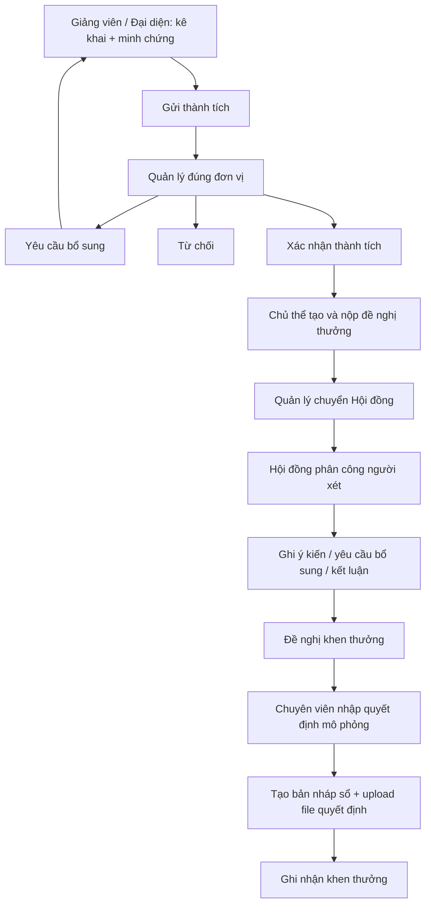

# Kịch bản test đầy đủ theo vai trò

**Bộ file sẵn cho hai người:** [ZIP, dữ liệu copy theo form và thứ tự seed](../kits/README.md). Bao gồm minh chứng V1/V2, quyết định/ảnh, file lỗi và CSV/TSV/XLSX cho ca nhập KPI.

**Đợt chuẩn bị 19/10/2026:** đã backup, reset và nạp lại SCN, gồm cả việc xóa lịch cá nhân cũ. Xem [biên bản reset](RESET_2026-10-19.md) và [test plan 145 ca hoàn toàn qua UI](../UI_TEST_PLAN.md). Chưa thực thi các ca của test plan mới; các kết quả kiểm thử dưới đây là lịch sử của đợt trước.

**Chia 2 người test:** xem [phân công song song](../UI_TEST_PLAN_PARALLEL.md), [72 ca người 1](../UI_TEST_PLAN_TESTER_1.md) và [73 ca người 2](../UI_TEST_PLAN_TESTER_2.md). Hai bộ được thiết kế cho hai môi trường dữ liệu độc lập; mỗi người tự đổi đủ vai trò và tự chuẩn bị đầu vào, không bàn giao từng bước cho người kia. Việc chia tài liệu không tự tạo thêm môi trường hoặc reset lại database.

Bộ dữ liệu `SCN` phục vụ học workflow và kiểm thử trên database demo. Mọi thành tích, KPI và quyết định mang nhãn **MÔ PHỎNG**. Các hồ sơ đã ở bước giữa/cuối được dựng qua service backend, có lịch sử, lần nộp và file private tương ứng.

Lần chuẩn bị ngày 13/10/2026: đã tạo 10 tài khoản, 12 thành tích, 8 đề nghị, 4 sổ thưởng, 4 KPI và 2 phiên đánh giá mô phỏng. **26 nhóm kiểm tra HTTP đạt PASS**; đối chiếu fingerprint toàn bộ 51 bảng xác nhận lượt verify đã rollback và không thay đổi nội dung bảng. Chưa chạy thao tác trình duyệt, provider AI thật, nguồn KPI thật hoặc phục hồi vào schema thử nghiệm; các bước tương ứng ở checklist bên dưới.

Cập nhật giao diện ngày 14/10/2026: thay các ô ID bằng lựa chọn theo tên, thêm tick/tìm hồ sơ nguồn và bộ lọc đơn vị tự tải. Đã kiểm tra trình duyệt với An/Bích, build/lint, 16 test hồi quy và 11 nhóm kiểm tra API lựa chọn. Các kiểm tra không reset bộ dữ liệu đang thực hành.

## 1. Hiểu workflow trước khi bấm

Có **ba đối tượng khác nhau**:

1. **Thành tích**: giảng viên hoặc đại diện tập thể kê khai, upload minh chứng; quản lý đơn vị kiểm tra và xác nhận.
2. **Hồ sơ đề nghị thưởng**: chủ thể chọn thành tích đã xác nhận để đề nghị một loại thưởng; quản lý chuyển Hội đồng; Hội đồng xét và đưa ra đề nghị.
3. **Sổ khen thưởng**: chuyên viên nhập quyết định, tạo bản nháp sổ, upload file quyết định rồi ghi nhận. Hội đồng đề nghị thưởng **chưa làm phát sinh quyết định hoặc bản ghi sổ**.



Vai trò quyết định **được làm gì**; phạm vi/phân công quyết định **được làm cho đơn vị nào**. Quản lý không tự duyệt hồ sơ của mình. Admin quản trị dữ liệu nền nhưng không thay quản lý xác nhận thành tích.

## 2. Tài khoản

Mật khẩu chung của các tài khoản dưới đây: **`demo1234`**. Đăng xuất trước khi chuyển người dùng; sau reset, đăng nhập lại.

| Đăng nhập | Vai trò và phạm vi | Dùng để test |
|---|---|---|
| `an.nv` | Giảng viên, Bộ môn Kỹ thuật Phần mềm | Luồng cá nhân chính |
| `bich.tt` | Quản lý Khoa CNTT và các bộ môn con; đồng thời là giảng viên | Thẩm định, chuyển Hội đồng, chống tự duyệt |
| `duc.pm` | Admin | Tài khoản, phân quyền, danh mục, quy chế |
| `cuong.lh` | Giảng viên Bộ môn KHMT; đại diện Bộ môn KTPM | Phân biệt thành tích cá nhân với tập thể |
| `records.demo` | Chuyên viên thi đua khen thưởng, phạm vi Khoa CNTT và đơn vị con | Mở kỳ, quyết định và sổ thưởng |
| `council.demo` | Hội đồng, phạm vi Khoa CNTT và đơn vị con | Phân công và xử lý hồ sơ |
| `council.other` | Hội đồng cùng phạm vi, chưa được giao các hồ sơ seed | Quyền đọc so với quyền kết luận khi chưa phân công |
| `linh.pharm` | Giảng viên Khoa Dược | Hồ sơ ngoài phạm vi CNTT |
| `rep.expired` | Có role đại diện, nhưng phân công Bộ môn KHMT đã hết hạn | Có role vẫn không đủ quyền đại diện |
| `locked.demo` | Tài khoản bị khóa | Đăng nhập bị từ chối |

Hội đồng thuần role vào **Hồ sơ đề nghị**; một số trang khác không mở cho role này trong giao diện hiện tại. Dùng `duc.pm` để thao tác quy chế trên UI.

## 3. Mở project và tìm dữ liệu

Chạy backend/frontend theo README gốc, chọn API mode. File mẫu để upload:

- [Minh chứng PDF](fixtures/evidence-demo.pdf).
- [Quyết định PDF](fixtures/decision-demo.pdf).
- [CSV KPI hợp lệ](fixtures/kpi-valid.csv).
- [CSV KPI lỗi](fixtures/kpi-invalid.csv).

Đường dẫn private mặc định khi chạy backend từ thư mục `backend`: `backend/storage/private/evidences`. Byte file được lưu trên server, DB giữ metadata. Nếu đổi máy phải seed lại hoặc khôi phục cả DB lẫn kho file.

Mỗi hồ sơ có mã `SCN` trong tiêu đề/mục đích; tìm theo tên có mã đó. Các form chọn giảng viên, đơn vị, loại thưởng, thành tích, quyết định và người xét bằng tên đầy đủ; không cần nhớ hay nhập ID. Danh sách nguồn chỉ chứa hồ sơ đúng chủ thể, đúng trạng thái/phạm vi. Với Hội đồng, chọn tên tài khoản `council.demo` ở **Thành viên Hội đồng được phân công**. ID trong `output/scenario/manifest.json` chỉ dùng tra cứu kỹ thuật.

Các mốc kỳ mở, kỳ đóng và phân công được tính theo ngày chạy seed. Có một năm học hiện tại, một kỳ `SCN-OPEN-*` đang mở và một kỳ `SCN-CLOSED-*` đã đóng.

## 4. Luồng chính: làm từ đầu đến cuối

| Bước | Tài khoản / trang | Thao tác | Kết quả mong đợi |
|---|---|---|---|
| 1 | `an.nv` / Thành tích | Tìm `SCN-A01`, mở nháp. Thử gửi khi chưa có minh chứng | Bị chặn; vẫn là nháp |
| 2 | `an.nv` | Sửa mô tả vai trò; thêm minh chứng bằng `evidence-demo.pdf`; tải về thử | Lưu được; file mở được, nội dung có nhãn MÔ PHỎNG |
| 3 | `an.nv` | Gửi duyệt | `SUBMITTED`; có lần nộp và lịch sử |
| 4 | `bich.tt` / Thành tích | Mở A01; yêu cầu bổ sung, nhập lý do | `NEED_CORRECTION`; chủ hồ sơ nhận thông báo |
| 5 | `an.nv` | Xem lý do; sửa mô tả; upload phiên bản file mới; gửi lại | Lần nộp mới; phiên bản file cũ vẫn có trong lịch sử |
| 6 | `bich.tt` | Xác nhận A01 | `VERIFIED`; hồ sơ và minh chứng bị khóa sửa |
| 7 | `an.nv` / Hồ sơ đề nghị | Tạo đề nghị cá nhân: chọn kỳ `SCN-OPEN-*`, loại Chiến sĩ thi đua cơ sở, chọn A01; mục đích `SCN-MAIN | Đề nghị cá nhân MÔ PHỎNG` | Đề nghị `DRAFT`, đúng chủ thể và thành tích nguồn |
| 8 | `an.nv` | Nộp đề nghị | `SUBMITTED`; có bản chụp dữ liệu nguồn và file lúc nộp |
| 9 | `bich.tt` / Hồ sơ đề nghị | Trang tự tải tất cả đơn vị trong phạm vi; có thể lọc theo tên Bộ môn Kỹ thuật Phần mềm. Mở đề nghị vừa nộp; nhập ý kiến đơn vị và Chuyển Hội đồng | `COUNCIL_PENDING` |
| 10 | `council.demo` / Hồ sơ đề nghị | Chọn tên Bộ môn Kỹ thuật Phần mềm nếu cần lọc, mở hồ sơ; chọn thành viên `council.demo`, nhập lý do và Phân công | `UNDER_REVIEW`; có dòng phân công |
| 11 | `council.demo` | Ghi ý kiến; sau đó Đề nghị khen thưởng với lý do | `RECOMMENDED`; chưa tự sinh quyết định hay sổ |
| 12 | `records.demo` / Sổ khen thưởng | Nhập quyết định số riêng, ví dụ `SCN-MAIN-2026-DEMO`, ngày hiện tại, cơ quan `Đơn vị mô phỏng PTUD`; tạo nháp cho An, đúng loại thưởng, liên kết A01 | Bản ghi `DRAFT` |
| 13 | `records.demo` | Upload `decision-demo.pdf` vào quyết định của nháp; Ghi nhận | `RECORDED`; có file, ngày/người ghi nhận và lịch sử |
| 14 | `bich.tt` / Báo cáo | Lọc năm ghi nhận, Bộ môn KTPM; tìm hồ sơ và xuất CSV | Thành tích VERIFIED và sổ RECORDED được tính hợp lệ; file CSV theo cùng bộ lọc |

Chọn các mục theo tên trong combobox; tick tên thành tích/sổ thưởng liên quan. Đổi chủ thể sẽ bỏ các nguồn đã chọn trước để tránh chọn nhầm hồ sơ của người khác. Dùng số quyết định mới mỗi lần chạy lại luồng chính để tránh trùng.

## 5. Bộ hồ sơ có sẵn để test từng nhánh

### Thành tích

| Mã | Trạng thái lúc seed | Ca test |
|---|---|---|
| `SCN-A01` | DRAFT, chưa minh chứng | Luồng chính; chặn nộp thiếu file |
| `SCN-A02` | SUBMITTED | Quản lý xác nhận hoặc từ chối |
| `SCN-A03` | NEED_CORRECTION | An bổ sung, upload v2 và gửi lại |
| `SCN-A04` | VERIFIED | Nguồn của các đề nghị mẫu; thử sửa/upload phải bị chặn |
| `SCN-A05` | REJECTED | Xem lý do; chủ hồ sơ tạo bản thay thế |
| `SCN-A06` | CANCELLED | Xem lịch sử rút; tạo bản thay thế |
| `SCN-A07` | REVOKED | Xem lý do thu hồi, kiểm không còn tính hợp lệ |
| `SCN-A08` | DRAFT, thay A07 | Kiểm liên kết bản gốc; upload file và đi lại quy trình |
| `SCN-A09` | SUBMITTED, của Bích | Bích thử xác nhận: bị chặn tự duyệt |
| `SCN-A10` | SUBMITTED, của Linh/Khoa Dược | Bích thử đọc/xác nhận: ngoài phạm vi; Linh xem được hồ sơ của mình |
| `SCN-T01` | DRAFT, tập thể Bộ môn KTPM | Cường upload/gửi; Bích xác nhận; tạo đề nghị tập thể |
| `SCN-T02` | VERIFIED, tập thể Bộ môn KTPM | Nguồn của đề nghị tập thể mẫu |

Với tập thể, chọn **Bộ môn KTPM** là đơn vị Cường đại diện. Nơi công tác cá nhân của Cường là Bộ môn KHMT, không tự tạo quyền đại diện KHMT hoặc toàn Khoa CNTT. `rep.expired` tạo tập thể KHMT phải bị chặn.

### Hồ sơ đề nghị

| Mã | Trạng thái lúc seed | Ca test |
|---|---|---|
| `SCN-P01` | DRAFT | An nộp; kiểm bản chụp nguồn |
| `SCN-P02` | SUBMITTED | Bích chuyển Hội đồng |
| `SCN-P03` | COUNCIL_PENDING | Hội đồng phân công |
| `SCN-P04` | UNDER_REVIEW, giao council.demo | Ghi ý kiến, yêu cầu bổ sung, đề nghị/không đề nghị |
| `SCN-P05` | NEED_CORRECTION | An xem lý do và Gửi bổ sung; Bích chuyển lại; Hội đồng xử lý theo phân công hiện hành hoặc phân công thành viên khác |
| `SCN-P06` | RECOMMENDED | Xem lịch sử kết luận; không được hiểu là đã ghi sổ |
| `SCN-P07` | NOT_RECOMMENDED | Xem lý do không đề nghị |
| `SCN-PT01` | COUNCIL_PENDING, tập thể | Hội đồng xét tập thể; chuyên viên ghi sổ tập thể |

`council.other` đọc P04 trong phạm vi được, nhưng ghi ý kiến/kết luận P04 khi chưa được phân công phải bị chặn. Có role Hội đồng và có phạm vi chưa thay thế phân công hồ sơ. Bộ lọc Hội đồng/Quản lý/Chuyên viên mặc định tải tất cả đơn vị trong phạm vi; chọn tên Bộ môn Kỹ thuật Phần mềm để thu hẹp và danh sách tự cập nhật.

Ở code hiện tại, **Gửi bổ sung đề nghị** là bước chuyển trạng thái và ghi lý do; bản chụp input lúc nộp được giữ bất biến. Không có bước tự do sửa lại toàn bộ danh sách nguồn của đề nghị đã nộp. Thực hành đổi file/nội dung tại bước thành tích trước khi xác nhận và tạo đề nghị mới nếu cần nguồn khác.

### Quyết định và sổ thưởng

| Mã | Trạng thái | Ca test |
|---|---|---|
| `SCN-R01` | DRAFT, thiếu file quyết định | Ghi nhận bị chặn; upload decision-demo.pdf rồi ghi nhận |
| `SCN-R02` | RECORDED | Tải quyết định, kiểm lịch sử; thu hồi với lý do |
| `SCN-R03` | REVOKED | Chuẩn bị bản thay thế, nhập quyết định mới, tạo nháp thay thế rồi ghi nhận |
| `SCN-RT01` | RECORDED, tập thể | Kiểm sổ tập thể tách khỏi cá nhân |

Chuyên viên chọn Bộ môn KTPM để thấy sổ mẫu. Giảng viên không có quyền quản lý trang sổ. Ghi nhận cần file quyết định tồn tại; file của quyết định đã dùng được khóa. Thu hồi cần lý do. Chống trùng chủ thể-loại thưởng-quyết định vẫn áp dụng.

## 6. KPI, nhập CSV và nguồn ngoài

| Mã | Chuẩn bị | Thao tác |
|---|---|---|
| `SCN-K01` | Nháp của An | Sửa rồi chấp nhận, hoặc xóa nháp |
| `SCN-K02` | Đã chấp nhận, chưa kết quả | Nhập kết quả; thử nhập lần hai bị chặn |
| `SCN-K03` | Đã chấp nhận, thực tế 1/2 | Sửa kết quả; tạo kê khai nháp; upload minh chứng; gửi quản lý |
| `SCN-KT01` | KPI tập thể của Cường | Chọn UNIT/KTPM; tạo kê khai nháp tập thể |

KPI hoàn thành hoặc nhập kết quả **chưa tự trở thành thành tích VERIFIED**. Sau chuyển thành kê khai, sửa nguồn KPI có thể bị khóa để giữ liên kết; xử lý hồ sơ theo workflow.

An vào KPI > Nhập CSV: dùng `kpi-valid.csv`, kiểm preview rồi commit; nhập lại phải báo trùng. Dùng `kpi-invalid.csv`, kiểm lỗi ngày/số lượng và không được commit các dòng lỗi. Excel/XLSX trên giao diện chuyển dữ liệu về cùng luồng kiểm tra; có thể mở CSV trong Excel và lưu XLSX để thử.

Nguồn KPI ngoài dùng mock server sẵn có của project:

```powershell
# Terminal 1, từ thư mục backend
$env:KPI_MOCK_TOKEN = 'scn-local-demo-token'
npm run mock:kpi
```

Terminal chạy backend riêng, dùng cùng token demo local:

```powershell
cd backend
$env:KPI_SOURCE_URL = 'http://127.0.0.1:4301/kpi'
$env:KPI_SOURCE_TOKEN = 'scn-local-demo-token'
npm start
```

Admin vào KPI quản trị, ánh xạ mã `SIM-EMP-001` tới giảng viên An, đồng bộ nguồn. Đồng bộ lại phải nhận diện trùng. An chỉ thấy dữ liệu đã ánh xạ cho mình, tạo được nháp từ nguồn FINAL; dữ liệu chưa ánh xạ hoặc DRAFT không được coi là hồ sơ hợp lệ. Khi thiếu URL/token, lỗi cấu hình nguồn là kết quả cần ghi nhận. Seed không thay cấu hình nguồn đang dùng.

## 7. Quy chế, AI và RAG

Giữ ba nguồn nền của database; dọn các văn bản `DOC-TEST-*`. Có thêm nguồn `SCN-REGULATION`, một phiên bản, một chunk và hai tiêu chí. Nguồn và `SCN-CRIT-01` được xác nhận **chỉ để thực hành dữ liệu mô phỏng**, trạng thái nguồn vẫn `SIMULATION_ONLY`, không phải `CONFIRMED_LHU_POLICY`. `SCN-CRIT-DRAFT` giữ chưa xác nhận để thử gate.

- An/Cường mở lịch sử đánh giá AI: có hai phiên `SCN-AI01` và `SCN-AIT01` tương ứng cá nhân/tập thể; ID run trong manifest. Kết quả dùng bộ kiểm tra deterministic/mock, không phải lời xác nhận từ provider thật.
- Vì nguồn là mô phỏng, kết quả vẫn yêu cầu con người rà soát; không tự trao thưởng, không tự tạo KPI được chấp nhận.
- An/Cường mở AI, chọn `SCN-CRIT-01`, đúng chủ thể cá nhân/tập thể rồi chạy đánh giá. Dù được xác nhận dùng cho demo, nguồn vẫn là mô phỏng nên không được coi là đủ căn cứ xét thưởng thật. `SCN-CRIT-DRAFT` không xuất hiện trong danh sách tiêu chí xác nhận; dùng API và ID `unconfirmedCriterionId` trong manifest để kiểm gate chưa xác nhận.
- Admin vào Quy chế: thử tạo văn bản mã riêng `SCN-USER-*`, thêm v1, đoạn trích và tiêu chí; tạo v2 liên kết v1 để kiểm lịch sử/hiệu lực; mã hoặc phiên bản trùng phải báo lỗi.
- Thử xác nhận/thu hồi xác nhận khi có căn cứ hợp lệ. Không biến tiêu chí giả lập thành chính sách thật của LHU chỉ để bấm qua gate. Các trạng thái xác nhận của ba nguồn nền được giữ như trước reset.
- RAG lập chỉ mục và tìm đoạn từ các nguồn đã xác nhận. Nguồn mô phỏng chưa xác nhận phải bị loại khỏi tập truy xuất mặc định.
- Nhánh giải thích AI bằng provider thật và gợi ý KPI cần nguồn/tiêu chí xác nhận hợp lệ, cấu hình provider hoạt động và quota. Chạy riêng khi đủ điều kiện; ghi kết quả thật hoặc lỗi provider, không đánh dấu PASS bằng mock.

Đây là giới hạn nghiệp vụ/config hiện có, không phải chức năng tự nhiên sẽ PASS chỉ nhờ seed. Seed chuẩn bị các ca kiểm gate và lịch sử đọc được; không gửi dữ liệu tới provider ngoài khi dựng dữ liệu.

## 8. Các chức năng còn lại và ca lỗi

| Nhóm | Cách kiểm tra | Mong đợi |
|---|---|---|
| Hồ sơ cá nhân | An sửa điện thoại/chức danh; quản lý xem trong phạm vi | Lưu được trường cho phép; không tự đổi đơn vị hoặc quyền |
| Hồ sơ đơn vị | Bích xem CNTT và bộ môn; thử Khoa Dược | Phạm vi đọc được kiểm ở backend |
| Dashboard/Báo cáo | Lọc cá nhân/tập thể, năm, đơn vị, trạng thái | Không lẫn chủ thể; REVOKED/CANCELLED không tính hợp lệ |
| Xuất CSV | Bích/Cường/Chuyên viên xuất theo bộ lọc; An thử xuất | Role được phép xuất có CSV; An bị từ chối xuất theo code hiện tại |
| Thông báo | An mở chuông, đánh dấu đã đọc; thao tác đổi trạng thái | Thông báo đúng chủ hồ sơ; số chưa đọc giảm |
| Admin tài khoản | Đức tạo `SCN-USER-*`, gán role và phạm vi, khóa/mở | Quyền mới chỉ có khi đủ phân công còn hạn |
| Admin danh mục | Tạo mã mới, sửa/ẩn danh mục, thử mã trùng | Không tạo mã trùng; danh mục đã dùng chịu ràng buộc tham chiếu |
| Sai quyền | An vào Admin; Admin thử xác nhận A02; Bích tự duyệt A09 | Bị chặn, không đổi trạng thái/lịch sử |
| Sai chủ thể | Chọn thành tích của An cho đề nghị tập thể, hoặc chọn loại thưởng cá nhân cho UNIT | Bị từ chối |
| Kỳ đóng | Tạo/nộp đề nghị vào `SCN-CLOSED-*` | Bị chặn |
| File lỗi | Upload .txt, file rỗng, quá 10 MB, đổi đuôi .txt thành .pdf | Bị từ chối; không có metadata/file rác mới |
| Version cũ | Hai tab mở A01, tab 1 sửa, tab 2 dùng bản cũ để sửa/gửi | HTTP 409; làm mới rồi thao tác lại |
| File private | Không đăng nhập tải file; Linh tải file của An | 401 / ngoài quyền; đúng chủ hồ sơ tải được |
| Đăng nhập | Sai mật khẩu; locked.demo; đăng xuất rồi gọi API | Bị từ chối theo trạng thái/xác thực |
| Backup/Restore | Tạo backup rồi phục hồi vào schema/kho thử nghiệm riêng | So sánh số bản ghi, hash file và quyền tải; không restore đè DB đang test |

## 9. Reset và kiểm chứng

Script mới giữ dữ liệu nền và backup trước mỗi lần reset. Mười tài khoản demo được đặt lại mật khẩu/trạng thái/phân quyền theo bảng ở trên để các ca sửa quyền có thể làm lại. **Lệnh apply xóa toàn bộ dữ liệu nghiệp vụ demo hiện tại**, kể cả hồ sơ bạn vừa test và ghi chú lịch cá nhân, rồi tạo lại SCN; chỉ dùng database demo đã thống nhất.

```powershell
cd backend
npm run seed:scenario:preview
npm run seed:scenario
npm run verify:scenario
npm run verify:selections
```

Preview không kết nối hoặc sửa DB. Apply tạo backup trong `backups/before_scenario_*`, reset trong một transaction, tạo dữ liệu qua các service, kiểm file/snapshot rồi commit; sau commit mới dọn file cũ trong kho đã backup. Nếu lỗi trước commit, DB rollback và file mới được dọn. Sequence PostgreSQL có thể tăng dù rollback, nên ID không phải mã kịch bản ổn định.

Verifier chạy HTTP với đăng nhập thật vào một server local tạm, thử luồng cá nhân/tập thể, quyền sai và download. Các thao tác test được rollback để bộ seed còn nguyên cho bạn thực hành; file upload của lượt verify được dọn. Kết quả ở `output/scenario/verification.json`. Verifier không thay thế thao tác UI hoặc kiểm provider/nguồn ngoài/restore thật.

Trên máy mới: migrate và chạy seed nền theo README trước, sau đó chạy `seed:scenario`. `npm run seed` cũ vẫn là seed nền dùng TRUNCATE rộng; không dùng nó để reset kịch bản trên DB đang có dữ liệu cần giữ.

Các backup chứa dữ liệu trước reset và hash xác thực; lưu nội bộ, không commit Git. Nếu đang mở project trước reset, đăng xuất, tải lại trang rồi đăng nhập để tránh phiên/version cũ.
